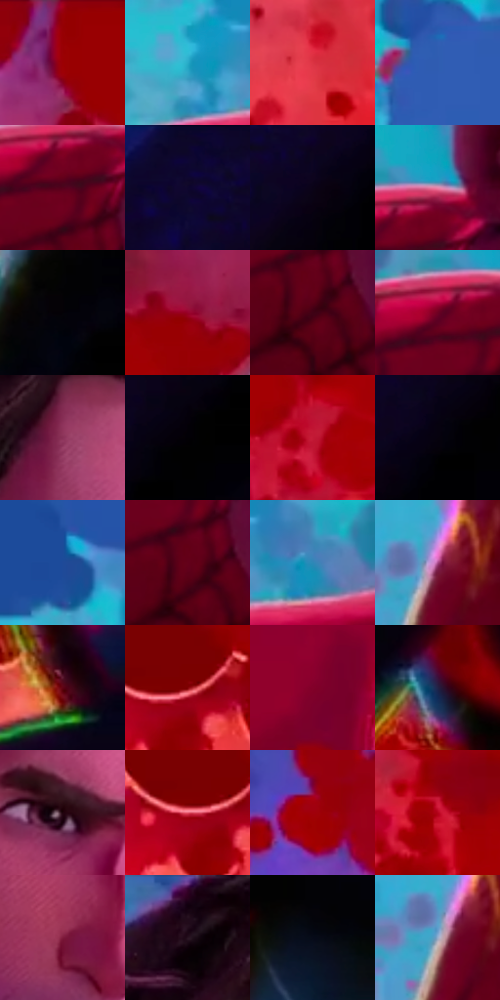

# 电影参考 653

- 状态：条件／活跃；来源世界：miles-home。
- 视角：near-level；景别：medium；场景：industrial。
- 时段：event-time-unknown（外观依据，中置信度；具体时间／晨昏未知）；光照：event-light。
- 材质候选：skin, hair, fabric, metal, glass（帧级，不是像素分割）。
- 明暗组：dark；L* P5/P50/P95：0.60771 / 29.25511 / 64.73718。
- 资格门禁：energy。
- 原截图 SHA-256：`9c848b5b9904cecf49a65d7b99cd09c4ccfcd2451438377345f2d50da3fff9ff`；尺寸：2880 × 1208。
- sRGB 像素 SHA-256：`f744a396cfa65fe246545536db178e93443d66877dcf3eaeeb333b77b8a06829`。

## 观察与迁移

事件彩光下人物、设备与粒子，皮肤和衣料仍保持体块。

成年脸的鼻颊、鬓角与胡茬有独立概括，红衣细网和黑色蛛网图案不是同一纹理；暖红圆形事件场与左侧冷蓝背景对比，不把年轻脸与成年脸套成同一模板。

本公开版保存32个128×128原像素色卡上下文；图集格子并非原场景相邻位置。原rect、图集tile和像素SHA见 `data/palette-crops.json`。上下文不足时不得批准替色，不能以小样推断完整构图。

## 实测色卡

颜色比例分母为保留采样像素，不是材料面积；全部 32 色参与全库匹配。表内四舍五入仅用于阅读，原精度在 JSON。

| ID | HEX | Lab | 原图 xy | 像素数 | 比例 | 明度角色 |
| --- | --- | --- | --- | ---: | ---: | --- |
| 653-S01 | #9A0104 | [31.584572, 54.871573, 43.817975] | [1636, 56] | 11137 | 5.760140% | shadow |
| 653-S02 | #29ABC8 | [64.774896, -24.01962, -24.500903] | [392, 460] | 10312 | 5.333444% | light |
| 653-S03 | #DB3344 | [49.313416, 64.28533, 31.520311] | [1516, 572] | 8805 | 4.554012% | midtone |
| 653-S04 | #3857A8 | [38.695669, 15.797911, -47.026305] | [32, 284] | 8633 | 4.465052% | shadow |
| 653-S05 | #54021C | [15.553573, 36.270041, 8.90246] | [716, 548] | 8544 | 4.419021% | deep-shadow |
| 653-S06 | #0E072A | [3.72552, 11.585873, -20.742304] | [2608, 56] | 7893 | 4.082319% | deep-shadow |
| 653-S07 | #0A0317 | [1.729875, 5.338316, -8.902007] | [2696, 136] | 7842 | 4.055941% | deep-shadow |
| 653-S08 | #E585A9 | [66.749302, 41.114141, -2.930147] | [752, 480] | 7825 | 4.047149% | light |
| 653-S09 | #030206 | [0.685803, 0.81764, -1.42149] | [1692, 1072] | 7598 | 3.929743% | deep-shadow |
| 653-S10 | #980229 | [31.534615, 55.161059, 23.481258] | [2052, 336] | 7376 | 3.814922% | shadow |
| 653-S11 | #3F0215 | [10.218504, 29.638318, 5.947706] | [740, 648] | 7258 | 3.753892% | deep-shadow |
| 653-S12 | #6E0022 | [21.695368, 44.269048, 13.841338] | [688, 520] | 7153 | 3.699585% | shadow |
| 653-S13 | #8A3258 | [34.783128, 41.233275, -3.110982] | [984, 264] | 6334 | 3.275992% | shadow |
| 653-S14 | #010004 | [0.137456, 0.817675, -1.421556] | [2820, 72] | 5859 | 3.030319% | deep-shadow |
| 653-S15 | #C31A36 | [42.1711, 63.275497, 30.219088] | [1908, 436] | 5684 | 2.939807% | midtone |
| 653-S16 | #06020D | [1.004378, 2.611573, -3.892366] | [2764, 100] | 5557 | 2.874122% | deep-shadow |
| 653-S17 | #1F4A99 | [32.892139, 15.120196, -47.433418] | [356, 332] | 5512 | 2.850848% | shadow |
| 653-S18 | #64001A | [19.160489, 41.165573, 15.770664] | [732, 624] | 5326 | 2.754647% | deep-shadow |
| 653-S19 | #2C88B7 | [53.557457, -10.646268, -32.266521] | [512, 468] | 5240 | 2.710167% | midtone |
| 653-S20 | #A74787 | [44.903737, 47.074886, -16.673485] | [88, 948] | 5240 | 2.710167% | midtone |
| 653-S21 | #4F0114 | [14.030241, 34.688857, 12.468295] | [2820, 872] | 5204 | 2.691548% | deep-shadow |
| 653-S22 | #830306 | [26.46287, 48.413184, 36.718594] | [2348, 896] | 5018 | 2.595347% | shadow |
| 653-S23 | #83002A | [26.717669, 50.163102, 15.772525] | [2248, 88] | 4998 | 2.585003% | shadow |
| 653-S24 | #222246 | [15.095046, 11.358192, -22.669747] | [2596, 464] | 4768 | 2.466045% | deep-shadow |
| 653-S25 | #22030D | [3.923556, 14.423393, 0.696949] | [1012, 404] | 4685 | 2.423117% | deep-shadow |
| 653-S26 | #E55569 | [56.267262, 57.214489, 19.012946] | [2316, 908] | 4677 | 2.418979% | midtone |
| 653-S27 | #A0000B | [32.919596, 56.669468, 42.493433] | [1324, 152] | 4424 | 2.288126% | shadow |
| 653-S28 | #B4031B | [37.573235, 61.716868, 40.178055] | [1696, 312] | 3471 | 1.795227% | shadow |
| 653-S29 | #7E1A3B | [28.091458, 44.119577, 5.950027] | [1004, 540] | 3428 | 1.772987% | shadow |
| 653-S30 | #281321 | [9.212274, 13.37684, -5.145555] | [952, 64] | 2938 | 1.519556% | deep-shadow |
| 653-S31 | #060A18 | [2.906078, 1.747646, -7.971915] | [2816, 512] | 2498 | 1.291984% | deep-shadow |
| 653-S32 | #99AECB | [70.423873, -0.816691, -17.127219] | [68, 972] | 2109 | 1.090791% | light |

## 色阶与空间分布

- 采样 ROI：`[0.01, 0.02, 0.98, 0.94]`；步长：4；样本数：193346。
- 排除区：`[]`。
- 深暗、暗、中、亮、高光五段计数：`[73714, 67888, 35935, 14446, 1363]`。
- RGB 各 256 箱、L* 100 箱、13×5 色相明度表和 3×3 空间统计全部保存在 [总数据](../film-library.json)。
- [可视化档案](../../references/library.html)按需绘制直方图，不存 2,094 张重复图表图片。

## 纹理特征占比

**这是分块图像特征的面积占比，不是波点／排线／丝网／错版的精确语义覆盖率。** 窗格、发丝、织物也会产生方向或周期特征。
原图 ROI 像素 3104134；已测块覆盖 3104134（100.0000%）；未测 0。

| 特征 | 块覆盖像素 | 占已测面积 | 阈值敏感范围 |
| --- | ---: | ---: | --- |
| low-contrast | 433926 | 13.9790% | 9.6575% ~ 15.5624% |
| directional-structure | 664320 | 21.4011% | 10.4861% ~ 36.8067% |
| periodic-structure | 1989504 | 64.0921% | 53.5358% ~ 69.7289% |
| mixed-detail | 16384 | 0.5278% | 0.0000% ~ 4.2225% |

阈值敏感范围不是统计置信区间。逐块坐标、尺度、对比、方向一致性、频谱集中度、频率与角度见 [全量特征记录](../texture-features.jsonl)，以帧号定位。
四种印刷层的真实像素覆盖仍标为 `null`，不能填 0，也不能拿上表代替。不得据这些代理测量删除唯一证据。

[测量方法与保留策略](../../references/library-retention.md) · [分类索引](../archive/README.md)
