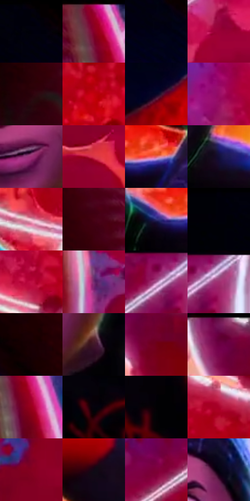

# 电影参考 654

- 状态：条件／活跃；来源世界：miles-home。
- 视角：near-level；景别：medium；场景：industrial。
- 时段：event-time-unknown（外观依据，中置信度；具体时间／晨昏未知）；光照：event-light。
- 材质候选：skin, hair, fabric, metal, glass（帧级，不是像素分割）。
- 明暗组：dark；L* P5/P50/P95：0.3148 / 26.38341 / 66.12398。
- 资格门禁：energy。
- 原截图 SHA-256：`ff5ad020f63327b9a61ac8a660387aa1cd7ece84386bfa7408d4f47a7a7e6a0b`；尺寸：2880 × 1210。
- sRGB 像素 SHA-256：`43e4bda3ad173d81a824e2e949d5d9c75b146c22120bc762960daf4c83d0d39f`。

## 观察与迁移

事件彩光下人物、设备与粒子，皮肤和衣料仍保持体块。

可见眉眼和嘴角形成紧张表情，脸是粉色体面，黑帽上缘偏蓝、下颌有窄绿边，前景人物为深蓝暗形；只记录表情，不把推测心理当画面事实。

本公开版保存32个128×128原像素色卡上下文；图集格子并非原场景相邻位置。原rect、图集tile和像素SHA见 `data/palette-crops.json`。上下文不足时不得批准替色，不能以小样推断完整构图。

## 实测色卡

颜色比例分母为保留采样像素，不是材料面积；全部 32 色参与全库匹配。表内四舍五入仅用于阅读，原精度在 JSON。

| ID | HEX | Lab | 原图 xy | 像素数 | 比例 | 明度角色 |
| --- | --- | --- | --- | ---: | ---: | --- |
| 654-S01 | #010106 | [0.373108, 0.695202, -1.892085] | [288, 32] | 16580 | 8.544454% | deep-shadow |
| 654-S02 | #890029 | [28.061162, 51.642516, 18.443689] | [812, 64] | 15035 | 7.748243% | shadow |
| 654-S03 | #010216 | [0.973494, 3.135753, -9.338175] | [364, 164] | 8475 | 4.367566% | deep-shadow |
| 654-S04 | #9B0037 | [32.361848, 56.907127, 15.464844] | [1408, 484] | 7826 | 4.033106% | shadow |
| 654-S05 | #2A020A | [5.037879, 20.017092, 3.816826] | [696, 400] | 7445 | 3.836759% | deep-shadow |
| 654-S06 | #C3010F | [40.674057, 65.501858, 49.634915] | [2628, 512] | 7418 | 3.822844% | midtone |
| 654-S07 | #090524 | [2.655242, 8.432361, -17.820699] | [76, 1036] | 7165 | 3.692462% | deep-shadow |
| 654-S08 | #980B65 | [33.68147, 58.545155, -12.856994] | [2424, 304] | 7161 | 3.690400% | shadow |
| 654-S09 | #9C2D73 | [38.17105, 52.266013, -14.813676] | [1764, 692] | 6923 | 3.567748% | shadow |
| 654-S10 | #D9354B | [49.265436, 63.45365, 27.211823] | [1264, 1000] | 6609 | 3.405929% | midtone |
| 654-S11 | #E36770 | [59.164198, 49.004359, 18.823914] | [2352, 1064] | 6548 | 3.374492% | midtone |
| 654-S12 | #130E36 | [6.492674, 15.844126, -25.233817] | [2592, 1124] | 6387 | 3.291522% | deep-shadow |
| 654-S13 | #ECBDCB | [81.039151, 18.984717, -0.603935] | [2516, 768] | 6083 | 3.134856% | highlight |
| 654-S14 | #470213 | [12.158901, 31.900629, 10.266724] | [684, 96] | 5881 | 3.030756% | deep-shadow |
| 654-S15 | #323279 | [24.762839, 22.337029, -40.712038] | [2260, 1076] | 5747 | 2.961699% | shadow |
| 654-S16 | #000009 | [0.178081, 1.251394, -3.405812] | [148, 28] | 5468 | 2.817918% | deep-shadow |
| 654-S17 | #BE0E40 | [40.629819, 64.382259, 21.871465] | [2456, 580] | 5240 | 2.700418% | midtone |
| 654-S18 | #712C6E | [30.49274, 39.702144, -24.125102] | [992, 496] | 5090 | 2.623116% | shadow |
| 654-S19 | #A65A92 | [48.879077, 38.860476, -17.216108] | [1860, 68] | 4727 | 2.436045% | midtone |
| 654-S20 | #BD9CC3 | [68.414161, 19.156408, -15.460944] | [1916, 48] | 4707 | 2.425738% | light |
| 654-S21 | #160004 | [1.620435, 7.468442, 0.921823] | [544, 132] | 4683 | 2.413370% | deep-shadow |
| 654-S22 | #401727 | [14.676929, 21.955774, -0.990736] | [1872, 732] | 4680 | 2.411824% | deep-shadow |
| 654-S23 | #700115 | [22.022704, 43.972627, 23.265481] | [2592, 132] | 4655 | 2.398940% | shadow |
| 654-S24 | #6C0F50 | [24.031089, 44.764007, -14.641616] | [2532, 32] | 4494 | 2.315970% | shadow |
| 654-S25 | #99021A | [31.560988, 54.880711, 32.966694] | [856, 156] | 4438 | 2.287110% | shadow |
| 654-S26 | #05020C | [0.92337, 2.190561, -3.550372] | [1844, 960] | 4370 | 2.252067% | deep-shadow |
| 654-S27 | #020103 | [0.372056, 0.53957, -0.664676] | [2052, 908] | 4217 | 2.173218% | deep-shadow |
| 654-S28 | #A8022A | [35.079357, 59.259961, 27.901261] | [2660, 344] | 4208 | 2.168580% | shadow |
| 654-S29 | #84011E | [26.798987, 49.676941, 23.967169] | [1212, 164] | 4157 | 2.142298% | shadow |
| 654-S30 | #110815 | [3.134301, 5.06002, -5.357335] | [2296, 856] | 3705 | 1.909361% | deep-shadow |
| 654-S31 | #7E0139 | [26.022359, 49.718343, 4.371237] | [1716, 132] | 2801 | 1.443487% | shadow |
| 654-S32 | #030210 | [0.904864, 2.356997, -5.611026] | [1860, 424] | 1121 | 0.577704% | deep-shadow |

## 色阶与空间分布

- 采样 ROI：`[0.01, 0.02, 0.98, 0.94]`；步长：4；样本数：194044。
- 排除区：`[]`。
- 深暗、暗、中、亮、高光五段计数：`[82309, 73257, 25457, 9095, 3926]`。
- RGB 各 256 箱、L* 100 箱、13×5 色相明度表和 3×3 空间统计全部保存在 [总数据](../film-library.json)。
- [可视化档案](../../references/library.html)按需绘制直方图，不存 2,094 张重复图表图片。

## 纹理特征占比

**这是分块图像特征的面积占比，不是波点／排线／丝网／错版的精确语义覆盖率。** 窗格、发丝、织物也会产生方向或周期特征。
原图 ROI 像素 3109722；已测块覆盖 3109722（100.0000%）；未测 0。

| 特征 | 块覆盖像素 | 占已测面积 | 阈值敏感范围 |
| --- | ---: | ---: | --- |
| low-contrast | 805632 | 25.9069% | 23.7994% ~ 28.3807% |
| directional-structure | 941056 | 30.2617% | 19.6998% ~ 37.9589% |
| periodic-structure | 1346650 | 43.3045% | 37.7148% ~ 49.8121% |
| mixed-detail | 16384 | 0.5269% | 0.5269% ~ 2.1075% |

阈值敏感范围不是统计置信区间。逐块坐标、尺度、对比、方向一致性、频谱集中度、频率与角度见 [全量特征记录](../texture-features.jsonl)，以帧号定位。
四种印刷层的真实像素覆盖仍标为 `null`，不能填 0，也不能拿上表代替。不得据这些代理测量删除唯一证据。

[测量方法与保留策略](../../references/library-retention.md) · [分类索引](../archive/README.md)
