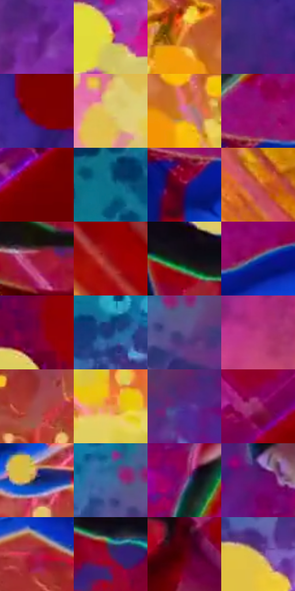

# 电影参考 655

- 状态：条件／活跃；来源世界：miles-home。
- 视角：low-angle；景别：environment-wide；场景：industrial。
- 时段：event-time-unknown（外观依据，中置信度；具体时间／晨昏未知）；光照：event-light。
- 材质候选：skin, hair, fabric, metal, glass（帧级，不是像素分割）。
- 明暗组：dark；L* P5/P50/P95：15.64546 / 33.13383 / 80.48255。
- 资格门禁：energy。
- 原截图 SHA-256：`d12c8f61a35fa710214f5f18453580be073d4e7560032a7369cd0665ee8d71da`；尺寸：2880 × 1200。
- sRGB 像素 SHA-256：`e6dd8cb9a0c51d9f8f9214d59b35c907feb94a507038a3474c733b4cee61b81a`。

## 观察与迁移

事件彩光下人物、设备与粒子，皮肤和衣料仍保持体块。

两个人物的伸手抓握、倾斜身体和遮挡构成受力关系，黄圆粒子在近处、红青紫事件场在后；保留真实接触位置，不自动加爆炸、伤害或冲击字。

本公开版保存32个128×128原像素色卡上下文；图集格子并非原场景相邻位置。原rect、图集tile和像素SHA见 `data/palette-crops.json`。上下文不足时不得批准替色，不能以小样推断完整构图。

## 实测色卡

颜色比例分母为保留采样像素，不是材料面积；全部 32 色参与全库匹配。表内四舍五入仅用于阅读，原精度在 JSON。

| ID | HEX | Lab | 原图 xy | 像素数 | 比例 | 明度角色 |
| --- | --- | --- | --- | ---: | ---: | --- |
| 655-S01 | #712A9B | [32.991303, 50.046311, -48.145277] | [712, 560] | 12551 | 6.514991% | shadow |
| 655-S02 | #E4C53E | [80.054235, -2.915266, 67.808931] | [316, 764] | 9722 | 5.046510% | highlight |
| 655-S03 | #D1712A | [57.594483, 32.851418, 53.401203] | [1184, 1036] | 9417 | 4.888190% | midtone |
| 655-S04 | #42277F | [24.132992, 34.597791, -45.460105] | [932, 100] | 9006 | 4.674847% | shadow |
| 655-S05 | #7E0103 | [25.15388, 47.364784, 36.3097] | [1208, 64] | 8908 | 4.623977% | shadow |
| 655-S06 | #DECB6A | [81.447685, -5.704709, 50.253488] | [700, 1000] | 8820 | 4.578298% | highlight |
| 655-S07 | #D772A1 | [60.832744, 44.996691, -7.327929] | [1328, 1108] | 8604 | 4.466177% | light |
| 655-S08 | #900A6E | [32.421929, 57.987839, -20.699543] | [1436, 572] | 8364 | 4.341597% | shadow |
| 655-S09 | #700001 | [21.755828, 43.685738, 32.616709] | [2780, 228] | 8334 | 4.326025% | shadow |
| 655-S10 | #0F6F8A | [43.21781, -15.590637, -22.066217] | [224, 292] | 8281 | 4.298513% | midtone |
| 655-S11 | #62023A | [19.827575, 42.676859, -6.145518] | [1392, 668] | 7754 | 4.024957% | deep-shadow |
| 655-S12 | #C15342 | [49.399648, 42.975822, 31.73632] | [2664, 1124] | 7647 | 3.969416% | midtone |
| 655-S13 | #981731 | [32.945265, 51.894215, 20.032877] | [2040, 628] | 7577 | 3.933080% | shadow |
| 655-S14 | #910C10 | [30.210915, 50.973657, 36.654094] | [2660, 952] | 7440 | 3.861966% | shadow |
| 655-S15 | #161218 | [6.04427, 3.113957, -3.246525] | [1904, 324] | 6786 | 3.522487% | deep-shadow |
| 655-S16 | #164E98 | [33.742498, 11.103088, -45.468264] | [1560, 604] | 6048 | 3.139405% | shadow |
| 655-S17 | #790136 | [24.809578, 48.239896, 4.55479] | [2036, 100] | 5556 | 2.884016% | shadow |
| 655-S18 | #19397B | [25.449436, 13.999566, -40.93614] | [240, 492] | 5189 | 2.693514% | shadow |
| 655-S19 | #5D508D | [37.81944, 20.162098, -32.042848] | [608, 316] | 4903 | 2.545056% | shadow |
| 655-S20 | #BD3D81 | [46.636856, 57.14153, -10.07183] | [816, 780] | 4679 | 2.428782% | midtone |
| 655-S21 | #A14E4F | [43.642534, 34.423636, 15.624563] | [1576, 868] | 4356 | 2.261119% | midtone |
| 655-S22 | #EC984E | [70.06639, 24.968241, 50.919457] | [2000, 1048] | 3977 | 2.064387% | light |
| 655-S23 | #512E8F | [28.606332, 38.351432, -48.096524] | [824, 256] | 3900 | 2.024418% | shadow |
| 655-S24 | #9E2C6A | [38.044393, 52.057395, -9.319681] | [2488, 360] | 3815 | 1.980296% | shadow |
| 655-S25 | #0F245F | [16.450098, 16.234047, -37.4628] | [1344, 860] | 3600 | 1.868693% | deep-shadow |
| 655-S26 | #3E6D9E | [44.841572, -0.574508, -31.324465] | [556, 268] | 3282 | 1.703625% | midtone |
| 655-S27 | #7F2477 | [32.048258, 48.598924, -27.227982] | [1436, 368] | 3097 | 1.607595% | shadow |
| 655-S28 | #5E136E | [23.577006, 45.409267, -35.31067] | [1376, 256] | 3096 | 1.607076% | shadow |
| 655-S29 | #A42044 | [36.640774, 54.100011, 13.06747] | [1776, 724] | 2952 | 1.532328% | shadow |
| 655-S30 | #4F1F53 | [21.082969, 30.886303, -21.654711] | [2084, 412] | 2229 | 1.157033% | shadow |
| 655-S31 | #58010E | [16.149156, 36.996261, 19.124291] | [2188, 672] | 1778 | 0.922927% | deep-shadow |
| 655-S32 | #CCAC75 | [71.979725, 4.215544, 32.598538] | [92, 700] | 980 | 0.508700% | light |

## 色阶与空间分布

- 采样 ROI：`[0.01, 0.02, 0.98, 0.94]`；步长：4；样本数：192648。
- 排除区：`[]`。
- 深暗、暗、中、亮、高光五段计数：`[17416, 102792, 39931, 22056, 10453]`。
- RGB 各 256 箱、L* 100 箱、13×5 色相明度表和 3×3 空间统计全部保存在 [总数据](../film-library.json)。
- [可视化档案](../../references/library.html)按需绘制直方图，不存 2,094 张重复图表图片。

## 纹理特征占比

**这是分块图像特征的面积占比，不是波点／排线／丝网／错版的精确语义覆盖率。** 窗格、发丝、织物也会产生方向或周期特征。
原图 ROI 像素 3084576；已测块覆盖 3084576（100.0000%）；未测 0。

| 特征 | 块覆盖像素 | 占已测面积 | 阈值敏感范围 |
| --- | ---: | ---: | --- |
| low-contrast | 244736 | 7.9342% | 7.0711% ~ 8.9965% |
| directional-structure | 515328 | 16.7066% | 7.9674% ~ 25.4458% |
| periodic-structure | 2324512 | 75.3592% | 67.4831% ~ 81.0028% |
| mixed-detail | 0 | 0.0000% | 0.0000% ~ 2.0333% |

阈值敏感范围不是统计置信区间。逐块坐标、尺度、对比、方向一致性、频谱集中度、频率与角度见 [全量特征记录](../texture-features.jsonl)，以帧号定位。
四种印刷层的真实像素覆盖仍标为 `null`，不能填 0，也不能拿上表代替。不得据这些代理测量删除唯一证据。

[测量方法与保留策略](../../references/library-retention.md) · [分类索引](../archive/README.md)
