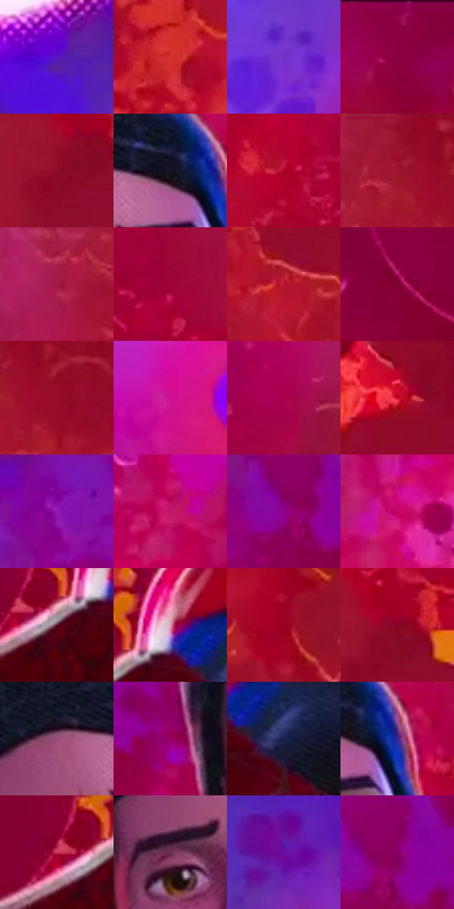

# 电影参考 656

- 状态：条件／活跃；来源世界：miles-home。
- 视角：low-angle；景别：medium；场景：industrial。
- 时段：event-time-unknown（外观依据，中置信度；具体时间／晨昏未知）；光照：event-light。
- 材质候选：skin, hair, fabric, metal, glass（帧级，不是像素分割）。
- 明暗组：dark；L* P5/P50/P95：10.00982 / 34.00534 / 50.00062。
- 资格门禁：energy。
- 原截图 SHA-256：`ee44b23a1135022b764f7a64a9a4d0bb3138a79c84c0d7e7482e1d86bc643366`；尺寸：2880 × 1206。
- sRGB 像素 SHA-256：`32653fb5a129cb547666454d158e8b3897796dd9ac5424d9d8f3bb7e0fbfe6bd`。

## 观察与迁移

事件彩光下人物、设备与粒子，皮肤和衣料仍保持体块。

略带笑意的裸脸处于粉紫中间调，黑衣蓝色细亮纹与窄暖边分开；伸手握住红蓝布料属于轻接触，右侧红橙粒子仍仅是事件环境。

本公开版保存32个128×128原像素色卡上下文；图集格子并非原场景相邻位置。原rect、图集tile和像素SHA见 `data/palette-crops.json`。上下文不足时不得批准替色，不能以小样推断完整构图。

## 实测色卡

颜色比例分母为保留采样像素，不是材料面积；全部 32 色参与全库匹配。表内四舍五入仅用于阅读，原精度在 JSON。

| ID | HEX | Lab | 原图 xy | 像素数 | 比例 | 明度角色 |
| --- | --- | --- | --- | ---: | ---: | --- |
| 656-S01 | #5B16C2 | [31.095305, 63.152676, -74.690467] | [132, 184] | 16565 | 8.567542% | shadow |
| 656-S02 | #D43531 | [47.96821, 60.812497, 40.554115] | [2472, 588] | 13902 | 7.190219% | midtone |
| 656-S03 | #7331C9 | [37.945956, 58.319945, -67.419238] | [576, 392] | 12824 | 6.632669% | shadow |
| 656-S04 | #8A0040 | [28.83778, 53.369027, 3.993176] | [1748, 32] | 11111 | 5.746692% | shadow |
| 656-S05 | #8F0A2A | [29.975029, 51.653122, 20.464601] | [1952, 508] | 9846 | 5.092425% | shadow |
| 656-S06 | #151421 | [6.951055, 4.195859, -8.828066] | [1520, 204] | 9598 | 4.964158% | deep-shadow |
| 656-S07 | #AB0228 | [35.708215, 59.94026, 30.042569] | [1940, 304] | 8751 | 4.526083% | shadow |
| 656-S08 | #9F152D | [34.188366, 54.121299, 24.47133] | [2536, 68] | 8297 | 4.291271% | shadow |
| 656-S09 | #A11945 | [35.408633, 55.183381, 10.631459] | [2416, 160] | 7180 | 3.713550% | shadow |
| 656-S10 | #9F0238 | [33.354833, 57.67581, 16.279126] | [2092, 316] | 7084 | 3.663898% | shadow |
| 656-S11 | #B3152D | [38.3977, 59.585887, 30.474708] | [2592, 460] | 6951 | 3.595109% | shadow |
| 656-S12 | #7B002C | [24.933825, 48.237638, 11.709644] | [824, 832] | 6662 | 3.445636% | shadow |
| 656-S13 | #960C2A | [31.615417, 53.222444, 22.827345] | [2604, 96] | 6560 | 3.392881% | shadow |
| 656-S14 | #CB1F99 | [46.947698, 72.362151, -23.867051] | [56, 1044] | 6185 | 3.198928% | midtone |
| 656-S15 | #A8024D | [35.803875, 61.216401, 6.196186] | [2124, 100] | 5499 | 2.844124% | shadow |
| 656-S16 | #C50624 | [41.424901, 65.907606, 40.133222] | [2004, 852] | 5299 | 2.740683% | midtone |
| 656-S17 | #921BB2 | [38.038826, 65.850327, -53.553597] | [1016, 72] | 5251 | 2.715857% | shadow |
| 656-S18 | #C41670 | [43.481907, 68.096468, -4.200705] | [684, 656] | 4669 | 2.414842% | midtone |
| 656-S19 | #93018B | [34.169834, 63.814781, -36.133114] | [1048, 220] | 4484 | 2.319158% | shadow |
| 656-S20 | #C3075F | [42.129314, 68.296415, 4.455252] | [560, 800] | 4347 | 2.248301% | midtone |
| 656-S21 | #4A0E21 | [14.845281, 29.430628, 3.891047] | [1196, 816] | 4137 | 2.139687% | deep-shadow |
| 656-S22 | #DE98B4 | [70.37435, 30.218833, -3.845671] | [1252, 756] | 3948 | 2.041935% | light |
| 656-S23 | #9A011E | [31.778945, 55.403762, 30.849687] | [2772, 504] | 3887 | 2.010386% | shadow |
| 656-S24 | #8B0427 | [28.70531, 51.396541, 20.68019] | [1988, 472] | 3600 | 1.861947% | shadow |
| 656-S25 | #994F77 | [43.796029, 35.953478, -8.816512] | [1400, 208] | 3485 | 1.802468% | midtone |
| 656-S26 | #970062 | [32.838451, 59.497384, -12.226194] | [1232, 324] | 3252 | 1.681959% | shadow |
| 656-S27 | #1A204B | [14.176196, 12.683245, -27.623962] | [1328, 816] | 2449 | 1.266641% | deep-shadow |
| 656-S28 | #3C2892 | [25.421041, 38.821658, -55.240955] | [1576, 220] | 2269 | 1.173544% | shadow |
| 656-S29 | #CE3661 | [47.786674, 61.403939, 11.51536] | [1148, 800] | 2038 | 1.054069% | midtone |
| 656-S30 | #6F2F52 | [29.469127, 32.709699, -7.627624] | [1360, 312] | 1256 | 0.649613% | shadow |
| 656-S31 | #680C9D | [28.486062, 58.554126, -56.754393] | [780, 204] | 1004 | 0.519276% | shadow |
| 656-S32 | #870065 | [29.642894, 56.449395, -19.367461] | [1080, 200] | 956 | 0.494450% | shadow |

## 色阶与空间分布

- 采样 ROI：`[0.01, 0.02, 0.98, 0.94]`；步长：4；样本数：193346。
- 排除区：`[]`。
- 深暗、暗、中、亮、高光五段计数：`[17006, 128679, 44378, 2040, 1243]`。
- RGB 各 256 箱、L* 100 箱、13×5 色相明度表和 3×3 空间统计全部保存在 [总数据](../film-library.json)。
- [可视化档案](../../references/library.html)按需绘制直方图，不存 2,094 张重复图表图片。

## 纹理特征占比

**这是分块图像特征的面积占比，不是波点／排线／丝网／错版的精确语义覆盖率。** 窗格、发丝、织物也会产生方向或周期特征。
原图 ROI 像素 3098546；已测块覆盖 3098546（100.0000%）；未测 0。

| 特征 | 块覆盖像素 | 占已测面积 | 阈值敏感范围 |
| --- | ---: | ---: | --- |
| low-contrast | 169216 | 5.4611% | 4.9324% ~ 7.5762% |
| directional-structure | 338560 | 10.9264% | 5.1100% ~ 18.3250% |
| periodic-structure | 2339634 | 75.5075% | 69.3441% ~ 75.5075% |
| mixed-detail | 251136 | 8.1050% | 1.5863% ~ 17.9697% |

阈值敏感范围不是统计置信区间。逐块坐标、尺度、对比、方向一致性、频谱集中度、频率与角度见 [全量特征记录](../texture-features.jsonl)，以帧号定位。
四种印刷层的真实像素覆盖仍标为 `null`，不能填 0，也不能拿上表代替。不得据这些代理测量删除唯一证据。

[测量方法与保留策略](../../references/library-retention.md) · [分类索引](../archive/README.md)
