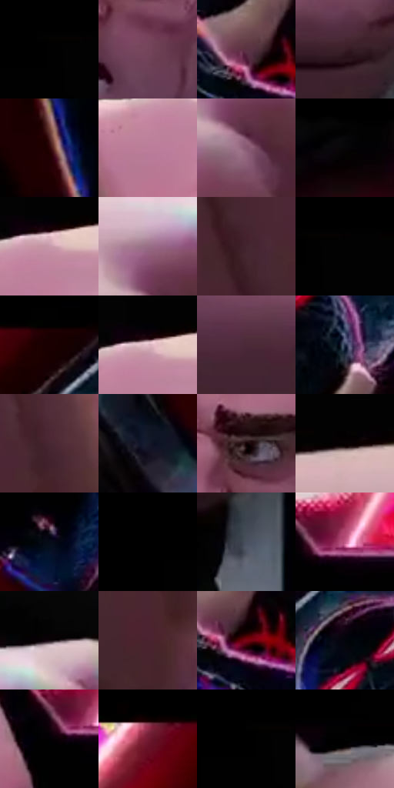

# 电影参考 657

- 状态：条件／活跃；来源世界：miles-home。
- 视角：low-angle；景别：close-up；场景：graphic。
- 时段：graphic-no-physical-time（外观依据，中置信度；具体时间／晨昏未知）；光照：graphic-field。
- 材质候选：skin, fabric, metal（帧级，不是像素分割）。
- 明暗组：very-dark；L* P5/P50/P95：0.27417 / 11.99272 / 66.80117。
- 资格门禁：impact。
- 原截图 SHA-256：`db0ef0ccb7ce0fb9ad79b8223cd4402780b1bdd33b053b6b979b7aa7a96c4bc8`；尺寸：2880 × 1256。
- sRGB 像素 SHA-256：`12070f501b1e64635c183345df2a6db2545d3e9dd8f0544c174d1a1984889a6f`。

## 观察与迁移

拳头夸张近大远小属于冲击构图，原照手部不能擅自变形。

近拳强透视、巨大黑衣体块与远侧较小人物构成动作强度，车窗裂线是实体玻璃损伤；夸大角色比例不作真人默认，黑边属于截图而不是美术内容。

本公开版保存32个128×128原像素色卡上下文；图集格子并非原场景相邻位置。原rect、图集tile和像素SHA见 `data/palette-crops.json`。上下文不足时不得批准替色，不能以小样推断完整构图。

## 实测色卡

颜色比例分母为保留采样像素，不是材料面积；全部 32 色参与全库匹配。表内四舍五入仅用于阅读，原精度在 JSON。

| ID | HEX | Lab | 原图 xy | 像素数 | 比例 | 明度角色 |
| --- | --- | --- | --- | ---: | ---: | --- |
| 657-S01 | #010101 | [0.274173, -1.7e-05, 3.3e-05] | [160, 56] | 37160 | 18.811951% | deep-shadow |
| 657-S02 | #73465B | [35.559441, 22.516225, -4.259371] | [1580, 604] | 8532 | 4.319256% | shadow |
| 657-S03 | #5B3243 | [26.479801, 21.03244, -2.509234] | [2552, 328] | 8454 | 4.279770% | shadow |
| 657-S04 | #391E26 | [15.161256, 14.411728, 0.299506] | [1476, 896] | 7811 | 3.954256% | deep-shadow |
| 657-S05 | #2B0509 | [5.799249, 19.133734, 5.359059] | [2792, 1176] | 7750 | 3.923375% | deep-shadow |
| 657-S06 | #BB7D99 | [59.465064, 28.176415, -5.139605] | [1240, 292] | 7600 | 3.847439% | midtone |
| 657-S07 | #875971 | [43.49058, 22.749164, -5.859405] | [880, 304] | 7484 | 3.788715% | midtone |
| 657-S08 | #080508 | [1.605154, 1.201542, -0.85869] | [1712, 80] | 7022 | 3.554831% | deep-shadow |
| 657-S09 | #C699AA | [67.792996, 19.464427, -2.3614] | [1292, 232] | 6915 | 3.500663% | light |
| 657-S10 | #996E86 | [51.434924, 20.979603, -6.409077] | [856, 212] | 6868 | 3.476870% | midtone |
| 657-S11 | #41242E | [18.2901, 15.379633, -0.665746] | [1032, 580] | 6748 | 3.416121% | deep-shadow |
| 657-S12 | #020202 | [0.548347, -3.5e-05, 6.6e-05] | [208, 52] | 6486 | 3.283485% | deep-shadow |
| 657-S13 | #1A0001 | [2.004187, 9.038554, 2.757293] | [2292, 52] | 5955 | 3.014671% | deep-shadow |
| 657-S14 | #E1BCC7 | [79.670173, 14.972748, -0.571641] | [1288, 220] | 5656 | 2.863305% | light |
| 657-S15 | #4C2A39 | [21.901424, 18.141032, -2.779794] | [300, 696] | 5350 | 2.708395% | shadow |
| 657-S16 | #242F4B | [19.703855, 4.356605, -18.785404] | [2580, 188] | 5046 | 2.554497% | deep-shadow |
| 657-S17 | #492732 | [20.432522, 17.587753, -0.17453] | [1164, 528] | 4940 | 2.500835% | shadow |
| 657-S18 | #161A2C | [9.728787, 4.043176, -12.725929] | [2316, 728] | 4911 | 2.486154% | deep-shadow |
| 657-S19 | #140104 | [1.619072, 6.18241, 0.896148] | [1552, 488] | 4679 | 2.368706% | deep-shadow |
| 657-S20 | #090102 | [0.76043, 2.231021, 0.358718] | [504, 140] | 4581 | 2.319094% | deep-shadow |
| 657-S21 | #070C18 | [3.378625, 1.162913, -7.274895] | [2416, 528] | 4483 | 2.269483% | deep-shadow |
| 657-S22 | #000000 | [0.0, 0.0, 0.0] | [32, 52] | 4384 | 2.219365% | deep-shadow |
| 657-S23 | #4A515F | [34.327737, 0.641923, -9.083036] | [1504, 1052] | 4184 | 2.118116% | shadow |
| 657-S24 | #C15A85 | [52.226049, 45.911275, -4.076842] | [1740, 348] | 3976 | 2.012818% | midtone |
| 657-S25 | #180B13 | [4.341067, 6.436086, -2.189447] | [956, 128] | 3784 | 1.915620% | deep-shadow |
| 657-S26 | #4B232F | [19.653204, 20.470156, 0.81398] | [1132, 668] | 3695 | 1.870564% | deep-shadow |
| 657-S27 | #7D0415 | [25.267229, 46.916779, 27.608503] | [2584, 356] | 3357 | 1.699454% | shadow |
| 657-S28 | #01040C | [1.082291, 0.343442, -3.34629] | [2420, 132] | 3315 | 1.678192% | deep-shadow |
| 657-S29 | #010104 | [0.333534, 0.417114, -1.135238] | [1684, 372] | 3161 | 1.600231% | deep-shadow |
| 657-S30 | #8F2F4B | [34.766691, 42.793736, 5.342129] | [2132, 52] | 2514 | 1.272692% | shadow |
| 657-S31 | #010100 | [0.254387, -0.139061, 0.378457] | [144, 52] | 407 | 0.206040% | deep-shadow |
| 657-S32 | #000201 | [0.411943, -0.662077, 0.194212] | [64, 176] | 326 | 0.165035% | deep-shadow |

## 色阶与空间分布

- 采样 ROI：`[0.01, 0.02, 0.98, 0.94]`；步长：4；样本数：197534。
- 排除区：`[{"label": "approximate top letterbox", "rect": [0, 0, 1, 0.04]}]`。
- 深暗、暗、中、亮、高光五段计数：`[120759, 37040, 23775, 13775, 2185]`。
- RGB 各 256 箱、L* 100 箱、13×5 色相明度表和 3×3 空间统计全部保存在 [总数据](../film-library.json)。
- [可视化档案](../../references/library.html)按需绘制直方图，不存 2,094 张重复图表图片。

## 纹理特征占比

**这是分块图像特征的面积占比，不是波点／排线／丝网／错版的精确语义覆盖率。** 窗格、发丝、织物也会产生方向或周期特征。
原图 ROI 像素 3157220；已测块覆盖 2861056（90.6195%）；未测 296164。

| 特征 | 块覆盖像素 | 占已测面积 | 阈值敏感范围 |
| --- | ---: | ---: | --- |
| low-contrast | 638976 | 22.3336% | 20.6156% ~ 24.0515% |
| directional-structure | 873472 | 30.5297% | 17.4571% ~ 46.5641% |
| periodic-structure | 1315840 | 45.9914% | 32.2477% ~ 55.2523% |
| mixed-detail | 32768 | 1.1453% | 0.5727% ~ 3.2391% |

阈值敏感范围不是统计置信区间。逐块坐标、尺度、对比、方向一致性、频谱集中度、频率与角度见 [全量特征记录](../texture-features.jsonl)，以帧号定位。
四种印刷层的真实像素覆盖仍标为 `null`，不能填 0，也不能拿上表代替。不得据这些代理测量删除唯一证据。

[测量方法与保留策略](../../references/library-retention.md) · [分类索引](../archive/README.md)
