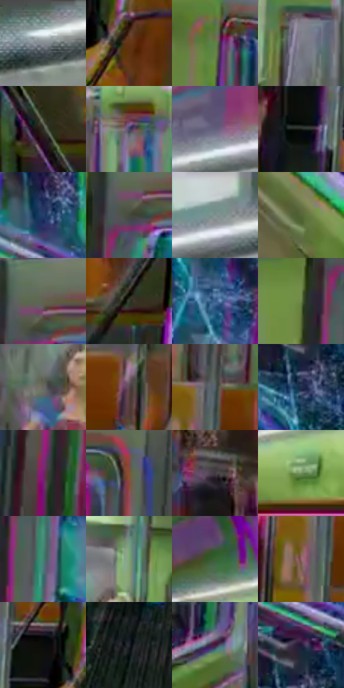

# 电影参考 658

- 状态：条件／活跃；来源世界：miles-home。
- 视角：near-level；景别：environment-wide；场景：vehicle。
- 时段：event-time-unknown（外观依据，中置信度；具体时间／晨昏未知）；光照：event-light。
- 材质候选：skin, fabric, metal, glass, plastic（帧级，不是像素分割）。
- 明暗组：dark；L* P5/P50/P95：10.79134 / 37.22737 / 67.81056。
- 资格门禁：glitch。
- 原截图 SHA-256：`d4fd5cbab2cf732bf3903fc9f5ad8a77dd5dd8bbdcc45f517941de4ebb40dabd`；尺寸：2880 × 1208。
- sRGB 像素 SHA-256：`f21a55c1bf2102a225fa7b591eb69e3a25ee153d727428fe5f8a671573659a66`。

## 观察与迁移

地铁空间彩色错乱，车体真实框架与故障分开。

绿灰车厢、橙座椅、白顶灯和重复立杆维持空间格网，窗裂和局部人物多层透明异常须分开；青粉窗缘错版不是玻璃反射的充分依据，不迁移异常人形。

本公开版保存32个128×128原像素色卡上下文；图集格子并非原场景相邻位置。原rect、图集tile和像素SHA见 `data/palette-crops.json`。上下文不足时不得批准替色，不能以小样推断完整构图。

## 实测色卡

颜色比例分母为保留采样像素，不是材料面积；全部 32 色参与全库匹配。表内四舍五入仅用于阅读，原精度在 JSON。

| ID | HEX | Lab | 原图 xy | 像素数 | 比例 | 明度角色 |
| --- | --- | --- | --- | ---: | ---: | --- |
| 658-S01 | #92999F | [62.840806, -1.294701, -4.00567] | [2616, 60] | 10860 | 5.616873% | light |
| 658-S02 | #643415 | [27.353108, 18.847235, 28.248747] | [1372, 828] | 9755 | 5.045359% | shadow |
| 658-S03 | #5F823F | [50.401459, -24.700906, 32.119407] | [312, 284] | 9351 | 4.836407% | midtone |
| 658-S04 | #7A7B86 | [51.864984, 1.924454, -6.09364] | [852, 388] | 9000 | 4.654867% | midtone |
| 658-S05 | #2A2C21 | [17.476107, -3.326784, 6.861913] | [516, 984] | 8896 | 4.601078% | deep-shadow |
| 658-S06 | #494767 | [31.582801, 8.866393, -18.34548] | [1444, 380] | 8063 | 4.170244% | shadow |
| 658-S07 | #62617D | [42.194967, 6.85547, -15.488333] | [2180, 104] | 8011 | 4.143349% | midtone |
| 658-S08 | #181C19 | [9.758028, -2.669885, 1.441067] | [1184, 820] | 7622 | 3.942156% | deep-shadow |
| 658-S09 | #26406B | [27.129606, 4.942984, -28.051383] | [1812, 592] | 6823 | 3.528907% | shadow |
| 658-S10 | #454A3E | [30.665681, -4.609696, 6.487434] | [2068, 388] | 6769 | 3.500978% | shadow |
| 658-S11 | #C7CECE | [82.239111, -2.385027, -0.826841] | [2420, 32] | 6678 | 3.453912% | highlight |
| 658-S12 | #536637 | [40.601691, -16.00744, 24.19349] | [1780, 1020] | 6473 | 3.347884% | midtone |
| 658-S13 | #5F634C | [41.02231, -5.983675, 12.583566] | [2088, 344] | 6333 | 3.275475% | midtone |
| 658-S14 | #323F2E | [25.0459, -9.225762, 8.727366] | [1420, 988] | 6223 | 3.218582% | shadow |
| 658-S15 | #385F8D | [39.491493, 0.944172, -29.587028] | [2564, 548] | 6043 | 3.125485% | shadow |
| 658-S16 | #6E864C | [52.825517, -19.09824, 28.397877] | [1996, 456] | 6031 | 3.119278% | midtone |
| 658-S17 | #696861 | [43.896959, -1.003037, 4.081425] | [1080, 460] | 5825 | 3.012734% | midtone |
| 658-S18 | #5C464E | [32.27127, 10.863024, -1.151504] | [888, 608] | 5419 | 2.802747% | shadow |
| 658-S19 | #505E63 | [38.918224, -4.168839, -4.660217] | [1252, 580] | 5233 | 2.706547% | shadow |
| 658-S20 | #202E4D | [19.210385, 4.679448, -20.931059] | [1804, 804] | 5011 | 2.591727% | deep-shadow |
| 658-S21 | #7A216C | [30.178676, 46.640987, -23.230646] | [2312, 1092] | 4863 | 2.515180% | shadow |
| 658-S22 | #865238 | [40.229183, 18.917236, 24.27118] | [2248, 392] | 4826 | 2.496043% | midtone |
| 658-S23 | #433943 | [25.335787, 6.525121, -4.540335] | [1040, 768] | 4644 | 2.401912% | shadow |
| 658-S24 | #70915D | [56.570679, -21.569767, 23.961817] | [1772, 296] | 4352 | 2.250887% | midtone |
| 658-S25 | #408370 | [50.086772, -26.229184, 3.770009] | [2076, 544] | 4342 | 2.245715% | midtone |
| 658-S26 | #7BA574 | [63.656973, -23.954439, 20.942703] | [1160, 348] | 4322 | 2.235371% | light |
| 658-S27 | #3A6138 | [37.361009, -23.119335, 19.141066] | [1708, 188] | 4320 | 2.234336% | shadow |
| 658-S28 | #905E6A | [45.601846, 22.169, 1.626833] | [1212, 652] | 4148 | 2.145377% | midtone |
| 658-S29 | #090C0B | [3.117956, -0.965317, 0.125001] | [1296, 768] | 3857 | 1.994869% | deep-shadow |
| 658-S30 | #21262D | [14.947866, -0.274217, -5.349274] | [956, 976] | 3792 | 1.961251% | deep-shadow |
| 658-S31 | #431E42 | [17.987945, 23.901354, -15.062587] | [600, 608] | 3468 | 1.793676% | deep-shadow |
| 658-S32 | #211736 | [10.575259, 13.574572, -18.590451] | [1820, 720] | 1993 | 1.030795% | deep-shadow |

## 色阶与空间分布

- 采样 ROI：`[0.01, 0.02, 0.98, 0.94]`；步长：4；样本数：193346。
- 排除区：`[]`。
- 深暗、暗、中、亮、高光五段计数：`[30996, 78556, 66222, 13839, 3733]`。
- RGB 各 256 箱、L* 100 箱、13×5 色相明度表和 3×3 空间统计全部保存在 [总数据](../film-library.json)。
- [可视化档案](../../references/library.html)按需绘制直方图，不存 2,094 张重复图表图片。

## 纹理特征占比

**这是分块图像特征的面积占比，不是波点／排线／丝网／错版的精确语义覆盖率。** 窗格、发丝、织物也会产生方向或周期特征。
原图 ROI 像素 3104134；已测块覆盖 3104134（100.0000%）；未测 0。

| 特征 | 块覆盖像素 | 占已测面积 | 阈值敏感范围 |
| --- | ---: | ---: | --- |
| low-contrast | 0 | 0.0000% | 0.0000% ~ 0.0000% |
| directional-structure | 1226118 | 39.4995% | 25.5661% ~ 49.3589% |
| periodic-structure | 1790208 | 57.6717% | 49.7546% ~ 68.0795% |
| mixed-detail | 87808 | 2.8287% | 0.8866% ~ 6.3544% |

阈值敏感范围不是统计置信区间。逐块坐标、尺度、对比、方向一致性、频谱集中度、频率与角度见 [全量特征记录](../texture-features.jsonl)，以帧号定位。
四种印刷层的真实像素覆盖仍标为 `null`，不能填 0，也不能拿上表代替。不得据这些代理测量删除唯一证据。

[测量方法与保留策略](../../references/library-retention.md) · [分类索引](../archive/README.md)
