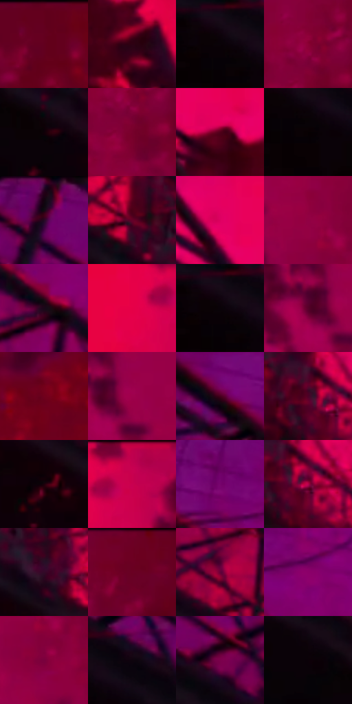

# 电影参考 659

- 状态：条件／活跃；来源世界：miles-home。
- 视角：low-angle；景别：environment-wide；场景：city。
- 时段：event-time-unknown（外观依据，中置信度；具体时间／晨昏未知）；光照：event-light。
- 材质候选：metal, stone, sky（帧级，不是像素分割）。
- 明暗组：very-dark；L* P5/P50/P95：0.83958 / 17.57916 / 46.5247。
- 资格门禁：energy。
- 原截图 SHA-256：`df18e8c8a577d232efeb7e1f10c83900bc0b481d3165fe9131fc98fbd979be58`；尺寸：2880 × 1206。
- sRGB 像素 SHA-256：`02c3823b854326dbe977bd823ab8be92a7a8ae2e31c367014f4199d2dc72c187`。

## 观察与迁移

桥架黑形与红色粒子场，非日常夕照天空。

桥底黑色斜向梁与深红塔拱仍有实体层级，周围洋红粒子与局部破碎属于事件；索、桁架、散落碎块及印刷排线分别记录，不当普通红色夕照桥梁。

本公开版保存32个128×128原像素色卡上下文；图集格子并非原场景相邻位置。原rect、图集tile和像素SHA见 `data/palette-crops.json`。上下文不足时不得批准替色，不能以小样推断完整构图。

## 实测色卡

颜色比例分母为保留采样像素，不是材料面积；全部 32 色参与全库匹配。表内四舍五入仅用于阅读，原精度在 JSON。

| ID | HEX | Lab | 原图 xy | 像素数 | 比例 | 明度角色 |
| --- | --- | --- | --- | ---: | ---: | --- |
| 659-S01 | #62001D | [18.740644, 40.787551, 13.002462] | [2664, 28] | 10613 | 5.489123% | deep-shadow |
| 659-S02 | #2E0113 | [5.869052, 23.92177, 0.46086] | [1768, 308] | 10567 | 5.465332% | deep-shadow |
| 659-S03 | #0A0105 | [0.8781, 2.909652, -0.684415] | [36, 136] | 10155 | 5.252242% | deep-shadow |
| 659-S04 | #8B0035 | [28.766879, 52.832614, 11.358039] | [2380, 112] | 9332 | 4.826580% | shadow |
| 659-S05 | #0F0007 | [1.05618, 5.088822, -1.198875] | [544, 412] | 8264 | 4.274203% | deep-shadow |
| 659-S06 | #77002C | [24.015636, 47.216528, 10.312913] | [2388, 168] | 8106 | 4.192484% | shadow |
| 659-S07 | #510019 | [14.513181, 35.912651, 9.599641] | [1440, 200] | 7484 | 3.870781% | deep-shadow |
| 659-S08 | #060103 | [0.605291, 1.585567, -0.296121] | [92, 176] | 7162 | 3.704240% | deep-shadow |
| 659-S09 | #3E0018 | [9.722858, 30.568724, 3.016835] | [292, 56] | 6902 | 3.569766% | deep-shadow |
| 659-S10 | #640028 | [19.488168, 42.044735, 6.200672] | [1196, 652] | 6821 | 3.527872% | deep-shadow |
| 659-S11 | #DD0060 | [47.263696, 74.904356, 11.839041] | [1284, 80] | 6724 | 3.477703% | midtone |
| 659-S12 | #920043 | [30.683687, 55.519415, 4.853002] | [2200, 200] | 6682 | 3.455980% | shadow |
| 659-S13 | #190818 | [4.031555, 9.354946, -6.146413] | [784, 264] | 6606 | 3.416673% | deep-shadow |
| 659-S14 | #E60047 | [48.615091, 75.635183, 29.35818] | [1840, 88] | 6437 | 3.329265% | midtone |
| 659-S15 | #0A0208 | [1.133538, 2.926223, -1.533367] | [64, 132] | 6329 | 3.273406% | deep-shadow |
| 659-S16 | #57012A | [16.580871, 38.545569, 0.19125] | [2060, 140] | 6298 | 3.257373% | deep-shadow |
| 659-S17 | #70011B | [22.112386, 44.217718, 19.325771] | [2620, 564] | 6006 | 3.106348% | shadow |
| 659-S18 | #9F014C | [33.808746, 59.150294, 3.742324] | [2112, 136] | 5632 | 2.912913% | shadow |
| 659-S19 | #44001D | [11.40096, 32.660214, 1.776085] | [548, 76] | 5490 | 2.839469% | deep-shadow |
| 659-S20 | #4C0126 | [13.818678, 35.266473, -1.227169] | [1540, 828] | 5446 | 2.816712% | deep-shadow |
| 659-S21 | #1D000B | [2.578443, 12.118275, -0.442626] | [888, 620] | 5339 | 2.761371% | deep-shadow |
| 659-S22 | #C4004F | [41.695181, 68.125172, 14.00798] | [1924, 36] | 5030 | 2.601554% | midtone |
| 659-S23 | #76036B | [26.674968, 53.331191, -28.159568] | [708, 96] | 4914 | 2.541558% | shadow |
| 659-S24 | #B0024A | [37.427896, 62.899701, 10.66974] | [1576, 844] | 4630 | 2.394671% | shadow |
| 659-S25 | #340929 | [9.685874, 25.318502, -10.236648] | [1312, 744] | 4533 | 2.344502% | deep-shadow |
| 659-S26 | #6D0022 | [21.460262, 44.005439, 13.490341] | [2500, 32] | 4118 | 2.129860% | shadow |
| 659-S27 | #630139 | [19.925455, 43.070285, -5.272895] | [1048, 548] | 4073 | 2.106586% | deep-shadow |
| 659-S28 | #8C0069 | [30.870793, 57.976903, -19.965652] | [812, 148] | 3796 | 1.963320% | shadow |
| 659-S29 | #79013D | [25.028805, 48.823497, 0.050515] | [2228, 284] | 3640 | 1.882635% | shadow |
| 659-S30 | #0E040D | [1.890295, 4.024839, -2.539497] | [160, 116] | 3336 | 1.725404% | deep-shadow |
| 659-S31 | #7A014B | [25.768488, 50.425619, -8.355555] | [428, 220] | 1909 | 0.987349% | shadow |
| 659-S32 | #0B0108 | [0.997255, 3.59495, -1.725197] | [432, 356] | 972 | 0.502726% | deep-shadow |

## 色阶与空间分布

- 采样 ROI：`[0.01, 0.02, 0.98, 0.94]`；步长：4；样本数：193346。
- 排除区：`[]`。
- 深暗、暗、中、亮、高光五段计数：`[112191, 63505, 17650, 0, 0]`。
- RGB 各 256 箱、L* 100 箱、13×5 色相明度表和 3×3 空间统计全部保存在 [总数据](../film-library.json)。
- [可视化档案](../../references/library.html)按需绘制直方图，不存 2,094 张重复图表图片。

## 纹理特征占比

**这是分块图像特征的面积占比，不是波点／排线／丝网／错版的精确语义覆盖率。** 窗格、发丝、织物也会产生方向或周期特征。
原图 ROI 像素 3098546；已测块覆盖 3098546（100.0000%）；未测 0。

| 特征 | 块覆盖像素 | 占已测面积 | 阈值敏感范围 |
| --- | ---: | ---: | --- |
| low-contrast | 955826 | 30.8476% | 24.1554% ~ 39.3821% |
| directional-structure | 180224 | 5.8164% | 2.6438% ~ 10.5753% |
| periodic-structure | 1962496 | 63.3360% | 57.9740% ~ 65.2693% |
| mixed-detail | 0 | 0.0000% | 0.0000% ~ 0.0000% |

阈值敏感范围不是统计置信区间。逐块坐标、尺度、对比、方向一致性、频谱集中度、频率与角度见 [全量特征记录](../texture-features.jsonl)，以帧号定位。
四种印刷层的真实像素覆盖仍标为 `null`，不能填 0，也不能拿上表代替。不得据这些代理测量删除唯一证据。

[测量方法与保留策略](../../references/library-retention.md) · [分类索引](../archive/README.md)
