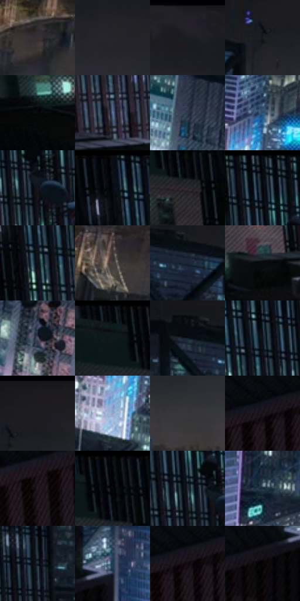

# 电影参考 660

- 状态：常规／活跃；来源世界：miles-home。
- 视角：high-angle；景别：environment-wide；场景：street。
- 时段：night-appearance（外观依据，中置信度；具体时间／晨昏未知）；光照：night-mixed。
- 材质候选：skin, hair, fabric, stone, brick, glass, asphalt, painted-metal（帧级，不是像素分割）。
- 明暗组：very-dark；L* P5/P50/P95：1.58673 / 12.17968 / 45.55772。
- 资格门禁：无附加门禁。
- 原截图 SHA-256：`ac7da43e18cfa8af700d9901527ac71a9dff37fa8c2cd7ba7b7f6469bb37d479`；尺寸：2880 × 1212。
- sRGB 像素 SHA-256：`450e1095111fe0360631c976ec15cdee30088d6d63f0add3a15882b61a6900cc`。

## 观察与迁移

冷灰雾街、警灯与圆形车灯光晕，雾不等于事件粒子。

近处灰蓝黑屋顶形成大暗面，中景玻璃楼用青白窗组和少量粉色招牌组织光，远处地平线保留微暖点；事件背景不当稳定几何，普通楼面不全部发霓虹光。

本公开版保存32个128×128原像素色卡上下文；图集格子并非原场景相邻位置。原rect、图集tile和像素SHA见 `data/palette-crops.json`。上下文不足时不得批准替色，不能以小样推断完整构图。

## 实测色卡

颜色比例分母为保留采样像素，不是材料面积；全部 32 色参与全库匹配。表内四舍五入仅用于阅读，原精度在 JSON。

| ID | HEX | Lab | 原图 xy | 像素数 | 比例 | 明度角色 |
| --- | --- | --- | --- | ---: | ---: | --- |
| 660-S01 | #353032 | [20.444379, 2.676489, -0.464207] | [1572, 448] | 8587 | 4.425285% | shadow |
| 660-S02 | #272529 | [15.032365, 1.900369, -2.31225] | [1900, 156] | 8074 | 4.160912% | deep-shadow |
| 660-S03 | #202127 | [12.867941, 1.142017, -4.176663] | [1948, 56] | 7884 | 4.062996% | deep-shadow |
| 660-S04 | #171B21 | [9.607575, -0.101301, -4.758153] | [1024, 112] | 7585 | 3.908907% | deep-shadow |
| 660-S05 | #070708 | [1.939001, 0.138922, -0.378193] | [88, 520] | 7509 | 3.869741% | deep-shadow |
| 660-S06 | #5C6F92 | [46.603309, 2.056651, -21.35369] | [416, 416] | 7215 | 3.718229% | midtone |
| 660-S07 | #2F394C | [23.843298, 1.297156, -12.960032] | [1584, 880] | 6932 | 3.572386% | shadow |
| 660-S08 | #2D4D71 | [31.936943, 0.078956, -24.250152] | [1480, 620] | 6846 | 3.528066% | shadow |
| 660-S09 | #14161B | [7.2413, 0.459444, -3.817533] | [520, 192] | 6810 | 3.509513% | deep-shadow |
| 660-S10 | #0A0F17 | [4.227545, 0.235916, -5.254845] | [316, 28] | 6788 | 3.498176% | deep-shadow |
| 660-S11 | #2B2A30 | [17.380568, 1.936761, -3.722178] | [208, 136] | 6776 | 3.491992% | deep-shadow |
| 660-S12 | #080C13 | [3.266009, 0.223305, -3.913807] | [460, 28] | 6656 | 3.430150% | deep-shadow |
| 660-S13 | #111115 | [5.186751, 0.867143, -2.360295] | [356, 164] | 6387 | 3.291522% | deep-shadow |
| 660-S14 | #48403F | [27.8547, 3.221569, 1.861113] | [2084, 508] | 6255 | 3.223496% | shadow |
| 660-S15 | #1A2532 | [14.247476, -0.57139, -10.024499] | [912, 144] | 5928 | 3.054977% | deep-shadow |
| 660-S16 | #0A0B0E | [3.031221, 0.210306, -1.396865] | [268, 472] | 5874 | 3.027148% | deep-shadow |
| 660-S17 | #525465 | [36.126214, 3.199803, -10.066909] | [1696, 984] | 5751 | 2.963761% | shadow |
| 660-S18 | #05080D | [2.122537, -0.05329, -2.266596] | [124, 36] | 5686 | 2.930263% | deep-shadow |
| 660-S19 | #121B27 | [9.472647, 0.036791, -9.461956] | [812, 108] | 5619 | 2.895735% | deep-shadow |
| 660-S20 | #0A151F | [6.320684, -1.004541, -8.340126] | [404, 120] | 5612 | 2.892128% | deep-shadow |
| 660-S21 | #1D1B20 | [10.178414, 2.255882, -3.094222] | [1072, 28] | 5565 | 2.867906% | deep-shadow |
| 660-S22 | #92A1C5 | [66.236884, 2.795035, -20.206576] | [1432, 740] | 5554 | 2.862237% | light |
| 660-S23 | #38373B | [23.300659, 1.364132, -2.336525] | [1196, 228] | 5435 | 2.800911% | shadow |
| 660-S24 | #1A1319 | [6.824923, 4.75882, -2.825882] | [680, 740] | 5407 | 2.786481% | deep-shadow |
| 660-S25 | #241B20 | [11.016039, 5.534815, -1.758814] | [552, 808] | 5375 | 2.769990% | deep-shadow |
| 660-S26 | #020305 | [0.803785, 0.016536, -0.848887] | [196, 36] | 5231 | 2.695780% | deep-shadow |
| 660-S27 | #262C37 | [17.869634, 0.480954, -7.912083] | [476, 168] | 4840 | 2.494280% | deep-shadow |
| 660-S28 | #1A2C3F | [17.365472, -0.816426, -14.299939] | [1232, 500] | 4746 | 2.445837% | deep-shadow |
| 660-S29 | #17212A | [12.201588, -1.527186, -7.436924] | [668, 176] | 4513 | 2.325761% | deep-shadow |
| 660-S30 | #1F3A52 | [23.426218, -2.017737, -17.662993] | [980, 624] | 4478 | 2.307724% | shadow |
| 660-S31 | #120C0F | [3.848431, 2.54774, -0.651444] | [708, 740] | 4353 | 2.243306% | deep-shadow |
| 660-S32 | #080405 | [1.349716, 1.184971, -0.009737] | [892, 688] | 3773 | 1.944404% | deep-shadow |

## 色阶与空间分布

- 采样 ROI：`[0.01, 0.02, 0.98, 0.94]`；步长：4；样本数：194044。
- 排除区：`[]`。
- 深暗、暗、中、亮、高光五段计数：`[140514, 40226, 9609, 3225, 470]`。
- RGB 各 256 箱、L* 100 箱、13×5 色相明度表和 3×3 空间统计全部保存在 [总数据](../film-library.json)。
- [可视化档案](../../references/library.html)按需绘制直方图，不存 2,094 张重复图表图片。

## 纹理特征占比

**这是分块图像特征的面积占比，不是波点／排线／丝网／错版的精确语义覆盖率。** 窗格、发丝、织物也会产生方向或周期特征。
原图 ROI 像素 3115310；已测块覆盖 3115310（100.0000%）；未测 0。

| 特征 | 块覆盖像素 | 占已测面积 | 阈值敏感范围 |
| --- | ---: | ---: | --- |
| low-contrast | 131072 | 4.2073% | 2.6296% ~ 6.8369% |
| directional-structure | 393216 | 12.6221% | 1.0518% ~ 24.4608% |
| periodic-structure | 2051968 | 65.8672% | 65.3002% ~ 66.2534% |
| mixed-detail | 539054 | 17.3034% | 6.6562% ~ 26.8110% |

阈值敏感范围不是统计置信区间。逐块坐标、尺度、对比、方向一致性、频谱集中度、频率与角度见 [全量特征记录](../texture-features.jsonl)，以帧号定位。
四种印刷层的真实像素覆盖仍标为 `null`，不能填 0，也不能拿上表代替。不得据这些代理测量删除唯一证据。

[测量方法与保留策略](../../references/library-retention.md) · [分类索引](../archive/README.md)
