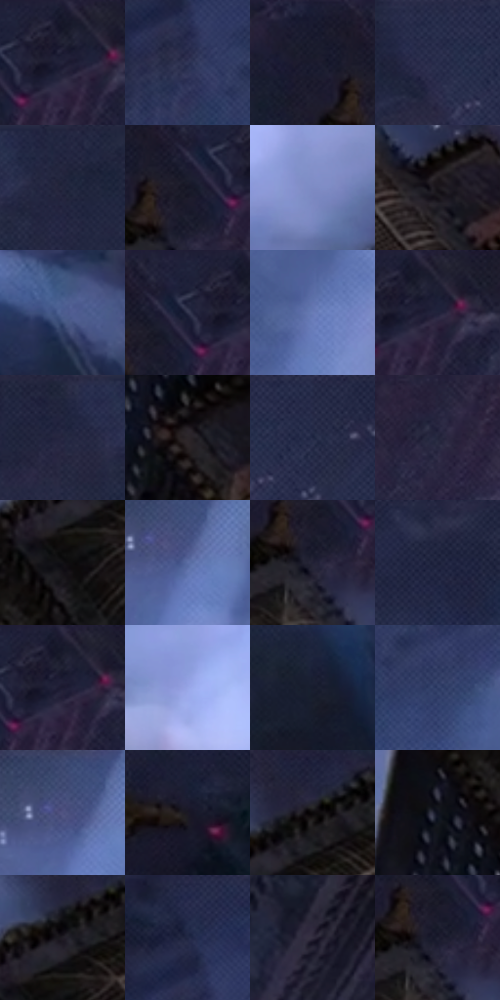

# 电影参考 661

- 状态：常规／活跃；来源世界：miles-home。
- 视角：high-angle；景别：environment-wide；场景：street。
- 时段：night-appearance（外观依据，中置信度；具体时间／晨昏未知）；光照：night-mixed。
- 材质候选：skin, hair, fabric, stone, brick, glass, asphalt, painted-metal（帧级，不是像素分割）。
- 明暗组：very-dark；L* P5/P50/P95：5.189 / 15.37522 / 57.79813。
- 资格门禁：无附加门禁。
- 原截图 SHA-256：`a1a1bc4f498f28d42e4acf2013a254f25cfa1f19cc3cbb38b9c1583f96dca424`；尺寸：2880 × 1204。
- sRGB 像素 SHA-256：`8a302e483ae45c3a44c5c93ac9ad8a8ff1246f8ce644b47c3ba46a1c6d4f8977`。

## 观察与迁移

冷灰雾街、警灯与圆形车灯光晕，雾不等于事件粒子。

深灰屋顶格网与低亮金色边条保持材料差异，白色搜索光穿过蓝灰雾区，雾减弱后方结构对比；光束须有原照光源依据，不把所有远楼统一高斯模糊。

本公开版保存32个128×128原像素色卡上下文；图集格子并非原场景相邻位置。原rect、图集tile和像素SHA见 `data/palette-crops.json`。上下文不足时不得批准替色，不能以小样推断完整构图。

## 实测色卡

颜色比例分母为保留采样像素，不是材料面积；全部 32 色参与全库匹配。表内四舍五入仅用于阅读，原精度在 JSON。

| ID | HEX | Lab | 原图 xy | 像素数 | 比例 | 明度角色 |
| --- | --- | --- | --- | ---: | ---: | --- |
| 661-S01 | #171A2B | [9.761452, 4.031842, -11.933061] | [2316, 32] | 10527 | 5.464370% | deep-shadow |
| 661-S02 | #2F3556 | [23.074714, 7.277811, -20.777963] | [1252, 152] | 9875 | 5.125929% | shadow |
| 661-S03 | #1B1C2D | [10.942241, 4.6802, -11.530123] | [2148, 44] | 9711 | 5.040800% | deep-shadow |
| 661-S04 | #282E4C | [19.748023, 6.622491, -19.369306] | [636, 28] | 9457 | 4.908953% | deep-shadow |
| 661-S05 | #25263F | [16.197022, 6.942572, -16.06016] | [500, 44] | 8579 | 4.453200% | deep-shadow |
| 661-S06 | #151625 | [7.829587, 4.228277, -10.497638] | [2228, 88] | 7465 | 3.874943% | deep-shadow |
| 661-S07 | #7D8BC4 | [58.797532, 8.898227, -31.21016] | [1668, 592] | 7366 | 3.823554% | midtone |
| 661-S08 | #18151A | [7.272449, 2.704971, -2.960888] | [2380, 344] | 7056 | 3.662639% | deep-shadow |
| 661-S09 | #4A5B8D | [39.344255, 7.818074, -29.745448] | [744, 420] | 6661 | 3.457601% | shadow |
| 661-S10 | #1E223A | [13.975027, 5.79897, -16.089191] | [2260, 36] | 6429 | 3.337175% | deep-shadow |
| 661-S11 | #6B7DB7 | [53.179308, 8.533672, -32.648837] | [1616, 292] | 6427 | 3.336136% | midtone |
| 661-S12 | #1B1F35 | [12.415659, 5.24298, -15.00488] | [2344, 48] | 6386 | 3.314854% | deep-shadow |
| 661-S13 | #20253D | [15.313197, 5.31381, -16.083227] | [384, 28] | 6225 | 3.231282% | deep-shadow |
| 661-S14 | #2B2529 | [15.470711, 3.710375, -1.615223] | [1936, 568] | 5978 | 3.103069% | deep-shadow |
| 661-S15 | #252A47 | [17.936773, 6.80439, -18.840044] | [720, 28] | 5798 | 3.009634% | deep-shadow |
| 661-S16 | #282841 | [17.227399, 7.194099, -15.813424] | [2596, 52] | 5782 | 3.001329% | deep-shadow |
| 661-S17 | #111014 | [4.880098, 1.195819, -2.132245] | [1956, 316] | 5645 | 2.930215% | deep-shadow |
| 661-S18 | #5C6EA5 | [47.161223, 8.237181, -31.688691] | [1708, 84] | 5605 | 2.909451% | midtone |
| 661-S19 | #222235 | [14.065421, 5.486683, -12.381442] | [2220, 144] | 5527 | 2.868963% | deep-shadow |
| 661-S20 | #2B2C47 | [19.097179, 7.326176, -16.983061] | [928, 28] | 5478 | 2.843528% | deep-shadow |
| 661-S21 | #1D1F30 | [12.315987, 4.195102, -11.556589] | [2324, 44] | 5280 | 2.740750% | deep-shadow |
| 661-S22 | #97A6E6 | [69.157236, 9.737665, -33.899206] | [1416, 700] | 5135 | 2.665483% | light |
| 661-S23 | #171C2D | [10.572564, 3.234558, -12.133787] | [616, 520] | 5068 | 2.630705% | deep-shadow |
| 661-S24 | #313D66 | [26.590071, 7.835591, -25.656151] | [1348, 208] | 5060 | 2.626552% | shadow |
| 661-S25 | #3E4871 | [31.464552, 7.786289, -24.914895] | [1684, 36] | 4708 | 2.443835% | shadow |
| 661-S26 | #1B1924 | [9.446548, 4.026943, -7.202016] | [2668, 636] | 4503 | 2.337424% | deep-shadow |
| 661-S27 | #0C090B | [2.689133, 1.095424, -0.479406] | [2016, 208] | 4466 | 2.318218% | deep-shadow |
| 661-S28 | #0F121E | [5.671568, 2.080397, -8.52195] | [1856, 412] | 4018 | 2.085669% | deep-shadow |
| 661-S29 | #211D26 | [11.566125, 4.220001, -5.396612] | [1980, 244] | 3950 | 2.050372% | deep-shadow |
| 661-S30 | #212844 | [16.787381, 5.950877, -18.614616] | [1236, 60] | 2907 | 1.508970% | deep-shadow |
| 661-S31 | #332E3F | [20.110458, 6.458601, -9.895488] | [2176, 992] | 2899 | 1.504817% | shadow |
| 661-S32 | #202032 | [13.048392, 5.234902, -11.834905] | [2224, 132] | 2677 | 1.389581% | deep-shadow |

## 色阶与空间分布

- 采样 ROI：`[0.01, 0.02, 0.98, 0.94]`；步长：4；样本数：192648。
- 排除区：`[]`。
- 深暗、暗、中、亮、高光五段计数：`[136025, 28996, 20394, 7229, 4]`。
- RGB 各 256 箱、L* 100 箱、13×5 色相明度表和 3×3 空间统计全部保存在 [总数据](../film-library.json)。
- [可视化档案](../../references/library.html)按需绘制直方图，不存 2,094 张重复图表图片。

## 纹理特征占比

**这是分块图像特征的面积占比，不是波点／排线／丝网／错版的精确语义覆盖率。** 窗格、发丝、织物也会产生方向或周期特征。
原图 ROI 像素 3092958；已测块覆盖 3092958（100.0000%）；未测 0。

| 特征 | 块覆盖像素 | 占已测面积 | 阈值敏感范围 |
| --- | ---: | ---: | --- |
| low-contrast | 556638 | 17.9969% | 9.2069% ~ 23.4514% |
| directional-structure | 114688 | 3.7080% | 1.0594% ~ 5.2972% |
| periodic-structure | 2203776 | 71.2514% | 56.5351% ~ 82.6900% |
| mixed-detail | 217856 | 7.0436% | 2.8059% ~ 18.9540% |

阈值敏感范围不是统计置信区间。逐块坐标、尺度、对比、方向一致性、频谱集中度、频率与角度见 [全量特征记录](../texture-features.jsonl)，以帧号定位。
四种印刷层的真实像素覆盖仍标为 `null`，不能填 0，也不能拿上表代替。不得据这些代理测量删除唯一证据。

[测量方法与保留策略](../../references/library-retention.md) · [分类索引](../archive/README.md)
