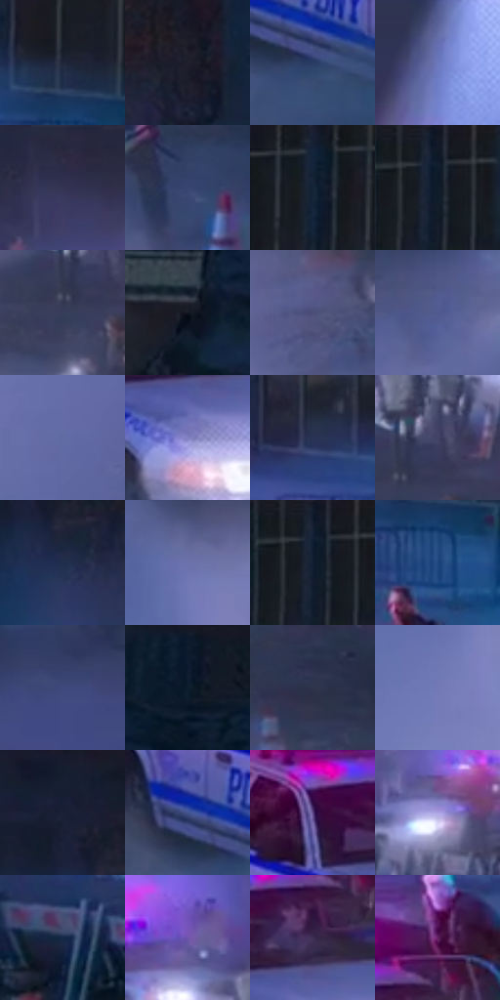

# 电影参考 662

- 状态：常规／活跃；来源世界：miles-home。
- 视角：high-angle；景别：environment-wide；场景：street。
- 时段：night-appearance（外观依据，中置信度；具体时间／晨昏未知）；光照：night-mixed。
- 材质候选：skin, hair, fabric, stone, brick, glass, asphalt, painted-metal（帧级，不是像素分割）。
- 明暗组：dark；L* P5/P50/P95：8.554 / 25.34802 / 54.00414。
- 资格门禁：无附加门禁。
- 原截图 SHA-256：`6433b5650b73ea0d904b28b73a567a84a456468f51107dcd3e7bf1233fedda88`；尺寸：2880 × 1206。
- sRGB 像素 SHA-256：`e613c02a184fe23edd47837032f798897f89f622c6b5e314ba6d72a3274b8375`。

## 观察与迁移

冷灰雾街、警灯与圆形车灯光晕，雾不等于事件粒子。

灰蓝楼体、灰紫雾与暗街面为主体面积，车灯白束及红蓝警灯只占局部高彩区域；人群、路障和残损属于此现场，不能凭配色参考向原照添加这些物体。

本公开版保存32个128×128原像素色卡上下文；图集格子并非原场景相邻位置。原rect、图集tile和像素SHA见 `data/palette-crops.json`。上下文不足时不得批准替色，不能以小样推断完整构图。

## 实测色卡

颜色比例分母为保留采样像素，不是材料面积；全部 32 色参与全库匹配。表内四舍五入仅用于阅读，原精度在 JSON。

| ID | HEX | Lab | 原图 xy | 像素数 | 比例 | 明度角色 |
| --- | --- | --- | --- | ---: | ---: | --- |
| 662-S01 | #1F263A | [15.3973, 3.200935, -13.858899] | [1772, 372] | 9148 | 4.731414% | deep-shadow |
| 662-S02 | #1F1F2D | [12.356015, 3.983095, -9.311831] | [1268, 128] | 9041 | 4.676073% | deep-shadow |
| 662-S03 | #293B63 | [25.259334, 6.065429, -25.859301] | [1404, 808] | 8883 | 4.594354% | shadow |
| 662-S04 | #5A6198 | [42.74715, 11.818302, -30.929484] | [48, 68] | 8299 | 4.292305% | midtone |
| 662-S05 | #2A2940 | [17.6827, 6.864994, -14.399382] | [500, 28] | 8203 | 4.242653% | deep-shadow |
| 662-S06 | #36446F | [29.577742, 7.556911, -26.660369] | [1144, 736] | 7800 | 4.034218% | shadow |
| 662-S07 | #13233B | [13.568004, 2.242962, -17.489918] | [1820, 32] | 7778 | 4.022840% | deep-shadow |
| 662-S08 | #101927 | [8.583619, 0.878275, -10.853057] | [1580, 28] | 7539 | 3.899227% | deep-shadow |
| 662-S09 | #353D5A | [26.251563, 4.999712, -18.400081] | [336, 508] | 7419 | 3.837162% | shadow |
| 662-S10 | #111620 | [7.201377, 0.857778, -7.717092] | [2260, 264] | 7313 | 3.782338% | deep-shadow |
| 662-S11 | #4C4E78 | [34.68314, 10.224135, -24.171191] | [436, 736] | 7203 | 3.725446% | shadow |
| 662-S12 | #525A8E | [39.678846, 10.95255, -29.784634] | [808, 792] | 7142 | 3.693896% | shadow |
| 662-S13 | #616BA3 | [46.578739, 10.844735, -31.401111] | [576, 1096] | 6848 | 3.541837% | midtone |
| 662-S14 | #7E7EC0 | [55.238929, 15.736962, -34.479091] | [1596, 756] | 6834 | 3.534596% | midtone |
| 662-S15 | #283353 | [21.737449, 5.558677, -20.929331] | [1612, 372] | 6733 | 3.482358% | shadow |
| 662-S16 | #404164 | [28.877484, 8.956675, -20.698116] | [376, 452] | 6373 | 3.296163% | shadow |
| 662-S17 | #202E4D | [19.210385, 4.679448, -20.931059] | [1080, 164] | 5998 | 3.102211% | deep-shadow |
| 662-S18 | #6C72AB | [49.692222, 11.989914, -31.152437] | [204, 624] | 5993 | 3.099625% | midtone |
| 662-S19 | #142135 | [12.565755, 1.578545, -14.807568] | [1572, 32] | 5713 | 2.954806% | deep-shadow |
| 662-S20 | #1F4680 | [29.983801, 7.822217, -36.76083] | [1792, 468] | 5510 | 2.849813% | shadow |
| 662-S21 | #3F497C | [32.42836, 11.008865, -30.272996] | [1516, 1068] | 5201 | 2.689996% | shadow |
| 662-S22 | #0D1B2E | [9.534279, 1.325975, -14.544744] | [2492, 28] | 5051 | 2.612415% | deep-shadow |
| 662-S23 | #2F344C | [22.238283, 4.701965, -15.438399] | [492, 588] | 4974 | 2.572590% | shadow |
| 662-S24 | #7379B5 | [52.569604, 12.572132, -32.408733] | [180, 868] | 4973 | 2.572073% | midtone |
| 662-S25 | #141E2F | [11.151936, 1.477515, -12.703171] | [1036, 28] | 4752 | 2.457770% | deep-shadow |
| 662-S26 | #43538D | [36.559588, 11.162983, -34.170588] | [1352, 760] | 4124 | 2.132964% | shadow |
| 662-S27 | #5F4888 | [35.684116, 24.373861, -32.350659] | [1476, 648] | 3679 | 1.902806% | shadow |
| 662-S28 | #ADA3E3 | [69.911536, 17.041464, -30.956957] | [472, 368] | 3498 | 1.809192% | light |
| 662-S29 | #142947 | [16.450859, 3.013411, -21.26288] | [1092, 532] | 3357 | 1.736266% | deep-shadow |
| 662-S30 | #6E55AC | [42.445137, 30.470802, -43.167284] | [268, 340] | 3271 | 1.691786% | midtone |
| 662-S31 | #3E2C51 | [21.65144, 16.860343, -19.58453] | [1620, 664] | 2623 | 1.356635% | shadow |
| 662-S32 | #642266 | [26.195567, 39.284518, -25.888945] | [1656, 564] | 2073 | 1.072171% | shadow |

## 色阶与空间分布

- 采样 ROI：`[0.01, 0.02, 0.98, 0.94]`；步长：4；样本数：193346。
- 排除区：`[]`。
- 深暗、暗、中、亮、高光五段计数：`[73942, 77065, 39242, 2615, 482]`。
- RGB 各 256 箱、L* 100 箱、13×5 色相明度表和 3×3 空间统计全部保存在 [总数据](../film-library.json)。
- [可视化档案](../../references/library.html)按需绘制直方图，不存 2,094 张重复图表图片。

## 纹理特征占比

**这是分块图像特征的面积占比，不是波点／排线／丝网／错版的精确语义覆盖率。** 窗格、发丝、织物也会产生方向或周期特征。
原图 ROI 像素 3098546；已测块覆盖 3098546（100.0000%）；未测 0。

| 特征 | 块覆盖像素 | 占已测面积 | 阈值敏感范围 |
| --- | ---: | ---: | --- |
| low-contrast | 198912 | 6.4195% | 2.9908% ~ 10.2902% |
| directional-structure | 317362 | 10.2423% | 2.1151% ~ 20.4623% |
| periodic-structure | 2423936 | 78.2282% | 73.5519% ~ 78.2282% |
| mixed-detail | 158336 | 5.1100% | 2.9950% ~ 9.4269% |

阈值敏感范围不是统计置信区间。逐块坐标、尺度、对比、方向一致性、频谱集中度、频率与角度见 [全量特征记录](../texture-features.jsonl)，以帧号定位。
四种印刷层的真实像素覆盖仍标为 `null`，不能填 0，也不能拿上表代替。不得据这些代理测量删除唯一证据。

[测量方法与保留策略](../../references/library-retention.md) · [分类索引](../archive/README.md)
