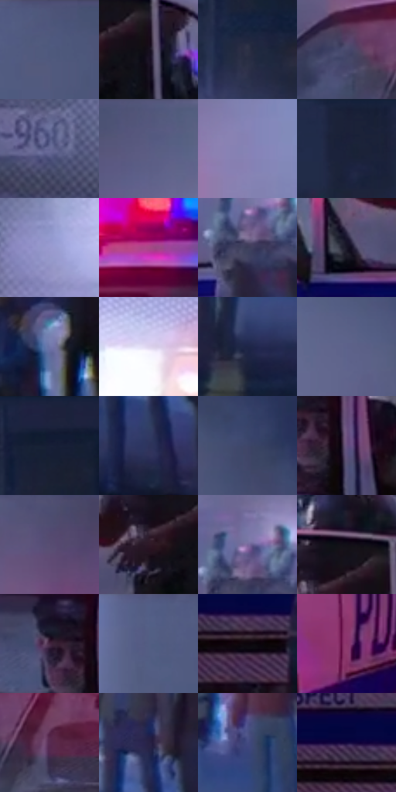

# 电影参考 663

- 状态：常规／活跃；来源世界：miles-home。
- 视角：near-level；景别：environment-wide；场景：street。
- 时段：night-appearance（外观依据，中置信度；具体时间／晨昏未知）；光照：night-mixed。
- 材质候选：skin, hair, fabric, stone, brick, glass, asphalt, painted-metal（帧级，不是像素分割）。
- 明暗组：dark；L* P5/P50/P95：4.73129 / 32.73456 / 64.9715。
- 资格门禁：无附加门禁。
- 原截图 SHA-256：`ef28428112bac527a114ababaff858d860efec8ebf67dce9de420901083e8fb0`；尺寸：2880 × 1214。
- sRGB 像素 SHA-256：`5a80733b0624a3a02000e7aa28bf9f752b0ef1ea6f92ce091a5af93398b262f7`。

## 观察与迁移

冷灰雾街、警灯与圆形车灯光晕，雾不等于事件粒子。

白车身侧面受粉红灯光，白青车灯有近圆网点光晕，挡风玻璃内景与表面亮映分开；人群退后，既有双黄线保留但不作为新增道路标线模板。

本公开版保存32个128×128原像素色卡上下文；图集格子并非原场景相邻位置。原rect、图集tile和像素SHA见 `data/palette-crops.json`。上下文不足时不得批准替色，不能以小样推断完整构图。

## 实测色卡

颜色比例分母为保留采样像素，不是材料面积；全部 32 色参与全库匹配。表内四舍五入仅用于阅读，原精度在 JSON。

| ID | HEX | Lab | 原图 xy | 像素数 | 比例 | 明度角色 |
| --- | --- | --- | --- | ---: | ---: | --- |
| 663-S01 | #4D567B | [37.2306, 6.302563, -22.052099] | [288, 28] | 9682 | 4.971706% | shadow |
| 663-S02 | #16101E | [5.734898, 6.021734, -8.365468] | [1780, 512] | 8812 | 4.524961% | deep-shadow |
| 663-S03 | #2C3045 | [20.357249, 4.223256, -13.658192] | [2652, 200] | 8572 | 4.401721% | shadow |
| 663-S04 | #494A6D | [32.739891, 8.632476, -20.341723] | [780, 484] | 8528 | 4.379127% | shadow |
| 663-S05 | #656794 | [45.088058, 10.215319, -24.829374] | [440, 1020] | 8433 | 4.330345% | midtone |
| 663-S06 | #555980 | [38.957309, 8.344213, -22.387992] | [1332, 52] | 8230 | 4.226104% | shadow |
| 663-S07 | #8583B5 | [56.638912, 12.003326, -25.982197] | [1436, 264] | 7491 | 3.846628% | midtone |
| 663-S08 | #1B2138 | [13.267528, 4.846583, -15.803769] | [2440, 28] | 7228 | 3.711577% | deep-shadow |
| 663-S09 | #989ACE | [65.154093, 10.755934, -26.83072] | [596, 912] | 7057 | 3.623769% | light |
| 663-S10 | #A84B87 | [45.781769, 45.447512, -15.320786] | [1060, 388] | 6928 | 3.557527% | midtone |
| 663-S11 | #3D3D5A | [26.926494, 7.637842, -17.299283] | [1984, 572] | 6849 | 3.516961% | shadow |
| 663-S12 | #171626 | [8.092154, 5.349039, -10.823684] | [1572, 572] | 6752 | 3.467151% | deep-shadow |
| 663-S13 | #6E75A9 | [50.571548, 10.203477, -28.607241] | [2588, 592] | 6661 | 3.420423% | midtone |
| 663-S14 | #DDD4ED | [86.292374, 7.684074, -11.134309] | [936, 764] | 6603 | 3.390640% | highlight |
| 663-S15 | #1E2547 | [15.767654, 8.398408, -22.308268] | [2348, 748] | 6581 | 3.379343% | deep-shadow |
| 663-S16 | #5C618B | [42.289727, 8.637633, -23.842137] | [1948, 192] | 6232 | 3.200131% | midtone |
| 663-S17 | #121B33 | [10.19372, 4.760126, -17.119401] | [2668, 56] | 5982 | 3.071756% | deep-shadow |
| 663-S18 | #2D335B | [22.586105, 9.796692, -24.854737] | [2748, 740] | 5763 | 2.959300% | shadow |
| 663-S19 | #3E4569 | [30.156975, 7.217953, -21.903821] | [2120, 192] | 5692 | 2.922842% | shadow |
| 663-S20 | #685180 | [38.527198, 19.553405, -22.91865] | [1316, 544] | 5570 | 2.860195% | shadow |
| 663-S21 | #574D72 | [35.100553, 12.758603, -19.712826] | [992, 68] | 5426 | 2.786251% | shadow |
| 663-S22 | #2D1827 | [11.673373, 13.373005, -5.815669] | [1692, 520] | 5351 | 2.747738% | deep-shadow |
| 663-S23 | #78679C | [47.097084, 18.290627, -26.324178] | [1992, 520] | 5135 | 2.636822% | midtone |
| 663-S24 | #100E18 | [4.427701, 2.852989, -5.672565] | [1728, 448] | 4988 | 2.561338% | deep-shadow |
| 663-S25 | #442742 | [20.335842, 18.629994, -11.41991] | [1248, 504] | 4717 | 2.422179% | shadow |
| 663-S26 | #535E86 | [40.516338, 6.329024, -23.629871] | [184, 28] | 4683 | 2.404720% | midtone |
| 663-S27 | #0D060C | [2.189302, 2.748259, -1.644052] | [1780, 876] | 4344 | 2.230644% | deep-shadow |
| 663-S28 | #8A346A | [35.793146, 42.75245, -13.05972] | [1396, 796] | 4157 | 2.134619% | shadow |
| 663-S29 | #582B52 | [24.989211, 26.856254, -14.786812] | [896, 512] | 3824 | 1.963624% | shadow |
| 663-S30 | #282245 | [15.616568, 12.832471, -21.11361] | [2752, 608] | 3517 | 1.805979% | deep-shadow |
| 663-S31 | #434A82 | [33.354371, 13.386346, -32.507701] | [2408, 624] | 2941 | 1.510203% | shadow |
| 663-S32 | #13073E | [5.76385, 23.057898, -32.210074] | [1716, 836] | 2013 | 1.033675% | deep-shadow |

## 色阶与空间分布

- 采样 ROI：`[0.01, 0.02, 0.98, 0.94]`；步长：4；样本数：194742。
- 排除区：`[]`。
- 深暗、暗、中、亮、高光五段计数：`[62999, 70985, 47269, 8923, 4566]`。
- RGB 各 256 箱、L* 100 箱、13×5 色相明度表和 3×3 空间统计全部保存在 [总数据](../film-library.json)。
- [可视化档案](../../references/library.html)按需绘制直方图，不存 2,094 张重复图表图片。

## 纹理特征占比

**这是分块图像特征的面积占比，不是波点／排线／丝网／错版的精确语义覆盖率。** 窗格、发丝、织物也会产生方向或周期特征。
原图 ROI 像素 3120898；已测块覆盖 3120898（100.0000%）；未测 0。

| 特征 | 块覆盖像素 | 占已测面积 | 阈值敏感范围 |
| --- | ---: | ---: | --- |
| low-contrast | 315138 | 10.0977% | 5.6600% ~ 14.8799% |
| directional-structure | 516736 | 16.5573% | 4.2941% ~ 28.4021% |
| periodic-structure | 2190720 | 70.1952% | 65.9379% ~ 71.5199% |
| mixed-detail | 98304 | 3.1499% | 0.0000% ~ 9.3060% |

阈值敏感范围不是统计置信区间。逐块坐标、尺度、对比、方向一致性、频谱集中度、频率与角度见 [全量特征记录](../texture-features.jsonl)，以帧号定位。
四种印刷层的真实像素覆盖仍标为 `null`，不能填 0，也不能拿上表代替。不得据这些代理测量删除唯一证据。

[测量方法与保留策略](../../references/library-retention.md) · [分类索引](../archive/README.md)
