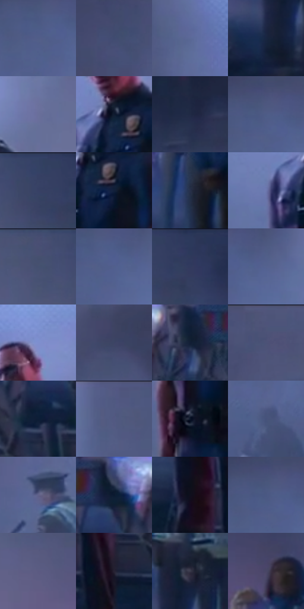

# 电影参考 664

- 状态：常规／活跃；来源世界：miles-home。
- 视角：near-level；景别：environment-wide；场景：street。
- 时段：night-appearance（外观依据，中置信度；具体时间／晨昏未知）；光照：night-mixed。
- 材质候选：skin, hair, fabric, stone, brick, glass, asphalt, painted-metal（帧级，不是像素分割）。
- 明暗组：dark；L* P5/P50/P95：8.14331 / 32.66174 / 51.28824。
- 资格门禁：无附加门禁。
- 原截图 SHA-256：`c575c20e29a0aebb09b1ef57eefef9a8e2a2b6606e4c13c46f52fa8426c47d92`；尺寸：2880 × 1208。
- sRGB 像素 SHA-256：`0f2372be9fc0116963355cd73da83e9e950fe300c6179cdabbd4fe5398997078`。

## 观察与迁移

冷灰雾街、警灯与圆形车灯光晕，雾不等于事件粒子。

深色制服人物由大面积灰蓝雾衬出，不需要全身霓虹轮廓；粗糙近地、远处手灯剪影和递减对比的路障分层，低对比不等于删除背景人群。

本公开版保存32个128×128原像素色卡上下文；图集格子并非原场景相邻位置。原rect、图集tile和像素SHA见 `data/palette-crops.json`。上下文不足时不得批准替色，不能以小样推断完整构图。

## 实测色卡

颜色比例分母为保留采样像素，不是材料面积；全部 32 色参与全库匹配。表内四舍五入仅用于阅读，原精度在 JSON。

| ID | HEX | Lab | 原图 xy | 像素数 | 比例 | 明度角色 |
| --- | --- | --- | --- | ---: | ---: | --- |
| 664-S01 | #505D88 | [40.099607, 6.666931, -25.506711] | [1396, 332] | 8933 | 4.620215% | midtone |
| 664-S02 | #404B70 | [32.461677, 6.085397, -22.715115] | [1468, 140] | 8230 | 4.256618% | shadow |
| 664-S03 | #5B6998 | [45.072328, 7.146489, -27.288736] | [92, 192] | 7839 | 4.054390% | midtone |
| 664-S04 | #182540 | [14.884465, 4.06604, -18.891841] | [2432, 728] | 7771 | 4.019219% | deep-shadow |
| 664-S05 | #696F9B | [47.928263, 8.485376, -24.546722] | [1940, 248] | 7638 | 3.950431% | midtone |
| 664-S06 | #101B30 | [9.855319, 2.970304, -15.485634] | [1772, 328] | 7528 | 3.893538% | deep-shadow |
| 664-S07 | #202A45 | [17.425306, 4.570978, -18.303058] | [2736, 184] | 7511 | 3.884745% | deep-shadow |
| 664-S08 | #4D5B86 | [39.208377, 6.453751, -25.699306] | [1408, 296] | 7012 | 3.626659% | shadow |
| 664-S09 | #364165 | [28.125196, 6.196849, -22.57394] | [2324, 36] | 6932 | 3.585282% | shadow |
| 664-S10 | #12203A | [12.39648, 3.830871, -18.640232] | [1812, 376] | 6907 | 3.572352% | deep-shadow |
| 664-S11 | #27304A | [20.201264, 4.211482, -17.315221] | [2692, 688] | 6531 | 3.377882% | shadow |
| 664-S12 | #6D78AE | [51.541017, 9.507541, -30.004755] | [1684, 380] | 6529 | 3.376848% | midtone |
| 664-S13 | #494F73 | [34.489771, 7.162501, -21.380319] | [2208, 32] | 6328 | 3.272889% | shadow |
| 664-S14 | #515F8C | [40.939049, 6.911259, -26.60952] | [1436, 336] | 6306 | 3.261510% | midtone |
| 664-S15 | #2C395B | [24.375439, 5.355566, -22.035951] | [2404, 28] | 6301 | 3.258924% | shadow |
| 664-S16 | #54628F | [42.158321, 6.799876, -26.496622] | [1488, 328] | 6266 | 3.240822% | midtone |
| 664-S17 | #7F8FCF | [60.480752, 10.141601, -34.771285] | [1800, 192] | 6015 | 3.111003% | light |
| 664-S18 | #3D4464 | [29.528598, 6.009935, -19.702749] | [1084, 196] | 5872 | 3.037042% | shadow |
| 664-S19 | #121E35 | [11.373509, 3.279925, -16.693477] | [2128, 656] | 5859 | 3.030319% | deep-shadow |
| 664-S20 | #4E547A | [36.67789, 7.588137, -22.288627] | [1008, 28] | 5775 | 2.986873% | shadow |
| 664-S21 | #0D1D36 | [10.780505, 3.242622, -18.370294] | [1968, 772] | 5752 | 2.974978% | deep-shadow |
| 664-S22 | #505981 | [38.611566, 7.092443, -23.566231] | [424, 28] | 5695 | 2.945497% | shadow |
| 664-S23 | #0C172A | [7.750627, 2.448465, -14.411815] | [1748, 544] | 5486 | 2.837400% | deep-shadow |
| 664-S24 | #45527B | [35.457843, 6.477453, -24.858681] | [996, 512] | 5029 | 2.601036% | shadow |
| 664-S25 | #60628B | [42.892216, 9.267014, -22.882876] | [136, 456] | 4924 | 2.546730% | midtone |
| 664-S26 | #0A1930 | [8.765166, 3.036323, -17.236519] | [2008, 652] | 4586 | 2.371914% | deep-shadow |
| 664-S27 | #0F0F1D | [4.804528, 3.439797, -9.050445] | [1760, 832] | 4540 | 2.348122% | deep-shadow |
| 664-S28 | #4A5883 | [37.973806, 6.571475, -25.815038] | [1396, 300] | 4516 | 2.335709% | shadow |
| 664-S29 | #5B5A82 | [39.828335, 10.182557, -22.217881] | [2368, 336] | 4250 | 2.198132% | shadow |
| 664-S30 | #272233 | [14.481361, 6.793372, -10.274918] | [1868, 884] | 3862 | 1.997455% | deep-shadow |
| 664-S31 | #39394A | [24.609274, 4.30271, -10.38478] | [2480, 624] | 3713 | 1.920391% | shadow |
| 664-S32 | #4A4666 | [31.336294, 9.578196, -18.084872] | [2716, 380] | 2910 | 1.505074% | shadow |

## 色阶与空间分布

- 采样 ROI：`[0.01, 0.02, 0.98, 0.94]`；步长：4；样本数：193346。
- 排除区：`[]`。
- 深暗、暗、中、亮、高光五段计数：`[62665, 77931, 49739, 3003, 8]`。
- RGB 各 256 箱、L* 100 箱、13×5 色相明度表和 3×3 空间统计全部保存在 [总数据](../film-library.json)。
- [可视化档案](../../references/library.html)按需绘制直方图，不存 2,094 张重复图表图片。

## 纹理特征占比

**这是分块图像特征的面积占比，不是波点／排线／丝网／错版的精确语义覆盖率。** 窗格、发丝、织物也会产生方向或周期特征。
原图 ROI 像素 3104134；已测块覆盖 3104134（100.0000%）；未测 0。

| 特征 | 块覆盖像素 | 占已测面积 | 阈值敏感范围 |
| --- | ---: | ---: | --- |
| low-contrast | 487552 | 15.7065% | 7.3894% ~ 24.3991% |
| directional-structure | 222592 | 7.1708% | 0.9649% ~ 24.2713% |
| periodic-structure | 2295686 | 73.9558% | 66.2281% ~ 73.9558% |
| mixed-detail | 98304 | 3.1669% | 2.1112% ~ 6.6925% |

阈值敏感范围不是统计置信区间。逐块坐标、尺度、对比、方向一致性、频谱集中度、频率与角度见 [全量特征记录](../texture-features.jsonl)，以帧号定位。
四种印刷层的真实像素覆盖仍标为 `null`，不能填 0，也不能拿上表代替。不得据这些代理测量删除唯一证据。

[测量方法与保留策略](../../references/library-retention.md) · [分类索引](../archive/README.md)
