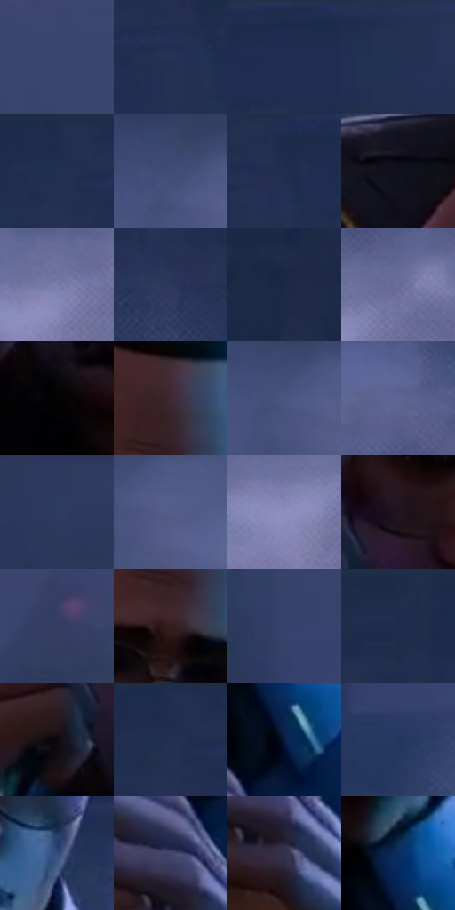

# 电影参考 665

- 状态：常规／活跃；来源世界：miles-home。
- 视角：near-level；景别：medium；场景：street。
- 时段：night-appearance（外观依据，中置信度；具体时间／晨昏未知）；光照：night-mixed。
- 材质候选：skin, hair, fabric, stone, brick, glass, asphalt, painted-metal（帧级，不是像素分割）。
- 明暗组：dark；L* P5/P50/P95：3.15329 / 21.65137 / 52.42358。
- 资格门禁：无附加门禁。
- 原截图 SHA-256：`2a3b3aab58035bd0fc83915bffbe7aa5616bc0631b4cdb375872ec55b5bece0a`；尺寸：2880 × 1204。
- sRGB 像素 SHA-256：`772271df00a9051d0d9d1a236d538ce5bc1d39f9df09d38957c6635d581471b5`。

## 观察与迁移

冷灰雾街、警灯与圆形车灯光晕，雾不等于事件粒子。

脸中央保留棕暖基础，侧面受蓝光，深背心、蓝制服与黄徽章颜色角色分开；镜片有暗色与反光但眼睛可读，皮肤排线不覆盖所有亮面。

本公开版保存32个128×128原像素色卡上下文；图集格子并非原场景相邻位置。原rect、图集tile和像素SHA见 `data/palette-crops.json`。上下文不足时不得批准替色，不能以小样推断完整构图。

## 实测色卡

颜色比例分母为保留采样像素，不是材料面积；全部 32 色参与全库匹配。表内四舍五入仅用于阅读，原精度在 JSON。

| ID | HEX | Lab | 原图 xy | 像素数 | 比例 | 明度角色 |
| --- | --- | --- | --- | ---: | ---: | --- |
| 665-S01 | #3A456F | [30.164514, 7.98258, -25.716787] | [2304, 116] | 13980 | 7.256758% | shadow |
| 665-S02 | #253355 | [21.640417, 5.45149, -22.424802] | [1116, 96] | 10008 | 5.194967% | shadow |
| 665-S03 | #202F50 | [19.716675, 5.102231, -22.149745] | [1248, 36] | 9838 | 5.106723% | deep-shadow |
| 665-S04 | #233051 | [20.302581, 5.555558, -21.880804] | [1432, 28] | 9459 | 4.909991% | shadow |
| 665-S05 | #1F2D4D | [18.815729, 5.131174, -21.558908] | [1004, 28] | 8648 | 4.489016% | deep-shadow |
| 665-S06 | #414C76 | [33.13605, 7.631716, -25.409913] | [2656, 420] | 7860 | 4.079980% | shadow |
| 665-S07 | #212F50 | [19.78288, 5.361528, -22.040763] | [1152, 68] | 7080 | 3.675097% | deep-shadow |
| 665-S08 | #0F111C | [5.295744, 2.037652, -7.535877] | [768, 764] | 7008 | 3.637723% | deep-shadow |
| 665-S09 | #797BA8 | [53.012226, 9.684815, -24.17997] | [2480, 752] | 6994 | 3.630456% | midtone |
| 665-S10 | #2C375A | [23.690421, 6.383463, -22.458583] | [496, 616] | 6970 | 3.617998% | shadow |
| 665-S11 | #1D2844 | [16.483811, 4.782107, -19.113501] | [220, 244] | 6624 | 3.438395% | deep-shadow |
| 665-S12 | #6B6E99 | [47.722574, 9.169034, -23.673621] | [2532, 724] | 6513 | 3.380777% | midtone |
| 665-S13 | #040305 | [0.920403, 0.539535, -0.66461] | [1128, 712] | 6509 | 3.378701% | deep-shadow |
| 665-S14 | #3E2831 | [19.071252, 11.942203, -1.664514] | [1272, 324] | 6311 | 3.275923% | deep-shadow |
| 665-S15 | #4A5580 | [36.949742, 7.553783, -25.578848] | [2664, 448] | 6280 | 3.259831% | shadow |
| 665-S16 | #5E6795 | [44.588534, 8.376786, -26.242624] | [2476, 596] | 6274 | 3.256717% | midtone |
| 665-S17 | #2D3B60 | [25.351432, 6.01785, -23.752434] | [1748, 48] | 6273 | 3.256198% | shadow |
| 665-S18 | #555E89 | [40.803527, 7.807201, -24.987414] | [2720, 468] | 6003 | 3.116046% | midtone |
| 665-S19 | #8C8EBD | [60.422321, 9.774776, -24.654721] | [2440, 788] | 5722 | 2.970184% | light |
| 665-S20 | #1E151D | [8.138643, 6.432286, -3.880844] | [1136, 536] | 5671 | 2.943711% | deep-shadow |
| 665-S21 | #343E62 | [26.896057, 6.634617, -22.582824] | [2700, 264] | 5401 | 2.803559% | shadow |
| 665-S22 | #351E21 | [14.374623, 11.721033, 2.691093] | [1260, 436] | 5251 | 2.725697% | deep-shadow |
| 665-S23 | #35426B | [28.680252, 7.261295, -25.540185] | [2124, 224] | 4985 | 2.587621% | shadow |
| 665-S24 | #1E2C4A | [18.239261, 4.442207, -20.442077] | [724, 36] | 4691 | 2.435011% | deep-shadow |
| 665-S25 | #0D090F | [2.849274, 2.050685, -2.157083] | [1052, 624] | 4208 | 2.184295% | deep-shadow |
| 665-S26 | #222F4F | [19.791355, 5.253077, -21.35148] | [1012, 28] | 4197 | 2.178585% | deep-shadow |
| 665-S27 | #091D40 | [11.322841, 7.002067, -24.62347] | [1296, 888] | 3408 | 1.769030% | deep-shadow |
| 665-S28 | #25375F | [23.510579, 6.378615, -26.045804] | [2184, 560] | 2771 | 1.438375% | shadow |
| 665-S29 | #324E7E | [33.205539, 5.226262, -30.339084] | [1360, 612] | 2227 | 1.155994% | shadow |
| 665-S30 | #414567 | [30.300827, 7.540495, -20.389469] | [1224, 992] | 1990 | 1.032972% | shadow |
| 665-S31 | #32314A | [21.46508, 7.191596, -15.275555] | [1248, 1068] | 1801 | 0.934866% | shadow |
| 665-S32 | #0A2C60 | [18.842826, 10.186858, -34.247656] | [1284, 800] | 1693 | 0.878805% | deep-shadow |

## 色阶与空间分布

- 采样 ROI：`[0.01, 0.02, 0.98, 0.94]`；步长：4；样本数：192648。
- 排除区：`[]`。
- 深暗、暗、中、亮、高光五段计数：`[74926, 87688, 28302, 1628, 104]`。
- RGB 各 256 箱、L* 100 箱、13×5 色相明度表和 3×3 空间统计全部保存在 [总数据](../film-library.json)。
- [可视化档案](../../references/library.html)按需绘制直方图，不存 2,094 张重复图表图片。

## 纹理特征占比

**这是分块图像特征的面积占比，不是波点／排线／丝网／错版的精确语义覆盖率。** 窗格、发丝、织物也会产生方向或周期特征。
原图 ROI 像素 3092958；已测块覆盖 3092958（100.0000%）；未测 0。

| 特征 | 块覆盖像素 | 占已测面积 | 阈值敏感范围 |
| --- | ---: | ---: | --- |
| low-contrast | 1067008 | 34.4980% | 30.7899% ~ 37.5852% |
| directional-structure | 299776 | 9.6922% | 5.8269% ~ 14.9604% |
| periodic-structure | 1595102 | 51.5721% | 47.8527% ~ 52.1307% |
| mixed-detail | 131072 | 4.2378% | 2.1189% ~ 8.7351% |

阈值敏感范围不是统计置信区间。逐块坐标、尺度、对比、方向一致性、频谱集中度、频率与角度见 [全量特征记录](../texture-features.jsonl)，以帧号定位。
四种印刷层的真实像素覆盖仍标为 `null`，不能填 0，也不能拿上表代替。不得据这些代理测量删除唯一证据。

[测量方法与保留策略](../../references/library-retention.md) · [分类索引](../archive/README.md)
