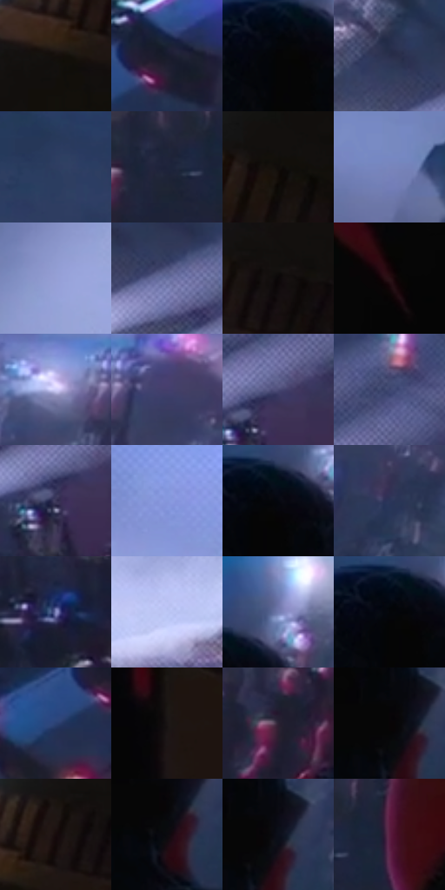

# 电影参考 666

- 状态：常规／活跃；来源世界：miles-home。
- 视角：high-angle；景别：environment-wide；场景：street。
- 时段：night-appearance（外观依据，中置信度；具体时间／晨昏未知）；光照：night-mixed。
- 材质候选：skin, hair, fabric, stone, brick, glass, asphalt, painted-metal（帧级，不是像素分割）。
- 明暗组：dark；L* P5/P50/P95：1.52811 / 20.35027 / 69.38286。
- 资格门禁：无附加门禁。
- 原截图 SHA-256：`422927a72b86a9ffcf6d3c8dfdebb39371b2e9224b7f88e250bbdcea70a8d42d`；尺寸：2880 × 1216。
- sRGB 像素 SHA-256：`3e41ffd7514854d0f72148d74f507a77f57a7a013e51c02fc3a0db12a0d4b575`。

## 观察与迁移

冷灰雾街、警灯与圆形车灯光晕，雾不等于事件粒子。

近处黑红背影与棕色砌体边缘都偏暗，远下方车灯白粉点穿透雾街；焦点不必最亮，前景体块、街面尺度与空气遮蔽共同形成深度，底黑边不学习。

本公开版保存32个128×128原像素色卡上下文；图集格子并非原场景相邻位置。原rect、图集tile和像素SHA见 `data/palette-crops.json`。上下文不足时不得批准替色，不能以小样推断完整构图。

## 实测色卡

颜色比例分母为保留采样像素，不是材料面积；全部 32 色参与全库匹配。表内四舍五入仅用于阅读，原精度在 JSON。

| ID | HEX | Lab | 原图 xy | 像素数 | 比例 | 明度角色 |
| --- | --- | --- | --- | ---: | ---: | --- |
| 666-S01 | #15100C | [5.027516, 1.306889, 2.580444] | [2656, 176] | 12510 | 6.423884% | deep-shadow |
| 666-S02 | #191B2C | [10.351697, 4.351225, -11.732961] | [312, 916] | 10881 | 5.587393% | deep-shadow |
| 666-S03 | #050505 | [1.370867, -8.7e-05, 0.000165] | [1848, 180] | 9394 | 4.823818% | deep-shadow |
| 666-S04 | #292E4C | [19.830513, 6.932654, -19.233972] | [728, 624] | 9043 | 4.643580% | deep-shadow |
| 666-S05 | #2E3D61 | [26.101598, 5.27658, -23.214817] | [1560, 184] | 8676 | 4.455125% | shadow |
| 666-S06 | #1E233B | [14.365312, 5.419516, -16.180546] | [1564, 716] | 8379 | 4.302616% | deep-shadow |
| 666-S07 | #100D0A | [3.793219, 0.543134, 1.585193] | [2560, 284] | 7879 | 4.045866% | deep-shadow |
| 666-S08 | #7985BC | [56.555038, 9.095069, -30.177463] | [1376, 116] | 7299 | 3.748036% | midtone |
| 666-S09 | #959FD5 | [66.511225, 8.767061, -28.643473] | [96, 380] | 7200 | 3.697199% | light |
| 666-S10 | #636C9C | [46.680985, 8.784657, -27.107112] | [800, 676] | 7183 | 3.688470% | midtone |
| 666-S11 | #0C0808 | [2.43319, 1.075308, 0.379195] | [2780, 100] | 6893 | 3.539555% | deep-shadow |
| 666-S12 | #291115 | [8.364113, 13.013237, 2.659726] | [1964, 776] | 6774 | 3.478448% | deep-shadow |
| 666-S13 | #9EAAE5 | [70.645633, 9.209651, -31.011107] | [2180, 36] | 6737 | 3.459449% | light |
| 666-S14 | #625490 | [39.497113, 19.977253, -31.18594] | [2292, 28] | 6312 | 3.241211% | shadow |
| 666-S15 | #4B4B76 | [33.638282, 11.261806, -24.5663] | [940, 748] | 6174 | 3.170348% | shadow |
| 666-S16 | #3D446F | [30.092619, 9.498896, -25.814425] | [988, 644] | 6152 | 3.159051% | shadow |
| 666-S17 | #3C3759 | [24.995932, 11.042321, -19.658984] | [912, 784] | 5989 | 3.075351% | shadow |
| 666-S18 | #8597DB | [63.534552, 10.43945, -36.672343] | [416, 184] | 5837 | 2.997299% | light |
| 666-S19 | #05080F | [2.171575, 0.291305, -3.20445] | [1876, 160] | 5773 | 2.964435% | deep-shadow |
| 666-S20 | #2B3559 | [22.933072, 7.137546, -23.00002] | [2316, 220] | 5464 | 2.805764% | shadow |
| 666-S21 | #868BC2 | [59.368046, 10.9627, -29.143913] | [860, 908] | 5407 | 2.776494% | midtone |
| 666-S22 | #BDC8F6 | [81.170318, 5.916672, -23.869657] | [392, 636] | 5342 | 2.743117% | highlight |
| 666-S23 | #727CB0 | [53.087492, 9.114377, -28.727143] | [1924, 96] | 5171 | 2.655308% | midtone |
| 666-S24 | #040609 | [1.587784, -0.105972, -1.31935] | [1848, 164] | 4278 | 2.196753% | deep-shadow |
| 666-S25 | #2A4173 | [28.141129, 8.138402, -31.516319] | [236, 972] | 4184 | 2.148484% | shadow |
| 666-S26 | #191414 | [6.842537, 2.347979, 0.828205] | [2220, 860] | 3992 | 2.049892% | deep-shadow |
| 666-S27 | #2D2334 | [15.528637, 8.782934, -9.317267] | [1440, 812] | 3880 | 1.992380% | deep-shadow |
| 666-S28 | #080506 | [1.565581, 0.923455, -0.101843] | [1932, 316] | 3466 | 1.779791% | deep-shadow |
| 666-S29 | #170B0C | [4.047498, 4.649552, 1.174034] | [2716, 116] | 3383 | 1.737170% | deep-shadow |
| 666-S30 | #0B0A0F | [2.91507, 1.065847, -2.076634] | [1940, 352] | 1937 | 0.994649% | deep-shadow |
| 666-S31 | #0B0E1A | [4.153145, 1.819859, -7.693071] | [1956, 312] | 1827 | 0.938164% | deep-shadow |
| 666-S32 | #5B1F41 | [22.253698, 31.493165, -7.474274] | [1652, 700] | 1326 | 0.680901% | shadow |

## 色阶与空间分布

- 采样 ROI：`[0.01, 0.02, 0.98, 0.94]`；步长：4；样本数：194742。
- 排除区：`[{"label": "approximate bottom letterbox", "rect": [0, 0.965, 1, 1]}]`。
- 深暗、暗、中、亮、高光五段计数：`[96541, 45143, 25594, 24740, 2724]`。
- RGB 各 256 箱、L* 100 箱、13×5 色相明度表和 3×3 空间统计全部保存在 [总数据](../film-library.json)。
- [可视化档案](../../references/library.html)按需绘制直方图，不存 2,094 张重复图表图片。

## 纹理特征占比

**这是分块图像特征的面积占比，不是波点／排线／丝网／错版的精确语义覆盖率。** 窗格、发丝、织物也会产生方向或周期特征。
原图 ROI 像素 3126486；已测块覆盖 3126486（100.0000%）；未测 0。

| 特征 | 块覆盖像素 | 占已测面积 | 阈值敏感范围 |
| --- | ---: | ---: | --- |
| low-contrast | 554326 | 17.7300% | 11.9369% ~ 22.7002% |
| directional-structure | 225152 | 7.2014% | 1.9611% ~ 16.6341% |
| periodic-structure | 2187392 | 69.9633% | 65.6522% ~ 69.9633% |
| mixed-detail | 159616 | 5.1053% | 3.1442% ~ 9.6865% |

阈值敏感范围不是统计置信区间。逐块坐标、尺度、对比、方向一致性、频谱集中度、频率与角度见 [全量特征记录](../texture-features.jsonl)，以帧号定位。
四种印刷层的真实像素覆盖仍标为 `null`，不能填 0，也不能拿上表代替。不得据这些代理测量删除唯一证据。

[测量方法与保留策略](../../references/library-retention.md) · [分类索引](../archive/README.md)
