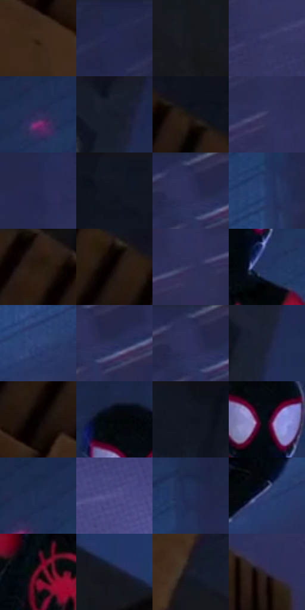

# 电影参考 667

- 状态：常规／活跃；来源世界：miles-home。
- 视角：low-angle；景别：environment-wide；场景：street。
- 时段：night-appearance（外观依据，中置信度；具体时间／晨昏未知）；光照：night-mixed。
- 材质候选：skin, hair, fabric, stone, brick, glass, asphalt, painted-metal（帧级，不是像素分割）。
- 明暗组：very-dark；L* P5/P50/P95：1.94761 / 18.80704 / 28.0155。
- 资格门禁：无附加门禁。
- 原截图 SHA-256：`ffb8a54f879f638bd16dec81bba7d3fc8bc84f642e2abc9b85698bf7b888ca5f`；尺寸：2880 × 1208。
- sRGB 像素 SHA-256：`622af1578dd5bbf0731d40c85a8ebfd4735b6b18c2f7dca876a1076803d57b95`。

## 观察与迁移

冷灰雾街、警灯与圆形车灯光晕，雾不等于事件粒子。

蹲姿人物以白眼和少量红块从黑衣中分离，棕色砖台有硬折面，蓝灰玻璃背景窗线更软；大暗空间保持安静，不把背景软线解释成任意拉歪建筑。

本公开版保存32个128×128原像素色卡上下文；图集格子并非原场景相邻位置。原rect、图集tile和像素SHA见 `data/palette-crops.json`。上下文不足时不得批准替色，不能以小样推断完整构图。

## 实测色卡

颜色比例分母为保留采样像素，不是材料面积；全部 32 色参与全库匹配。表内四舍五入仅用于阅读，原精度在 JSON。

| ID | HEX | Lab | 原图 xy | 像素数 | 比例 | 明度角色 |
| --- | --- | --- | --- | ---: | ---: | --- |
| 667-S01 | #3E2A1B | [19.053389, 7.142144, 13.464667] | [300, 316] | 14824 | 7.667084% | deep-shadow |
| 667-S02 | #1E2749 | [16.542521, 7.691914, -22.448072] | [2292, 28] | 12557 | 6.494574% | deep-shadow |
| 667-S03 | #16181D | [8.240448, 0.474772, -3.822128] | [516, 768] | 11168 | 5.776173% | deep-shadow |
| 667-S04 | #373764 | [25.150947, 12.936957, -26.611376] | [2312, 668] | 10933 | 5.654630% | shadow |
| 667-S05 | #2E2F58 | [21.27579, 11.843849, -24.946573] | [1628, 128] | 9889 | 5.114665% | shadow |
| 667-S06 | #151A29 | [9.467621, 2.590413, -10.92969] | [1008, 60] | 9757 | 5.046394% | deep-shadow |
| 667-S07 | #181515 | [7.087911, 1.408204, 0.497143] | [336, 156] | 9341 | 4.831235% | deep-shadow |
| 667-S08 | #32325C | [22.764154, 12.268544, -25.203532] | [2440, 320] | 8503 | 4.397815% | shadow |
| 667-S09 | #262A50 | [18.570708, 10.303849, -23.938944] | [2516, 76] | 7452 | 3.854230% | deep-shadow |
| 667-S10 | #101522 | [6.882545, 1.89549, -9.731931] | [592, 28] | 6539 | 3.382020% | deep-shadow |
| 667-S11 | #2C2D54 | [20.251502, 11.296576, -23.92184] | [2716, 36] | 6497 | 3.360297% | shadow |
| 667-S12 | #233967 | [24.520578, 7.599115, -29.63986] | [1852, 296] | 6372 | 3.295646% | shadow |
| 667-S13 | #2D1D15 | [12.549931, 6.586761, 8.625135] | [88, 28] | 6344 | 3.281164% | deep-shadow |
| 667-S14 | #0F0806 | [2.605016, 1.745294, 1.470093] | [216, 132] | 5929 | 3.066523% | deep-shadow |
| 667-S15 | #34335D | [23.297, 12.49823, -25.004451] | [2784, 424] | 5906 | 3.054627% | shadow |
| 667-S16 | #20325D | [21.499117, 7.993312, -27.9535] | [1452, 380] | 5876 | 3.039111% | shadow |
| 667-S17 | #304277 | [29.046571, 10.256362, -32.576687] | [1752, 600] | 5718 | 2.957392% | shadow |
| 667-S18 | #292F58 | [20.861314, 10.444957, -25.630557] | [2756, 80] | 5677 | 2.936187% | shadow |
| 667-S19 | #2E315B | [22.061618, 11.476336, -25.681487] | [2708, 44] | 4923 | 2.546212% | shadow |
| 667-S20 | #1A2035 | [12.66885, 4.165832, -14.613894] | [984, 256] | 4907 | 2.537937% | deep-shadow |
| 667-S21 | #060302 | [0.97766, 0.645402, 0.654938] | [172, 196] | 4655 | 2.407601% | deep-shadow |
| 667-S22 | #02060A | [1.490953, -0.489926, -1.88205] | [1372, 192] | 4529 | 2.342433% | deep-shadow |
| 667-S23 | #0F131D | [5.925424, 1.149959, -7.367496] | [796, 28] | 4142 | 2.142273% | deep-shadow |
| 667-S24 | #050A14 | [2.708351, 0.506445, -5.397684] | [1412, 272] | 3585 | 1.854189% | deep-shadow |
| 667-S25 | #1E2D53 | [19.127904, 7.204609, -25.103644] | [1660, 80] | 3577 | 1.850051% | deep-shadow |
| 667-S26 | #53518C | [37.145671, 16.357049, -32.557026] | [2592, 1056] | 3321 | 1.717646% | shadow |
| 667-S27 | #222D55 | [19.525691, 8.944471, -25.791681] | [1872, 132] | 3276 | 1.694372% | deep-shadow |
| 667-S28 | #303E6F | [27.354917, 10.083209, -30.206801] | [1580, 708] | 3234 | 1.672649% | shadow |
| 667-S29 | #710C2A | [23.478454, 42.951724, 10.746694] | [1320, 488] | 1745 | 0.902527% | shadow |
| 667-S30 | #161A24 | [9.293488, 1.212554, -7.480702] | [960, 852] | 860 | 0.444798% | deep-shadow |
| 667-S31 | #1C1D2B | [11.27536, 3.645936, -9.547263] | [392, 520] | 671 | 0.347046% | deep-shadow |
| 667-S32 | #342D49 | [20.392181, 10.378105, -16.253684] | [1804, 1084] | 639 | 0.330496% | shadow |

## 色阶与空间分布

- 采样 ROI：`[0.01, 0.02, 0.98, 0.94]`；步长：4；样本数：193346。
- 排除区：`[]`。
- 深暗、暗、中、亮、高光五段计数：`[111179, 81628, 434, 105, 0]`。
- RGB 各 256 箱、L* 100 箱、13×5 色相明度表和 3×3 空间统计全部保存在 [总数据](../film-library.json)。
- [可视化档案](../../references/library.html)按需绘制直方图，不存 2,094 张重复图表图片。

## 纹理特征占比

**这是分块图像特征的面积占比，不是波点／排线／丝网／错版的精确语义覆盖率。** 窗格、发丝、织物也会产生方向或周期特征。
原图 ROI 像素 3104134；已测块覆盖 3104134（100.0000%）；未测 0。

| 特征 | 块覆盖像素 | 占已测面积 | 阈值敏感范围 |
| --- | ---: | ---: | --- |
| low-contrast | 1238400 | 39.8952% | 33.0336% ~ 47.2145% |
| directional-structure | 639488 | 20.6012% | 10.1274% ~ 30.1100% |
| periodic-structure | 1165958 | 37.5615% | 36.8563% ~ 39.6230% |
| mixed-detail | 60288 | 1.9422% | 0.0000% ~ 3.0351% |

阈值敏感范围不是统计置信区间。逐块坐标、尺度、对比、方向一致性、频谱集中度、频率与角度见 [全量特征记录](../texture-features.jsonl)，以帧号定位。
四种印刷层的真实像素覆盖仍标为 `null`，不能填 0，也不能拿上表代替。不得据这些代理测量删除唯一证据。

[测量方法与保留策略](../../references/library-retention.md) · [分类索引](../archive/README.md)
