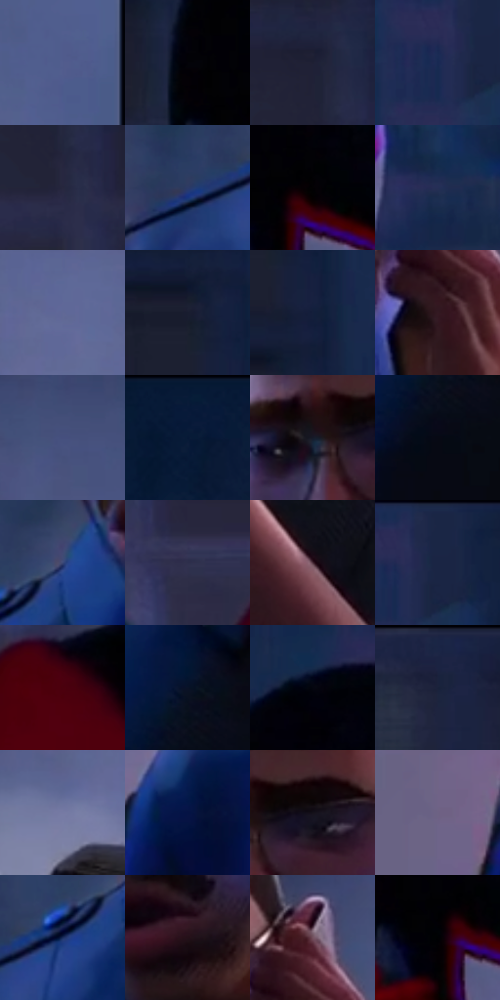

# 电影参考 668

- 状态：条件／活跃；来源世界：miles-home。
- 视角：mixed-panels；景别：graphic-or-multipanel；场景：portrait。
- 时段：night-appearance（外观依据，中置信度；具体时间／晨昏未知）；光照：night-mixed。
- 材质候选：skin, fabric, glass, brick（帧级，不是像素分割）。
- 明暗组：very-dark；L* P5/P50/P95：0.42795 / 14.50109 / 44.94983。
- 资格门禁：panel。
- 原截图 SHA-256：`52308d4abe7c1588eac0d2badf2af1dd32a6ca6303bf320fefff3320cd189515`；尺寸：2880 × 1206。
- sRGB 像素 SHA-256：`95accd6b60f4861bab362fbeac821b371a2d8a0a3ecdb32fcc4411d5f39ae387`。

## 观察与迁移

电话对话双画面，人物肤色与服装黑红各有层级。

左格棕暖脸和蓝制服对灰雾，右格黑红面罩对白眼和蓝楼；中间黑沟是分镜边界，不是同一连续空间，也不是镜中人物。只借两格各自光色，不默认分镜。

本公开版保存32个128×128原像素色卡上下文；图集格子并非原场景相邻位置。原rect、图集tile和像素SHA见 `data/palette-crops.json`。上下文不足时不得批准替色，不能以小样推断完整构图。

## 实测色卡

颜色比例分母为保留采样像素，不是材料面积；全部 32 色参与全库匹配。表内四舍五入仅用于阅读，原精度在 JSON。

| ID | HEX | Lab | 原图 xy | 像素数 | 比例 | 明度角色 |
| --- | --- | --- | --- | ---: | ---: | --- |
| 668-S01 | #515C8E | [40.173603, 9.407694, -29.013507] | [1368, 464] | 10549 | 5.543382% | midtone |
| 668-S02 | #030208 | [0.725377, 1.095727, -2.178337] | [2216, 436] | 9004 | 4.731501% | deep-shadow |
| 668-S03 | #1E2033 | [12.909959, 4.833543, -12.78114] | [1636, 548] | 8524 | 4.479267% | deep-shadow |
| 668-S04 | #172953 | [17.424237, 8.622474, -27.850313] | [2680, 84] | 8194 | 4.305856% | deep-shadow |
| 668-S05 | #27273E | [16.651158, 6.587437, -14.642489] | [1652, 644] | 8178 | 4.297448% | deep-shadow |
| 668-S06 | #2C3B67 | [25.690242, 8.268489, -27.746261] | [344, 676] | 8143 | 4.279056% | shadow |
| 668-S07 | #020102 | [0.352269, 0.400526, -0.286252] | [2312, 480] | 8120 | 4.266969% | deep-shadow |
| 668-S08 | #252F56 | [20.43202, 8.651728, -25.003029] | [2692, 568] | 7976 | 4.191299% | shadow |
| 668-S09 | #616896 | [45.141822, 8.940136, -25.959433] | [1064, 396] | 7962 | 4.183942% | midtone |
| 668-S10 | #181D2F | [11.121334, 3.553181, -12.727105] | [2160, 76] | 7273 | 3.821880% | deep-shadow |
| 668-S11 | #141F3B | [12.249621, 5.506316, -19.573991] | [2208, 164] | 7130 | 3.746735% | deep-shadow |
| 668-S12 | #341922 | [12.866212, 14.814428, -0.240237] | [800, 416] | 6953 | 3.653724% | deep-shadow |
| 668-S13 | #454F7E | [34.72771, 9.366564, -27.857103] | [1144, 128] | 6472 | 3.400964% | shadow |
| 668-S14 | #0A1B38 | [10.05955, 5.082156, -20.964811] | [412, 28] | 6305 | 3.313207% | deep-shadow |
| 668-S15 | #151A29 | [9.467621, 2.590413, -10.92969] | [572, 364] | 6039 | 3.173427% | deep-shadow |
| 668-S16 | #070914 | [2.628891, 1.430004, -5.499725] | [552, 896] | 5966 | 3.135066% | deep-shadow |
| 668-S17 | #394676 | [30.777936, 9.403414, -29.162713] | [512, 592] | 5558 | 2.920667% | shadow |
| 668-S18 | #2E2F4C | [20.578709, 7.839823, -18.030182] | [1908, 844] | 5419 | 2.847624% | shadow |
| 668-S19 | #4B2E39 | [22.811633, 15.146671, -1.452225] | [1008, 784] | 5365 | 2.819248% | shadow |
| 668-S20 | #1A2645 | [15.671524, 5.824788, -21.101444] | [2724, 28] | 5126 | 2.693656% | deep-shadow |
| 668-S21 | #4A010D | [12.653032, 32.875932, 14.399918] | [2060, 900] | 4806 | 2.525499% | deep-shadow |
| 668-S22 | #0A1227 | [5.813228, 3.926493, -15.212245] | [556, 808] | 4740 | 2.490817% | deep-shadow |
| 668-S23 | #04050F | [1.525033, 1.231487, -4.155543] | [2324, 280] | 4734 | 2.487664% | deep-shadow |
| 668-S24 | #1B223C | [13.84548, 5.593723, -17.718983] | [1656, 56] | 4623 | 2.429335% | deep-shadow |
| 668-S25 | #767AA4 | [52.342569, 8.3104, -22.912631] | [984, 488] | 4609 | 2.421978% | midtone |
| 668-S26 | #041344 | [8.206607, 16.023834, -32.520944] | [244, 848] | 4299 | 2.259077% | deep-shadow |
| 668-S27 | #14111A | [5.638318, 3.361462, -5.423109] | [652, 352] | 4259 | 2.238057% | deep-shadow |
| 668-S28 | #6D6284 | [43.730249, 11.767224, -17.285427] | [72, 1008] | 4194 | 2.203900% | midtone |
| 668-S29 | #1C2E5F | [20.150545, 10.850231, -31.442235] | [448, 652] | 3424 | 1.799274% | shadow |
| 668-S30 | #241018 | [7.331788, 11.761382, -1.1448] | [668, 576] | 3031 | 1.592757% | deep-shadow |
| 668-S31 | #74515E | [38.562465, 16.795316, -1.694888] | [824, 312] | 2425 | 1.274310% | shadow |
| 668-S32 | #000102 | [0.235652, -0.122473, -0.470529] | [2276, 508] | 899 | 0.472414% | deep-shadow |

## 色阶与空间分布

- 采样 ROI：`[0.01, 0.02, 0.98, 0.94]`；步长：4；样本数：190299。
- 排除区：`[{"label": "approximate central panel gutter", "rect": [0.495, 0, 0.506, 1]}, {"label": "central panel gutter", "rect": [0.495, 0, 0.511, 1]}]`。
- 深暗、暗、中、亮、高光五段计数：`[128179, 38970, 22652, 461, 37]`。
- RGB 各 256 箱、L* 100 箱、13×5 色相明度表和 3×3 空间统计全部保存在 [总数据](../film-library.json)。
- [可视化档案](../../references/library.html)按需绘制直方图，不存 2,094 张重复图表图片。

## 纹理特征占比

**这是分块图像特征的面积占比，不是波点／排线／丝网／错版的精确语义覆盖率。** 窗格、发丝、织物也会产生方向或周期特征。
原图 ROI 像素 3047532；已测块覆盖 2944395（96.6157%）；未测 103137。

| 特征 | 块覆盖像素 | 占已测面积 | 阈值敏感范围 |
| --- | ---: | ---: | --- |
| low-contrast | 499584 | 16.9673% | 12.1462% ~ 24.0142% |
| directional-structure | 806656 | 27.3963% | 16.0848% ~ 38.0079% |
| periodic-structure | 1583627 | 53.7845% | 48.9199% ~ 55.8233% |
| mixed-detail | 54528 | 1.8519% | 0.9260% ~ 4.0777% |

阈值敏感范围不是统计置信区间。逐块坐标、尺度、对比、方向一致性、频谱集中度、频率与角度见 [全量特征记录](../texture-features.jsonl)，以帧号定位。
四种印刷层的真实像素覆盖仍标为 `null`，不能填 0，也不能拿上表代替。不得据这些代理测量删除唯一证据。

[测量方法与保留策略](../../references/library-retention.md) · [分类索引](../archive/README.md)
