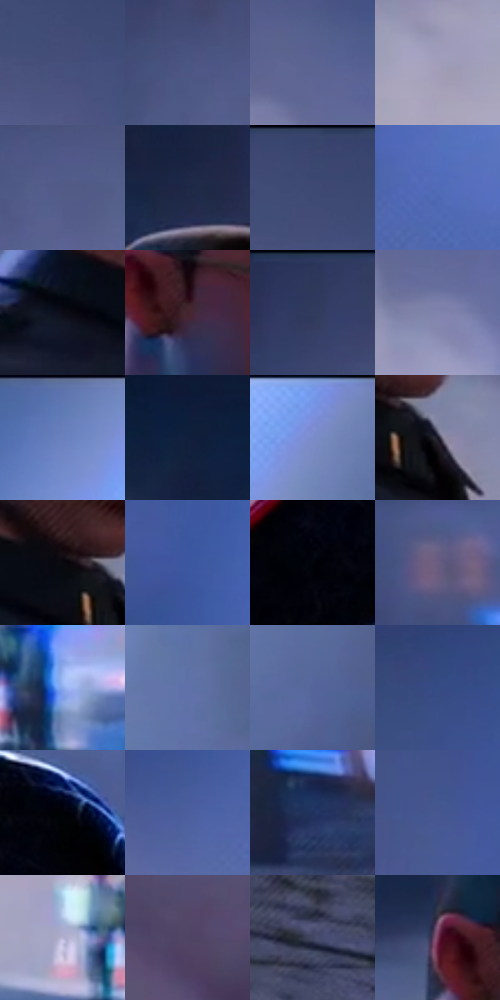

# 电影参考 669

- 状态：常规／活跃；来源世界：miles-home。
- 视角：near-level；景别：medium；场景：street。
- 时段：night-appearance（外观依据，中置信度；具体时间／晨昏未知）；光照：night-mixed。
- 材质候选：skin, hair, fabric, stone, brick, glass, asphalt, painted-metal（帧级，不是像素分割）。
- 明暗组：dark；L* P5/P50/P95：1.86815 / 36.70567 / 68.23615。
- 资格门禁：无附加门禁。
- 原截图 SHA-256：`28a4252fd877a7ea79901e5d4a6ad57e60e3227e0b673eb6f87f04b8af79c468`；尺寸：2880 × 1208。
- sRGB 像素 SHA-256：`c98aa06fc4b0cc516c67c661ee7dcddd17b6f546d5331ac8d88a573ed6502647`。

## 观察与迁移

冷灰雾街、警灯与圆形车灯光晕，雾不等于事件粒子。

大人物左、小人物右均留暗，顶右白色软光束照亮灰蓝雾而非把所有人物提亮；远警车和人群降细节，白眼、脸与徽章承担分层焦点。

本公开版保存32个128×128原像素色卡上下文；图集格子并非原场景相邻位置。原rect、图集tile和像素SHA见 `data/palette-crops.json`。上下文不足时不得批准替色，不能以小样推断完整构图。

## 实测色卡

颜色比例分母为保留采样像素，不是材料面积；全部 32 色参与全库匹配。表内四舍五入仅用于阅读，原精度在 JSON。

| ID | HEX | Lab | 原图 xy | 像素数 | 比例 | 明度角色 |
| --- | --- | --- | --- | ---: | ---: | --- |
| 669-S01 | #444F7A | [34.448259, 7.812021, -25.825119] | [1312, 120] | 11506 | 5.950989% | shadow |
| 669-S02 | #4A5683 | [37.389088, 7.844865, -26.729551] | [1060, 140] | 9803 | 5.070185% | shadow |
| 669-S03 | #5B6591 | [43.61743, 7.569957, -25.384394] | [1440, 536] | 9619 | 4.975019% | midtone |
| 669-S04 | #A19DBA | [65.931869, 7.31553, -14.43091] | [1228, 732] | 9476 | 4.901058% | light |
| 669-S05 | #525B86 | [39.57488, 7.911859, -25.100325] | [1116, 180] | 8652 | 4.474879% | shadow |
| 669-S06 | #1D2846 | [16.605787, 5.542812, -20.296139] | [740, 88] | 8585 | 4.440226% | deep-shadow |
| 669-S07 | #39466E | [30.340779, 6.706752, -24.812431] | [1320, 36] | 8042 | 4.159383% | shadow |
| 669-S08 | #506CB8 | [46.829541, 12.647112, -43.345783] | [1848, 516] | 7387 | 3.820612% | midtone |
| 669-S09 | #0C0C16 | [3.604319, 1.990979, -5.418849] | [620, 560] | 7096 | 3.670104% | deep-shadow |
| 669-S10 | #43242D | [18.561003, 16.088516, 0.468395] | [696, 328] | 6768 | 3.500460% | deep-shadow |
| 669-S11 | #2E3859 | [24.097237, 5.925151, -21.152769] | [960, 36] | 6612 | 3.419776% | shadow |
| 669-S12 | #7F84AD | [56.118791, 7.542299, -22.242957] | [1488, 648] | 6598 | 3.412535% | midtone |
| 669-S13 | #687EBB | [53.439841, 8.316286, -34.550014] | [2020, 56] | 6488 | 3.355642% | midtone |
| 669-S14 | #111F3D | [12.194646, 5.622276, -21.087561] | [324, 84] | 6458 | 3.340126% | deep-shadow |
| 669-S15 | #7495E5 | [62.391514, 10.256143, -44.081677] | [2508, 28] | 6410 | 3.315300% | light |
| 669-S16 | #191724 | [8.540337, 4.712304, -8.612476] | [864, 592] | 6131 | 3.170999% | deep-shadow |
| 669-S17 | #08080F | [2.346501, 1.075803, -2.928035] | [796, 556] | 5992 | 3.099107% | deep-shadow |
| 669-S18 | #3C57A1 | [38.461811, 13.989831, -43.220773] | [1708, 344] | 5873 | 3.037560% | shadow |
| 669-S19 | #03050C | [1.394986, 0.46588, -2.875695] | [2264, 812] | 5752 | 2.974978% | deep-shadow |
| 669-S20 | #6A5C81 | [41.694251, 13.682393, -18.618528] | [2640, 668] | 5651 | 2.922740% | midtone |
| 669-S21 | #8DABEC | [70.065315, 5.84035, -35.819664] | [1564, 968] | 5233 | 2.706547% | light |
| 669-S22 | #5E71A8 | [48.280204, 7.845463, -31.683411] | [2568, 212] | 5038 | 2.605691% | midtone |
| 669-S23 | #55669B | [43.944286, 8.241656, -30.862551] | [2540, 440] | 4916 | 2.542592% | midtone |
| 669-S24 | #354C85 | [33.175301, 9.727568, -34.701146] | [1628, 84] | 4676 | 2.418462% | shadow |
| 669-S25 | #010205 | [0.549399, 0.155597, -1.227343] | [2340, 696] | 3994 | 2.065727% | deep-shadow |
| 669-S26 | #4B5F9C | [41.342329, 10.398514, -35.599435] | [1680, 560] | 3466 | 1.792641% | midtone |
| 669-S27 | #20315D | [21.183538, 8.706836, -28.45733] | [1908, 1080] | 3419 | 1.768332% | shadow |
| 669-S28 | #445790 | [37.94653, 9.828242, -33.790706] | [1600, 256] | 3402 | 1.759540% | shadow |
| 669-S29 | #B5B1D2 | [73.494052, 7.969428, -16.127818] | [1432, 960] | 3288 | 1.700578% | light |
| 669-S30 | #4F4463 | [31.107625, 11.818359, -16.489269] | [152, 724] | 3000 | 1.551622% | shadow |
| 669-S31 | #414563 | [30.109794, 6.341523, -18.136156] | [1204, 1128] | 2280 | 1.179233% | shadow |
| 669-S32 | #763958 | [32.882557, 30.695232, -6.287578] | [624, 280] | 1735 | 0.897355% | shadow |

## 色阶与空间分布

- 采样 ROI：`[0.01, 0.02, 0.98, 0.94]`；步长：4；样本数：193346。
- 排除区：`[]`。
- 深暗、暗、中、亮、高光五段计数：`[49674, 66316, 54647, 22360, 349]`。
- RGB 各 256 箱、L* 100 箱、13×5 色相明度表和 3×3 空间统计全部保存在 [总数据](../film-library.json)。
- [可视化档案](../../references/library.html)按需绘制直方图，不存 2,094 张重复图表图片。

## 纹理特征占比

**这是分块图像特征的面积占比，不是波点／排线／丝网／错版的精确语义覆盖率。** 窗格、发丝、织物也会产生方向或周期特征。
原图 ROI 像素 3104134；已测块覆盖 3104134（100.0000%）；未测 0。

| 特征 | 块覆盖像素 | 占已测面积 | 阈值敏感范围 |
| --- | ---: | ---: | --- |
| low-contrast | 306688 | 9.8800% | 4.6019% ~ 14.1025% |
| directional-structure | 294912 | 9.5006% | 5.8059% ~ 20.9436% |
| periodic-structure | 2376710 | 76.5660% | 71.2876% ~ 76.5660% |
| mixed-detail | 125824 | 4.0534% | 3.1669% ~ 8.1069% |

阈值敏感范围不是统计置信区间。逐块坐标、尺度、对比、方向一致性、频谱集中度、频率与角度见 [全量特征记录](../texture-features.jsonl)，以帧号定位。
四种印刷层的真实像素覆盖仍标为 `null`，不能填 0，也不能拿上表代替。不得据这些代理测量删除唯一证据。

[测量方法与保留策略](../../references/library-retention.md) · [分类索引](../archive/README.md)
