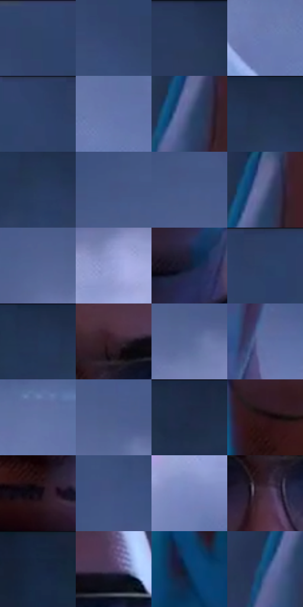

# 电影参考 670

- 状态：常规／活跃；来源世界：miles-home。
- 视角：near-level；景别：close-up；场景：street。
- 时段：night-appearance（外观依据，中置信度；具体时间／晨昏未知）；光照：night-mixed。
- 材质候选：skin, hair, fabric, stone, brick, glass, asphalt, painted-metal（帧级，不是像素分割）。
- 明暗组：dark；L* P5/P50/P95：8.70108 / 31.06332 / 56.7015。
- 资格门禁：无附加门禁。
- 原截图 SHA-256：`5651142794280eecdf0aad016aac6f8fc26fb45284c39f2ed16484b3f8cfeecf`；尺寸：2880 × 1206。
- sRGB 像素 SHA-256：`46c0e610b29aa24c9c0e6a234f5e0a18e92ddecc638046e671dadd958e11b30a`。

## 观察与迁移

冷灰雾街、警灯与圆形车灯光晕，雾不等于事件粒子。

鼻下、下颌与颈部短斜排线较明显，额头较净；脸中央棕红、侧缘青蓝、下方紫暗，镜片浅冷反光不遮眼，背景灰蓝雾保持低细节。

本公开版保存32个128×128原像素色卡上下文；图集格子并非原场景相邻位置。原rect、图集tile和像素SHA见 `data/palette-crops.json`。上下文不足时不得批准替色，不能以小样推断完整构图。

## 实测色卡

颜色比例分母为保留采样像素，不是材料面积；全部 32 色参与全库匹配。表内四舍五入仅用于阅读，原精度在 JSON。

| ID | HEX | Lab | 原图 xy | 像素数 | 比例 | 明度角色 |
| --- | --- | --- | --- | ---: | ---: | --- |
| 670-S01 | #32456C | [29.454273, 4.799049, -24.971465] | [44, 28] | 10095 | 5.221210% | shadow |
| 670-S02 | #364A73 | [31.622001, 4.946342, -25.96272] | [32, 156] | 8606 | 4.451088% | shadow |
| 670-S03 | #263758 | [23.164838, 4.028173, -21.999916] | [640, 36] | 7635 | 3.948879% | shadow |
| 670-S04 | #697BB1 | [52.222089, 7.447901, -30.698555] | [1356, 952] | 7510 | 3.884228% | midtone |
| 670-S05 | #2D4167 | [27.620297, 4.42993, -24.691259] | [240, 28] | 7395 | 3.824749% | shadow |
| 670-S06 | #6175AB | [49.741544, 7.12081, -31.132938] | [1520, 928] | 7140 | 3.692862% | midtone |
| 670-S07 | #3D4F79 | [33.907727, 5.546687, -26.086876] | [756, 240] | 7025 | 3.633383% | shadow |
| 670-S08 | #212F4C | [19.548263, 3.86564, -19.719512] | [1508, 48] | 6934 | 3.586317% | deep-shadow |
| 670-S09 | #293B5E | [24.974161, 4.241688, -23.064975] | [1508, 120] | 6641 | 3.434775% | shadow |
| 670-S10 | #455582 | [36.693276, 6.776077, -27.232609] | [188, 564] | 6638 | 3.433223% | shadow |
| 670-S11 | #465A87 | [38.486134, 5.464767, -27.47126] | [216, 588] | 6577 | 3.401674% | shadow |
| 670-S12 | #52608A | [41.206426, 5.971242, -24.981071] | [768, 200] | 6571 | 3.398570% | midtone |
| 670-S13 | #516492 | [42.669949, 5.627974, -27.511761] | [208, 688] | 6280 | 3.248063% | midtone |
| 670-S14 | #9AA4DA | [68.374029, 8.664026, -28.503647] | [588, 780] | 6253 | 3.234098% | light |
| 670-S15 | #151D33 | [11.114214, 4.094658, -15.649645] | [1084, 1056] | 6179 | 3.195825% | deep-shadow |
| 670-S16 | #2C3D62 | [26.023319, 5.095893, -23.99376] | [324, 28] | 6059 | 3.133760% | shadow |
| 670-S17 | #223352 | [21.269869, 3.547696, -21.027744] | [1440, 56] | 5995 | 3.100659% | shadow |
| 670-S18 | #351E2A | [14.694586, 13.365553, -3.338525] | [1040, 364] | 5889 | 3.045835% | deep-shadow |
| 670-S19 | #576998 | [44.7949, 6.020178, -27.741981] | [288, 712] | 5869 | 3.035491% | midtone |
| 670-S20 | #5C6FA1 | [47.257152, 6.424472, -29.19098] | [1236, 812] | 5844 | 3.022561% | midtone |
| 670-S21 | #6071A3 | [48.184889, 6.905094, -28.897499] | [1476, 852] | 5789 | 2.994114% | midtone |
| 670-S22 | #4D5E8B | [40.322616, 6.108283, -26.989135] | [280, 660] | 5713 | 2.954806% | midtone |
| 670-S23 | #1C2943 | [16.688855, 3.396411, -18.106468] | [1908, 32] | 5680 | 2.937739% | deep-shadow |
| 670-S24 | #281318 | [8.848214, 11.631562, 1.146317] | [768, 608] | 5590 | 2.891190% | deep-shadow |
| 670-S25 | #100913 | [3.184613, 3.842165, -3.969215] | [992, 748] | 5403 | 2.794472% | deep-shadow |
| 670-S26 | #3E5380 | [35.534673, 5.549598, -27.855219] | [256, 464] | 5336 | 2.759819% | shadow |
| 670-S27 | #7B89BF | [57.906451, 8.13982, -29.77392] | [496, 952] | 5286 | 2.733959% | midtone |
| 670-S28 | #452D41 | [22.030142, 14.879823, -8.141397] | [1004, 460] | 5198 | 2.688445% | shadow |
| 670-S29 | #172640 | [15.160463, 3.067162, -18.460288] | [2668, 64] | 4378 | 2.264334% | deep-shadow |
| 670-S30 | #4C3B5F | [28.089198, 15.570799, -18.618515] | [1168, 348] | 3486 | 1.802985% | shadow |
| 670-S31 | #0D3B66 | [24.232895, 2.323383, -29.503946] | [740, 876] | 2859 | 1.478696% | shadow |
| 670-S32 | #1C4C7C | [31.509488, 1.760893, -31.845229] | [708, 276] | 1493 | 0.772191% | shadow |

## 色阶与空间分布

- 采样 ROI：`[0.01, 0.02, 0.98, 0.94]`；步长：4；样本数：193346。
- 排除区：`[]`。
- 深暗、暗、中、亮、高光五段计数：`[40265, 92695, 52852, 7382, 152]`。
- RGB 各 256 箱、L* 100 箱、13×5 色相明度表和 3×3 空间统计全部保存在 [总数据](../film-library.json)。
- [可视化档案](../../references/library.html)按需绘制直方图，不存 2,094 张重复图表图片。

## 纹理特征占比

**这是分块图像特征的面积占比，不是波点／排线／丝网／错版的精确语义覆盖率。** 窗格、发丝、织物也会产生方向或周期特征。
原图 ROI 像素 3098546；已测块覆盖 3098546（100.0000%）；未测 0。

| 特征 | 块覆盖像素 | 占已测面积 | 阈值敏感范围 |
| --- | ---: | ---: | --- |
| low-contrast | 854962 | 27.5924% | 18.0746% ~ 40.4562% |
| directional-structure | 327680 | 10.5753% | 7.4027% ~ 17.2716% |
| periodic-structure | 1817600 | 58.6598% | 43.3297% ~ 64.1250% |
| mixed-detail | 98304 | 3.1726% | 0.5288% ~ 8.8114% |

阈值敏感范围不是统计置信区间。逐块坐标、尺度、对比、方向一致性、频谱集中度、频率与角度见 [全量特征记录](../texture-features.jsonl)，以帧号定位。
四种印刷层的真实像素覆盖仍标为 `null`，不能填 0，也不能拿上表代替。不得据这些代理测量删除唯一证据。

[测量方法与保留策略](../../references/library-retention.md) · [分类索引](../archive/README.md)
