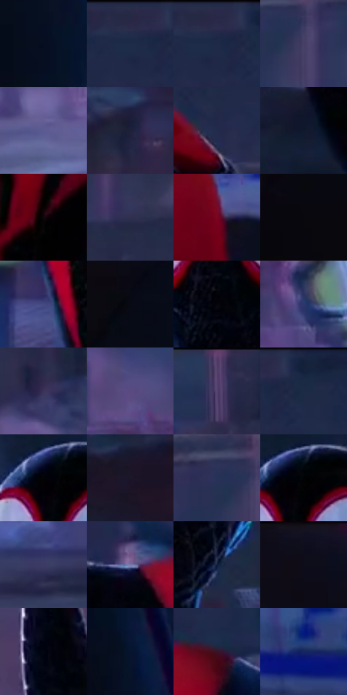

# 电影参考 671

- 状态：常规／活跃；来源世界：miles-home。
- 视角：near-level；景别：medium；场景：street。
- 时段：night-appearance（外观依据，中置信度；具体时间／晨昏未知）；光照：night-mixed。
- 材质候选：skin, hair, fabric, stone, brick, glass, asphalt, painted-metal（帧级，不是像素分割）。
- 明暗组：very-dark；L* P5/P50/P95：0.94452 / 16.81409 / 39.78237。
- 资格门禁：无附加门禁。
- 原截图 SHA-256：`66398ec095a06ae2c543a76f8756d4914bd305b2bb711faf94a4fd585e0fd88b`；尺寸：2880 × 1216。
- sRGB 像素 SHA-256：`46b214f7ea5e903fef430359ad0be11bca55de1dbaefd7f1c97946be157ea843`。

## 观察与迁移

冷灰雾街、警灯与圆形车灯光晕，雾不等于事件粒子。

前景制服暗裁切与右侧白眼黑红人物形成主次，身体蛛网纹更弱、蓝边局部细窄；后方反光背心和建筑窗组主动软化，不给每个路人同样锐度。

本公开版保存32个128×128原像素色卡上下文；图集格子并非原场景相邻位置。原rect、图集tile和像素SHA见 `data/palette-crops.json`。上下文不足时不得批准替色，不能以小样推断完整构图。

## 实测色卡

颜色比例分母为保留采样像素，不是材料面积；全部 32 色参与全库匹配。表内四舍五入仅用于阅读，原精度在 JSON。

| ID | HEX | Lab | 原图 xy | 像素数 | 比例 | 明度角色 |
| --- | --- | --- | --- | ---: | ---: | --- |
| 671-S01 | #060D1F | [3.843047, 2.534469, -12.117915] | [404, 328] | 9802 | 5.033326% | deep-shadow |
| 671-S02 | #2A2947 | [18.06688, 9.124026, -18.604757] | [1500, 36] | 9611 | 4.935248% | deep-shadow |
| 671-S03 | #1F2847 | [16.814093, 6.475053, -20.643126] | [1520, 52] | 9357 | 4.804819% | deep-shadow |
| 671-S04 | #493D66 | [28.676886, 15.136511, -22.231088] | [1104, 392] | 8310 | 4.267184% | shadow |
| 671-S05 | #5B5B92 | [40.866035, 14.091201, -30.282537] | [972, 920] | 8273 | 4.248185% | midtone |
| 671-S06 | #1E203A | [13.317806, 7.283139, -17.123513] | [2560, 624] | 7663 | 3.934950% | deep-shadow |
| 671-S07 | #222B4C | [18.318325, 7.003267, -21.65549] | [1360, 156] | 7431 | 3.815818% | deep-shadow |
| 671-S08 | #12192E | [9.165467, 4.283352, -15.103038] | [2320, 1124] | 7418 | 3.809142% | deep-shadow |
| 671-S09 | #12060B | [2.556632, 4.340949, -0.618218] | [2136, 1020] | 7315 | 3.756252% | deep-shadow |
| 671-S10 | #2F3051 | [21.253014, 9.094971, -20.319158] | [772, 92] | 6908 | 3.547257% | shadow |
| 671-S11 | #7C0520 | [25.257798, 46.878176, 20.37214] | [2412, 852] | 6874 | 3.529798% | shadow |
| 671-S12 | #08080C | [2.274764, 0.571695, -1.556049] | [168, 464] | 6724 | 3.452773% | deep-shadow |
| 671-S13 | #444A82 | [33.430431, 13.649961, -32.382304] | [1820, 844] | 6555 | 3.365992% | shadow |
| 671-S14 | #080A14 | [2.883278, 1.290943, -5.121269] | [216, 288] | 6478 | 3.326452% | deep-shadow |
| 671-S15 | #050509 | [1.450015, 0.556088, -1.513529] | [2044, 428] | 6312 | 3.241211% | deep-shadow |
| 671-S16 | #2C376D | [24.863517, 13.238793, -32.920806] | [1352, 728] | 6158 | 3.162132% | shadow |
| 671-S17 | #3B3358 | [23.677775, 13.124664, -21.073658] | [2388, 560] | 6111 | 3.137998% | shadow |
| 671-S18 | #5B4A80 | [35.36077, 19.729188, -27.964715] | [1020, 628] | 5981 | 3.071243% | shadow |
| 671-S19 | #54416E | [31.326615, 18.368107, -23.09563] | [520, 56] | 5262 | 2.702037% | shadow |
| 671-S20 | #192743 | [15.81328, 4.041573, -19.500505] | [1584, 44] | 5220 | 2.680470% | deep-shadow |
| 671-S21 | #030307 | [0.901668, 0.556123, -1.513595] | [2032, 236] | 5219 | 2.679956% | deep-shadow |
| 671-S22 | #1D162A | [9.009591, 8.993602, -12.322187] | [2612, 284] | 4946 | 2.539771% | deep-shadow |
| 671-S23 | #283158 | [21.40199, 8.760382, -24.776553] | [1052, 364] | 4918 | 2.525393% | shadow |
| 671-S24 | #020204 | [0.587921, 0.278053, -0.756781] | [2060, 232] | 4486 | 2.303561% | deep-shadow |
| 671-S25 | #3B3B65 | [26.726369, 11.725284, -24.744705] | [1216, 1080] | 4446 | 2.283021% | shadow |
| 671-S26 | #787CAF | [53.495353, 10.61599, -27.482643] | [1696, 552] | 4442 | 2.280967% | midtone |
| 671-S27 | #101E3F | [11.94045, 7.033882, -22.907929] | [2184, 480] | 4282 | 2.198807% | deep-shadow |
| 671-S28 | #0E0D1A | [4.116972, 3.204046, -7.723448] | [144, 52] | 4112 | 2.111512% | deep-shadow |
| 671-S29 | #030511 | [1.52073, 1.34949, -5.28054] | [1368, 424] | 3899 | 2.002136% | deep-shadow |
| 671-S30 | #071430 | [6.853985, 6.125082, -20.29723] | [464, 548] | 3847 | 1.975434% | deep-shadow |
| 671-S31 | #3A1326 | [12.642604, 21.74054, -3.396597] | [1888, 544] | 3313 | 1.701225% | deep-shadow |
| 671-S32 | #162661 | [17.550455, 16.512353, -36.980951] | [2760, 960] | 3069 | 1.575931% | deep-shadow |

## 色阶与空间分布

- 采样 ROI：`[0.01, 0.02, 0.98, 0.94]`；步长：4；样本数：194742。
- 排除区：`[{"label": "approximate bottom letterbox", "rect": [0, 0.97, 1, 1]}]`。
- 深暗、暗、中、亮、高光五段计数：`[123048, 62224, 8489, 957, 24]`。
- RGB 各 256 箱、L* 100 箱、13×5 色相明度表和 3×3 空间统计全部保存在 [总数据](../film-library.json)。
- [可视化档案](../../references/library.html)按需绘制直方图，不存 2,094 张重复图表图片。

## 纹理特征占比

**这是分块图像特征的面积占比，不是波点／排线／丝网／错版的精确语义覆盖率。** 窗格、发丝、织物也会产生方向或周期特征。
原图 ROI 像素 3126486；已测块覆盖 3126486（100.0000%）；未测 0。

| 特征 | 块覆盖像素 | 占已测面积 | 阈值敏感范围 |
| --- | ---: | ---: | --- |
| low-contrast | 696960 | 22.2921% | 19.1479% ~ 24.7322% |
| directional-structure | 687830 | 22.0001% | 9.8735% ~ 37.7049% |
| periodic-structure | 1708928 | 54.6597% | 43.1472% ~ 63.2982% |
| mixed-detail | 32768 | 1.0481% | 0.0000% ~ 2.0962% |

阈值敏感范围不是统计置信区间。逐块坐标、尺度、对比、方向一致性、频谱集中度、频率与角度见 [全量特征记录](../texture-features.jsonl)，以帧号定位。
四种印刷层的真实像素覆盖仍标为 `null`，不能填 0，也不能拿上表代替。不得据这些代理测量删除唯一证据。

[测量方法与保留策略](../../references/library-retention.md) · [分类索引](../archive/README.md)
