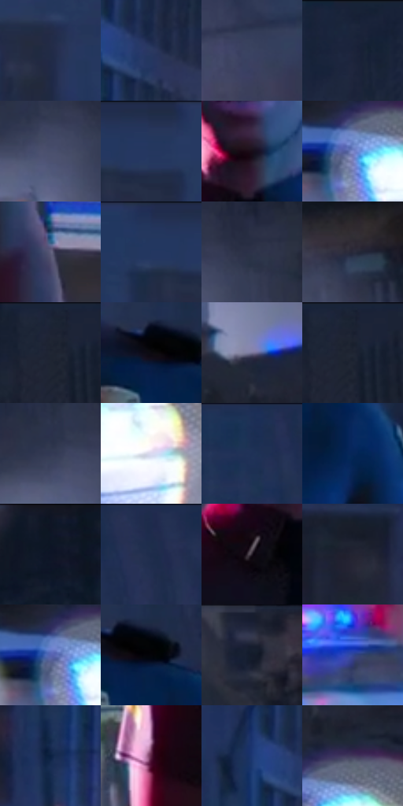

# 电影参考 672

- 状态：常规／活跃；来源世界：miles-home。
- 视角：near-level；景别：medium；场景：street。
- 时段：night-appearance（外观依据，中置信度；具体时间／晨昏未知）；光照：night-mixed。
- 材质候选：skin, hair, fabric, stone, brick, glass, asphalt, painted-metal（帧级，不是像素分割）。
- 明暗组：dark；L* P5/P50/P95：3.41907 / 20.17408 / 58.60086。
- 资格门禁：无附加门禁。
- 原截图 SHA-256：`5412bf38b02ec7785757250fc564dc13489d5cd9f021d1da2cc0870f8fee9db6`；尺寸：2880 × 1208。
- sRGB 像素 SHA-256：`ab9aa0bd501a19cba42ccc3360461f00c7077f6357d291dbdc151b8690663acf`。

## 观察与迁移

冷灰雾街、警灯与圆形车灯光晕，雾不等于事件粒子。

人物左脸臂受红光、右制服受蓝光，背景仍大面积灰蓝；白青车灯圆晕内可见较粗网点，警灯高彩但面积小。源光照面与印刷分色不是同一机制。

本公开版保存32个128×128原像素色卡上下文；图集格子并非原场景相邻位置。原rect、图集tile和像素SHA见 `data/palette-crops.json`。上下文不足时不得批准替色，不能以小样推断完整构图。

## 实测色卡

颜色比例分母为保留采样像素，不是材料面积；全部 32 色参与全库匹配。表内四舍五入仅用于阅读，原精度在 JSON。

| ID | HEX | Lab | 原图 xy | 像素数 | 比例 | 明度角色 |
| --- | --- | --- | --- | ---: | ---: | --- |
| 672-S01 | #212B46 | [17.887394, 4.513164, -18.256261] | [400, 124] | 10903 | 5.639113% | deep-shadow |
| 672-S02 | #2A3A60 | [24.835409, 5.910901, -24.579901] | [712, 296] | 10131 | 5.239829% | shadow |
| 672-S03 | #3B4461 | [29.2271, 4.446716, -18.263021] | [952, 424] | 9387 | 4.855027% | shadow |
| 672-S04 | #1D263C | [15.347828, 3.265114, -15.347713] | [2148, 32] | 8797 | 4.549874% | deep-shadow |
| 672-S05 | #494F6D | [34.215563, 5.408183, -18.056976] | [2380, 484] | 8575 | 4.435054% | shadow |
| 672-S06 | #243152 | [20.753248, 5.487281, -21.833125] | [184, 28] | 8021 | 4.148521% | shadow |
| 672-S07 | #170D19 | [4.879655, 6.523609, -5.719771] | [1424, 424] | 7942 | 4.107662% | deep-shadow |
| 672-S08 | #7E8ACD | [58.991843, 12.232786, -35.976852] | [2424, 848] | 7920 | 4.096283% | midtone |
| 672-S09 | #605F7C | [41.415993, 7.145459, -16.086265] | [1880, 992] | 7895 | 4.083353% | midtone |
| 672-S10 | #23345C | [22.251448, 6.870154, -26.087378] | [108, 32] | 7788 | 4.028012% | shadow |
| 672-S11 | #2D324A | [21.332324, 4.768967, -15.516584] | [2456, 440] | 7659 | 3.961292% | shadow |
| 672-S12 | #292A3B | [17.659032, 4.238782, -10.985355] | [2720, 540] | 7512 | 3.885263% | deep-shadow |
| 672-S13 | #1D2333 | [13.839774, 2.26906, -11.345074] | [2388, 36] | 6894 | 3.565628% | deep-shadow |
| 672-S14 | #0C0910 | [2.808754, 1.936018, -2.767177] | [1632, 504] | 6377 | 3.298232% | deep-shadow |
| 672-S15 | #787497 | [50.355508, 9.259864, -18.359702] | [2428, 688] | 6109 | 3.159621% | midtone |
| 672-S16 | #182030 | [12.224876, 1.674374, -11.732122] | [2404, 40] | 5989 | 3.097556% | deep-shadow |
| 672-S17 | #333954 | [24.544535, 5.151077, -17.139308] | [2348, 456] | 5908 | 3.055662% | shadow |
| 672-S18 | #DADAF1 | [87.678283, 4.337796, -11.20545] | [300, 1092] | 5498 | 2.843607% | highlight |
| 672-S19 | #1D2F54 | [19.777747, 5.927043, -24.742265] | [1588, 44] | 5225 | 2.702409% | deep-shadow |
| 672-S20 | #062658 | [16.15096, 10.686417, -33.296457] | [1744, 624] | 5103 | 2.639310% | deep-shadow |
| 672-S21 | #0E1526 | [6.951506, 2.765949, -12.662066] | [2768, 44] | 4741 | 2.452081% | deep-shadow |
| 672-S22 | #1D2B4C | [17.966179, 5.67455, -22.235741] | [1788, 28] | 4629 | 2.394153% | deep-shadow |
| 672-S23 | #211924 | [10.152757, 6.637943, -6.061411] | [1360, 528] | 4457 | 2.305194% | deep-shadow |
| 672-S24 | #232432 | [14.675742, 3.464623, -9.300637] | [168, 572] | 4337 | 2.243129% | deep-shadow |
| 672-S25 | #5763B0 | [44.352212, 17.230462, -42.594826] | [2408, 844] | 4181 | 2.162445% | midtone |
| 672-S26 | #04040A | [1.215415, 0.834193, -2.270409] | [1672, 508] | 4108 | 2.124688% | deep-shadow |
| 672-S27 | #141B2B | [9.852289, 2.221509, -11.810915] | [2588, 64] | 4096 | 2.118482% | deep-shadow |
| 672-S28 | #324694 | [32.248133, 18.645581, -45.391702] | [556, 804] | 3529 | 1.825225% | shadow |
| 672-S29 | #0A1F41 | [12.129395, 6.059973, -24.026814] | [608, 396] | 2967 | 1.534555% | deep-shadow |
| 672-S30 | #58203F | [21.825077, 29.630033, -6.803444] | [1060, 884] | 2295 | 1.186991% | shadow |
| 672-S31 | #1D3873 | [24.723546, 11.98994, -37.02736] | [636, 280] | 2189 | 1.132167% | shadow |
| 672-S32 | #41375A | [25.546135, 13.030996, -19.417422] | [2476, 792] | 2184 | 1.129581% | shadow |

## 色阶与空间分布

- 采样 ROI：`[0.01, 0.02, 0.98, 0.94]`；步长：4；样本数：193346。
- 排除区：`[]`。
- 深暗、暗、中、亮、高光五段计数：`[94978, 70222, 19329, 5053, 3764]`。
- RGB 各 256 箱、L* 100 箱、13×5 色相明度表和 3×3 空间统计全部保存在 [总数据](../film-library.json)。
- [可视化档案](../../references/library.html)按需绘制直方图，不存 2,094 张重复图表图片。

## 纹理特征占比

**这是分块图像特征的面积占比，不是波点／排线／丝网／错版的精确语义覆盖率。** 窗格、发丝、织物也会产生方向或周期特征。
原图 ROI 像素 3104134；已测块覆盖 3104134（100.0000%）；未测 0。

| 特征 | 块覆盖像素 | 占已测面积 | 阈值敏感范围 |
| --- | ---: | ---: | --- |
| low-contrast | 431488 | 13.9004% | 5.8059% ~ 18.8281% |
| directional-structure | 290304 | 9.3522% | 7.0512% ~ 17.1786% |
| periodic-structure | 2305670 | 74.2774% | 70.7641% ~ 76.1289% |
| mixed-detail | 76672 | 2.4700% | 0.8866% ~ 3.3566% |

阈值敏感范围不是统计置信区间。逐块坐标、尺度、对比、方向一致性、频谱集中度、频率与角度见 [全量特征记录](../texture-features.jsonl)，以帧号定位。
四种印刷层的真实像素覆盖仍标为 `null`，不能填 0，也不能拿上表代替。不得据这些代理测量删除唯一证据。

[测量方法与保留策略](../../references/library-retention.md) · [分类索引](../archive/README.md)
