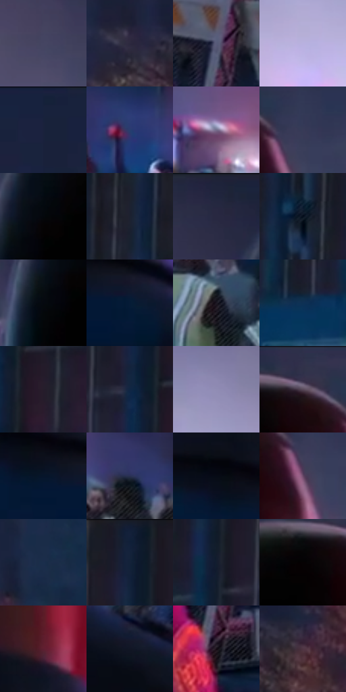

# 电影参考 673

- 状态：常规／活跃；来源世界：miles-home。
- 视角：near-level；景别：environment-wide；场景：street。
- 时段：night-appearance（外观依据，中置信度；具体时间／晨昏未知）；光照：night-mixed。
- 材质候选：skin, hair, fabric, stone, brick, glass, asphalt, painted-metal（帧级，不是像素分割）。
- 明暗组：very-dark；L* P5/P50/P95：1.86815 / 16.00793 / 61.55328。
- 资格门禁：无附加门禁。
- 原截图 SHA-256：`67ff93999163549b94a03d86e7e68fcdff5e9aaf066d6c34ee7674af20d858e7`；尺寸：2880 × 1206。
- sRGB 像素 SHA-256：`546922c78ae3e4e2ebc8c202556c5482437240fd696f84a7701740b29b398c05`。

## 观察与迁移

冷灰雾街、警灯与圆形车灯光晕，雾不等于事件粒子。

近背影为大暗形，侧缘白蓝与红光分区，远处举手人物仍可清楚，人群更软；路障透视稳定。焦点不等于最近物体，远人不一律抹糊。

本公开版保存32个128×128原像素色卡上下文；图集格子并非原场景相邻位置。原rect、图集tile和像素SHA见 `data/palette-crops.json`。上下文不足时不得批准替色，不能以小样推断完整构图。

## 实测色卡

颜色比例分母为保留采样像素，不是材料面积；全部 32 色参与全库匹配。表内四舍五入仅用于阅读，原精度在 JSON。

| ID | HEX | Lab | 原图 xy | 像素数 | 比例 | 明度角色 |
| --- | --- | --- | --- | ---: | ---: | --- |
| 673-S01 | #454562 | [30.407492, 7.395356, -17.00927] | [364, 132] | 9278 | 4.798651% | shadow |
| 673-S02 | #2C293F | [17.82867, 7.284252, -13.467183] | [1668, 356] | 8728 | 4.514187% | deep-shadow |
| 673-S03 | #575B79 | [39.392121, 5.797438, -17.42217] | [1648, 908] | 7985 | 4.129902% | shadow |
| 673-S04 | #B8B1DF | [74.165263, 11.741215, -22.175673] | [224, 516] | 7466 | 3.861471% | light |
| 673-S05 | #19223C | [13.690782, 5.005745, -17.973443] | [1728, 52] | 7104 | 3.674242% | deep-shadow |
| 673-S06 | #273E6E | [26.740009, 7.665782, -30.581643] | [1988, 640] | 7071 | 3.657174% | shadow |
| 673-S07 | #756F8D | [48.352733, 8.825729, -15.542707] | [1252, 536] | 7050 | 3.646313% | midtone |
| 673-S08 | #373B57 | [25.647741, 6.055658, -17.368319] | [1052, 104] | 6873 | 3.554767% | shadow |
| 673-S09 | #04070C | [1.845451, -0.073741, -2.210921] | [728, 184] | 6702 | 3.466325% | deep-shadow |
| 673-S10 | #1C2130 | [12.909514, 2.349477, -10.644934] | [2124, 248] | 6562 | 3.393916% | deep-shadow |
| 673-S11 | #20253E | [15.370792, 5.668523, -16.69092] | [620, 36] | 6529 | 3.376848% | deep-shadow |
| 673-S12 | #060F1E | [4.282116, 1.21236, -10.673457] | [2396, 176] | 6455 | 3.338574% | deep-shadow |
| 673-S13 | #050810 | [2.197949, 0.476633, -3.708841] | [688, 236] | 6328 | 3.272889% | deep-shadow |
| 673-S14 | #061B37 | [9.784638, 3.855451, -20.698081] | [964, 704] | 6327 | 3.272372% | deep-shadow |
| 673-S15 | #1D1923 | [9.623577, 4.592583, -6.165933] | [2700, 716] | 6226 | 3.220134% | deep-shadow |
| 673-S16 | #0D3054 | [19.388048, 2.299076, -25.405979] | [2284, 436] | 6207 | 3.210307% | deep-shadow |
| 673-S17 | #271D2B | [12.509197, 8.182246, -7.54803] | [2692, 316] | 6135 | 3.173068% | deep-shadow |
| 673-S18 | #0F2643 | [14.91439, 2.513176, -20.960002] | [2616, 264] | 5983 | 3.094452% | deep-shadow |
| 673-S19 | #908CB4 | [59.870903, 10.022959, -20.375421] | [260, 364] | 5902 | 3.052559% | midtone |
| 673-S20 | #32314B | [21.515357, 7.496416, -15.869591] | [936, 44] | 5800 | 2.999803% | shadow |
| 673-S21 | #06152A | [6.703575, 2.279035, -16.086276] | [880, 680] | 5730 | 2.963599% | deep-shadow |
| 673-S22 | #293052 | [20.805808, 7.602366, -21.725553] | [1468, 608] | 5530 | 2.860157% | shadow |
| 673-S23 | #060B15 | [3.000568, 0.587877, -5.63982] | [840, 636] | 5399 | 2.792403% | deep-shadow |
| 673-S24 | #694968 | [35.533972, 19.346153, -12.622937] | [1028, 156] | 5386 | 2.785680% | shadow |
| 673-S25 | #1A2E4C | [18.779129, 2.782264, -20.961157] | [1936, 196] | 5282 | 2.731890% | deep-shadow |
| 673-S26 | #102039 | [12.21124, 2.929268, -18.231768] | [2628, 36] | 4872 | 2.519835% | deep-shadow |
| 673-S27 | #131D2F | [10.721028, 1.918396, -13.382184] | [2500, 236] | 4588 | 2.372948% | deep-shadow |
| 673-S28 | #060203 | [0.801369, 1.185006, -0.009803] | [856, 100] | 4377 | 2.263817% | deep-shadow |
| 673-S29 | #5D1E30 | [21.834687, 30.458316, 3.673578] | [932, 548] | 4243 | 2.194511% | shadow |
| 673-S30 | #111625 | [7.465811, 2.714502, -11.091117] | [1128, 780] | 4101 | 2.121068% | deep-shadow |
| 673-S31 | #140913 | [3.533069, 5.404898, -3.418591] | [1636, 1072] | 3997 | 2.067278% | deep-shadow |
| 673-S32 | #503543 | [25.734864, 14.603422, -3.780782] | [1780, 384] | 3130 | 1.618859% | shadow |

## 色阶与空间分布

- 采样 ROI：`[0.01, 0.02, 0.98, 0.94]`；步长：4；样本数：193346。
- 排除区：`[]`。
- 深暗、暗、中、亮、高光五段计数：`[119154, 50436, 13452, 9447, 857]`。
- RGB 各 256 箱、L* 100 箱、13×5 色相明度表和 3×3 空间统计全部保存在 [总数据](../film-library.json)。
- [可视化档案](../../references/library.html)按需绘制直方图，不存 2,094 张重复图表图片。

## 纹理特征占比

**这是分块图像特征的面积占比，不是波点／排线／丝网／错版的精确语义覆盖率。** 窗格、发丝、织物也会产生方向或周期特征。
原图 ROI 像素 3098546；已测块覆盖 3098546（100.0000%）；未测 0。

| 特征 | 块覆盖像素 | 占已测面积 | 阈值敏感范围 |
| --- | ---: | ---: | --- |
| low-contrast | 529280 | 17.0816% | 13.9090% ~ 19.6345% |
| directional-structure | 589568 | 19.0272% | 9.4269% ~ 32.7669% |
| periodic-structure | 1886898 | 60.8962% | 52.2666% ~ 66.9770% |
| mixed-detail | 92800 | 2.9950% | 1.0575% ~ 3.9616% |

阈值敏感范围不是统计置信区间。逐块坐标、尺度、对比、方向一致性、频谱集中度、频率与角度见 [全量特征记录](../texture-features.jsonl)，以帧号定位。
四种印刷层的真实像素覆盖仍标为 `null`，不能填 0，也不能拿上表代替。不得据这些代理测量删除唯一证据。

[测量方法与保留策略](../../references/library-retention.md) · [分类索引](../archive/README.md)
