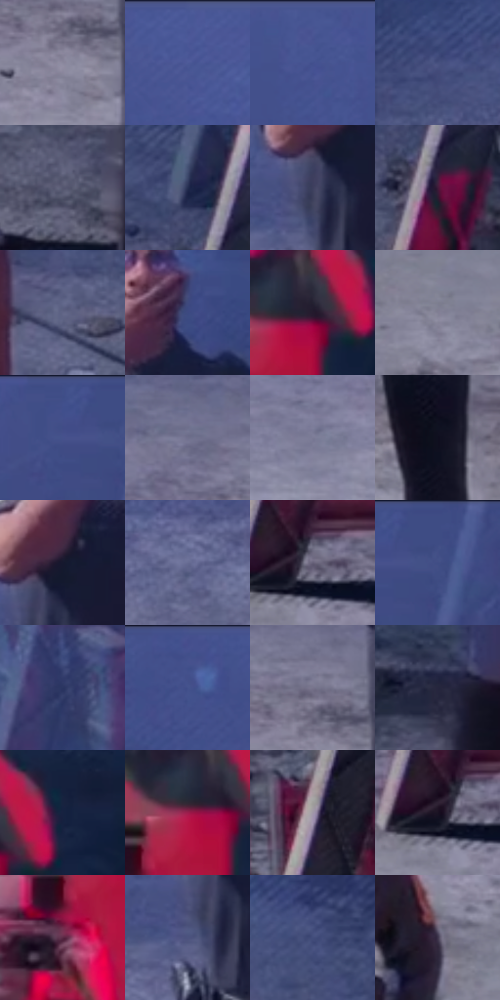

# 电影参考 674

- 状态：常规／活跃；来源世界：miles-home。
- 视角：high-angle；景别：environment-wide；场景：street。
- 时段：night-appearance（外观依据，中置信度；具体时间／晨昏未知）；光照：night-mixed。
- 材质候选：skin, hair, fabric, stone, brick, glass, asphalt, painted-metal（帧级，不是像素分割）。
- 明暗组：dark；L* P5/P50/P95：7.53658 / 35.03502 / 57.0523。
- 资格门禁：无附加门禁。
- 原截图 SHA-256：`b40f6e575c2cecee734f27d5584fe428bd68d917acb8aadab0e045e65d6288d0`；尺寸：2880 × 1210。
- sRGB 像素 SHA-256：`bbde5c58130c577a5ad6d314a4565e1549da809a6feb077cde9aa5acb9f43321`。

## 观察与迁移

冷灰雾街、警灯与圆形车灯光晕，雾不等于事件粒子。

俯视灰色粗糙地面保留碎石结构与方向性排线的区别，人物投影向画面下右延伸；红灯主要染亮右侧摄影者和路障侧面，不把整个路面涂红。

本公开版保存32个128×128原像素色卡上下文；图集格子并非原场景相邻位置。原rect、图集tile和像素SHA见 `data/palette-crops.json`。上下文不足时不得批准替色，不能以小样推断完整构图。

## 实测色卡

颜色比例分母为保留采样像素，不是材料面积；全部 32 色参与全库匹配。表内四舍五入仅用于阅读，原精度在 JSON。

| ID | HEX | Lab | 原图 xy | 像素数 | 比例 | 明度角色 |
| --- | --- | --- | --- | ---: | ---: | --- |
| 674-S01 | #8A889D | [57.507117, 5.088574, -10.870332] | [1184, 844] | 9410 | 4.849416% | midtone |
| 674-S02 | #4C5A98 | [39.773418, 12.516311, -35.685559] | [540, 64] | 8972 | 4.623694% | shadow |
| 674-S03 | #475592 | [37.682417, 12.51791, -35.406687] | [376, 48] | 8608 | 4.436107% | shadow |
| 674-S04 | #384271 | [29.232595, 10.113587, -28.461967] | [32, 508] | 8320 | 4.287687% | shadow |
| 674-S05 | #555670 | [37.401803, 5.845013, -14.945047] | [2404, 820] | 8161 | 4.205747% | shadow |
| 674-S06 | #242D4F | [19.291947, 7.228953, -22.131299] | [1852, 516] | 8117 | 4.183072% | deep-shadow |
| 674-S07 | #3D3F5E | [27.723259, 7.496163, -18.654556] | [1252, 488] | 7523 | 3.876956% | shadow |
| 674-S08 | #401A38 | [16.077018, 23.145907, -11.069979] | [1888, 608] | 7103 | 3.660510% | deep-shadow |
| 674-S09 | #616587 | [43.650216, 6.662913, -19.302853] | [1584, 592] | 7088 | 3.652780% | midtone |
| 674-S10 | #3B4981 | [32.434327, 11.688242, -33.385293] | [1404, 264] | 7014 | 3.614644% | shadow |
| 674-S11 | #24192D | [10.991358, 10.417481, -11.375266] | [2720, 228] | 6982 | 3.598153% | deep-shadow |
| 674-S12 | #828095 | [54.400487, 5.156543, -10.983671] | [1008, 1076] | 6874 | 3.542496% | midtone |
| 674-S13 | #414F8B | [35.160994, 12.607918, -35.179127] | [1548, 28] | 6511 | 3.355425% | shadow |
| 674-S14 | #70708C | [48.166944, 6.277808, -15.272305] | [1060, 724] | 6432 | 3.314712% | midtone |
| 674-S15 | #7B7B95 | [52.449529, 5.66035, -13.981955] | [720, 808] | 6402 | 3.299252% | midtone |
| 674-S16 | #0F0F1E | [4.849936, 3.75888, -9.761542] | [1424, 844] | 6256 | 3.224011% | deep-shadow |
| 674-S17 | #15182E | [9.073529, 6.002538, -15.231508] | [1280, 436] | 6178 | 3.183814% | deep-shadow |
| 674-S18 | #676C93 | [46.597979, 7.521979, -21.887403] | [1076, 576] | 5967 | 3.075076% | midtone |
| 674-S19 | #656077 | [41.944634, 7.048916, -12.199873] | [1852, 936] | 5780 | 2.978706% | midtone |
| 674-S20 | #404D85 | [34.170735, 11.645093, -33.076477] | [1612, 64] | 5676 | 2.925110% | shadow |
| 674-S21 | #2A3561 | [23.341971, 9.746668, -27.597947] | [2004, 104] | 5643 | 2.908103% | shadow |
| 674-S22 | #44528C | [36.283386, 11.724574, -33.99523] | [108, 60] | 5342 | 2.752984% | shadow |
| 674-S23 | #79748C | [50.03626, 7.009208, -12.36804] | [1184, 780] | 4892 | 2.521078% | midtone |
| 674-S24 | #26263D | [16.181006, 6.628871, -14.686934] | [2456, 684] | 4839 | 2.493764% | deep-shadow |
| 674-S25 | #172240 | [13.804723, 6.038854, -20.607572] | [2792, 196] | 4688 | 2.415947% | deep-shadow |
| 674-S26 | #9E1D4C | [35.344532, 53.873944, 5.90816] | [2684, 240] | 4385 | 2.259797% | shadow |
| 674-S27 | #A298A9 | [64.162939, 6.911773, -7.540005] | [2044, 800] | 4283 | 2.207231% | light |
| 674-S28 | #1A1223 | [6.987604, 8.452732, -10.246937] | [1824, 944] | 4204 | 2.166519% | deep-shadow |
| 674-S29 | #592844 | [23.866298, 26.382646, -7.113157] | [2636, 336] | 4160 | 2.143844% | shadow |
| 674-S30 | #4C537F | [36.470367, 9.112318, -25.70308] | [1232, 528] | 2951 | 1.520789% | shadow |
| 674-S31 | #424C7A | [33.417898, 9.199722, -27.453328] | [1640, 476] | 2814 | 1.450187% | shadow |
| 674-S32 | #3D344B | [23.525638, 9.462714, -12.673613] | [628, 1036] | 2469 | 1.272392% | shadow |

## 色阶与空间分布

- 采样 ROI：`[0.01, 0.02, 0.98, 0.94]`；步长：4；样本数：194044。
- 排除区：`[]`。
- 深暗、暗、中、亮、高光五段计数：`[46060, 85487, 58852, 3345, 300]`。
- RGB 各 256 箱、L* 100 箱、13×5 色相明度表和 3×3 空间统计全部保存在 [总数据](../film-library.json)。
- [可视化档案](../../references/library.html)按需绘制直方图，不存 2,094 张重复图表图片。

## 纹理特征占比

**这是分块图像特征的面积占比，不是波点／排线／丝网／错版的精确语义覆盖率。** 窗格、发丝、织物也会产生方向或周期特征。
原图 ROI 像素 3109722；已测块覆盖 3109722（100.0000%）；未测 0。

| 特征 | 块覆盖像素 | 占已测面积 | 阈值敏感范围 |
| --- | ---: | ---: | --- |
| low-contrast | 289920 | 9.3230% | 4.2149% ~ 16.1722% |
| directional-structure | 180224 | 5.7955% | 2.6343% ~ 17.3412% |
| periodic-structure | 2378842 | 76.4969% | 63.2731% ~ 76.8633% |
| mixed-detail | 260736 | 8.3845% | 1.5806% ~ 17.9204% |

阈值敏感范围不是统计置信区间。逐块坐标、尺度、对比、方向一致性、频谱集中度、频率与角度见 [全量特征记录](../texture-features.jsonl)，以帧号定位。
四种印刷层的真实像素覆盖仍标为 `null`，不能填 0，也不能拿上表代替。不得据这些代理测量删除唯一证据。

[测量方法与保留策略](../../references/library-retention.md) · [分类索引](../archive/README.md)
