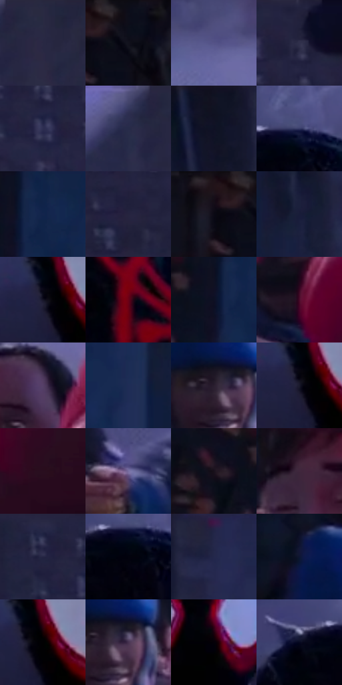

# 电影参考 675

- 状态：常规／活跃；来源世界：miles-home。
- 视角：near-level；景别：medium；场景：street。
- 时段：night-appearance（外观依据，中置信度；具体时间／晨昏未知）；光照：night-mixed。
- 材质候选：skin, hair, fabric, stone, brick, glass, asphalt, painted-metal（帧级，不是像素分割）。
- 明暗组：very-dark；L* P5/P50/P95：1.15711 / 15.05181 / 37.35182。
- 资格门禁：无附加门禁。
- 原截图 SHA-256：`0b0cef595f3ce1a4e67ae6a3726a1981cb0d857be91999ef4fcce862699c8fba`；尺寸：2880 × 1202。
- sRGB 像素 SHA-256：`d07dcaaa86ae02ad6b0572ef00b3a618006380e5037ff411b6a11f5353cc7e3d`。

## 观察与迁移

冷灰雾街、警灯与圆形车灯光晕，雾不等于事件粒子。

中心白眼黑红人物与不同肤色、不同衣料的人群并置，近脸更清楚、后楼与雾更柔；红色灯光局部出现，面罩形状不能作为普通人物五官比例模板。

本公开版保存32个128×128原像素色卡上下文；图集格子并非原场景相邻位置。原rect、图集tile和像素SHA见 `data/palette-crops.json`。上下文不足时不得批准替色，不能以小样推断完整构图。

## 实测色卡

颜色比例分母为保留采样像素，不是材料面积；全部 32 色参与全库匹配。表内四舍五入仅用于阅读，原精度在 JSON。

| ID | HEX | Lab | 原图 xy | 像素数 | 比例 | 明度角色 |
| --- | --- | --- | --- | ---: | ---: | --- |
| 675-S01 | #292844 | [17.489205, 8.517193, -17.462936] | [1876, 60] | 11068 | 5.745193% | deep-shadow |
| 675-S02 | #0D0E1A | [4.283426, 2.404137, -7.48627] | [164, 28] | 9519 | 4.941136% | deep-shadow |
| 675-S03 | #545387 | [37.517659, 13.872904, -28.91695] | [2540, 468] | 9394 | 4.876251% | shadow |
| 675-S04 | #21213C | [14.042844, 8.229257, -17.372681] | [2704, 32] | 9057 | 4.701321% | deep-shadow |
| 675-S05 | #2E2E52 | [20.611035, 10.514973, -22.004967] | [2216, 108] | 8244 | 4.279307% | shadow |
| 675-S06 | #292B4C | [18.889178, 9.06312, -20.716014] | [1788, 56] | 7997 | 4.151094% | deep-shadow |
| 675-S07 | #0F1221 | [5.816646, 3.099877, -10.610334] | [900, 36] | 7993 | 4.149018% | deep-shadow |
| 675-S08 | #343865 | [25.252866, 11.735452, -27.112731] | [1456, 172] | 7494 | 3.889996% | shadow |
| 675-S09 | #13244C | [15.071145, 8.640184, -26.892561] | [684, 72] | 6914 | 3.588929% | deep-shadow |
| 675-S10 | #25243F | [15.559788, 8.393023, -17.059523] | [2676, 208] | 6686 | 3.470578% | deep-shadow |
| 675-S11 | #0A0914 | [2.803817, 2.214502, -5.22331] | [88, 64] | 6304 | 3.272289% | deep-shadow |
| 675-S12 | #181C39 | [11.414626, 8.085222, -19.461942] | [920, 332] | 6264 | 3.251526% | deep-shadow |
| 675-S13 | #151426 | [7.223147, 6.037544, -12.193767] | [1300, 496] | 6248 | 3.243221% | deep-shadow |
| 675-S14 | #690116 | [20.376704, 42.091314, 20.29571] | [1440, 956] | 6070 | 3.150824% | shadow |
| 675-S15 | #0D1023 | [5.216083, 4.328812, -13.078539] | [640, 92] | 5943 | 3.084901% | deep-shadow |
| 675-S16 | #4B0B2A | [14.968557, 31.895976, -2.494962] | [2540, 848] | 5854 | 3.038703% | deep-shadow |
| 675-S17 | #554066 | [30.777363, 17.288935, -18.861735] | [2584, 616] | 5633 | 2.923986% | shadow |
| 675-S18 | #202C56 | [19.14053, 9.567832, -27.081968] | [776, 372] | 5586 | 2.899589% | deep-shadow |
| 675-S19 | #2A1E2F | [13.387934, 9.785979, -9.063214] | [348, 724] | 5399 | 2.802521% | deep-shadow |
| 675-S20 | #1A192B | [9.713864, 5.897945, -11.985414] | [1304, 504] | 5353 | 2.778643% | deep-shadow |
| 675-S21 | #290E1E | [7.942916, 16.551038, -4.766715] | [2820, 860] | 5208 | 2.703376% | deep-shadow |
| 675-S22 | #796FA1 | [49.504175, 15.052383, -25.525018] | [2232, 888] | 5176 | 2.686765% | midtone |
| 675-S23 | #180F1B | [5.555078, 6.585986, -6.280948] | [524, 88] | 5128 | 2.661850% | deep-shadow |
| 675-S24 | #40273C | [19.504886, 15.733861, -8.615866] | [2664, 1040] | 4763 | 2.472385% | deep-shadow |
| 675-S25 | #222443 | [15.523677, 8.812808, -19.913712] | [2152, 28] | 4687 | 2.432935% | deep-shadow |
| 675-S26 | #02020D | [0.771143, 1.565575, -4.26092] | [1436, 216] | 4610 | 2.392965% | deep-shadow |
| 675-S27 | #242749 | [17.022208, 9.376164, -21.656757] | [1016, 36] | 4043 | 2.098646% | deep-shadow |
| 675-S28 | #0E1532 | [7.767268, 8.012873, -20.280341] | [260, 608] | 4008 | 2.080478% | deep-shadow |
| 675-S29 | #010103 | [0.313747, 0.27807, -0.756814] | [1328, 500] | 3801 | 1.973029% | deep-shadow |
| 675-S30 | #463250 | [24.201677, 15.477265, -14.875064] | [384, 728] | 3630 | 1.884266% | shadow |
| 675-S31 | #050108 | [0.645916, 2.019287, -2.280378] | [1524, 512] | 2311 | 1.199597% | deep-shadow |
| 675-S32 | #05081F | [2.753402, 4.379851, -13.771707] | [1352, 200] | 2263 | 1.174681% | deep-shadow |

## 色阶与空间分布

- 采样 ROI：`[0.01, 0.02, 0.98, 0.94]`；步长：4；样本数：192648。
- 排除区：`[]`。
- 深暗、暗、中、亮、高光五段计数：`[149347, 36291, 6352, 654, 4]`。
- RGB 各 256 箱、L* 100 箱、13×5 色相明度表和 3×3 空间统计全部保存在 [总数据](../film-library.json)。
- [可视化档案](../../references/library.html)按需绘制直方图，不存 2,094 张重复图表图片。

## 纹理特征占比

**这是分块图像特征的面积占比，不是波点／排线／丝网／错版的精确语义覆盖率。** 窗格、发丝、织物也会产生方向或周期特征。
原图 ROI 像素 3087370；已测块覆盖 3087370（100.0000%）；未测 0。

| 特征 | 块覆盖像素 | 占已测面积 | 阈值敏感范围 |
| --- | ---: | ---: | --- |
| low-contrast | 445440 | 14.4278% | 9.6517% ~ 19.0091% |
| directional-structure | 369536 | 11.9693% | 2.1227% ~ 20.8457% |
| periodic-structure | 2239626 | 72.5415% | 68.9719% ~ 75.1535% |
| mixed-detail | 32768 | 1.0614% | 0.5307% ~ 3.7147% |

阈值敏感范围不是统计置信区间。逐块坐标、尺度、对比、方向一致性、频谱集中度、频率与角度见 [全量特征记录](../texture-features.jsonl)，以帧号定位。
四种印刷层的真实像素覆盖仍标为 `null`，不能填 0，也不能拿上表代替。不得据这些代理测量删除唯一证据。

[测量方法与保留策略](../../references/library-retention.md) · [分类索引](../archive/README.md)
