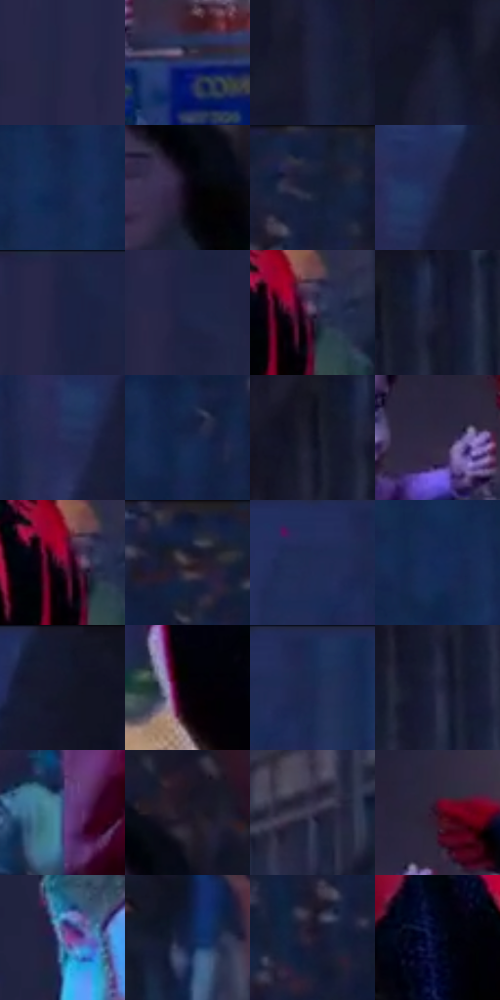

# 电影参考 676

- 状态：常规／活跃；来源世界：miles-home。
- 视角：near-level；景别：medium；场景：street。
- 时段：night-appearance（外观依据，中置信度；具体时间／晨昏未知）；光照：night-mixed。
- 材质候选：skin, hair, fabric, stone, brick, glass, asphalt, painted-metal（帧级，不是像素分割）。
- 明暗组：very-dark；L* P5/P50/P95：2.77834 / 15.33845 / 31.85296。
- 资格门禁：无附加门禁。
- 原截图 SHA-256：`20dc0349aeb497c06c8eb92a344e1462957ddd705bfeb0e1dcb50956f60c53c3`；尺寸：2880 × 1214。
- sRGB 像素 SHA-256：`961441bed42784617a7eb728ff221fb83cd7530eee61bfd3c76a46944017323e`。

## 观察与迁移

冷灰雾街、警灯与圆形车灯光晕，雾不等于事件粒子。

红衣成人抱婴儿与伸手人物构成温和接触，成人侧脸偏青、人物黑衣低亮，后方蓝黄餐车及人群较软；轻互动不添加冲击符号，餐车文字仅原有场景信息。

本公开版保存32个128×128原像素色卡上下文；图集格子并非原场景相邻位置。原rect、图集tile和像素SHA见 `data/palette-crops.json`。上下文不足时不得批准替色，不能以小样推断完整构图。

## 实测色卡

颜色比例分母为保留采样像素，不是材料面积；全部 32 色参与全库匹配。表内四舍五入仅用于阅读，原精度在 JSON。

| ID | HEX | Lab | 原图 xy | 像素数 | 比例 | 明度角色 |
| --- | --- | --- | --- | ---: | ---: | --- |
| 676-S01 | #262746 | [17.013557, 8.930399, -19.604084] | [132, 120] | 10223 | 5.249510% | deep-shadow |
| 676-S02 | #233669 | [23.721342, 10.483136, -32.208195] | [884, 992] | 9130 | 4.688254% | shadow |
| 676-S03 | #21223E | [14.485278, 8.192696, -18.078715] | [1556, 288] | 9111 | 4.678498% | deep-shadow |
| 676-S04 | #1C2037 | [12.957509, 5.549996, -15.57454] | [1548, 168] | 8076 | 4.147025% | deep-shadow |
| 676-S05 | #142651 | [16.148892, 9.451016, -28.558206] | [2144, 128] | 7788 | 3.999137% | deep-shadow |
| 676-S06 | #0D0716 | [2.668739, 4.338888, -6.776982] | [2648, 740] | 7645 | 3.925707% | deep-shadow |
| 676-S07 | #131E3B | [11.841471, 6.018037, -20.227729] | [2600, 32] | 7528 | 3.865627% | deep-shadow |
| 676-S08 | #22284E | [17.495081, 9.919595, -24.318491] | [1408, 192] | 7398 | 3.798872% | deep-shadow |
| 676-S09 | #1B2242 | [14.232236, 7.888031, -21.305161] | [228, 28] | 6913 | 3.549825% | deep-shadow |
| 676-S10 | #1E2546 | [15.701884, 8.018278, -21.724434] | [228, 300] | 6637 | 3.408099% | deep-shadow |
| 676-S11 | #483B57 | [27.279794, 12.050459, -14.712539] | [1400, 940] | 6554 | 3.365478% | shadow |
| 676-S12 | #191C31 | [10.984666, 5.379673, -14.384954] | [1772, 84] | 6273 | 3.221185% | deep-shadow |
| 676-S13 | #272F59 | [20.771436, 10.279261, -26.445679] | [1360, 240] | 6268 | 3.218617% | shadow |
| 676-S14 | #152649 | [15.625518, 6.273826, -23.944073] | [2272, 108] | 6241 | 3.204753% | deep-shadow |
| 676-S15 | #101325 | [6.408213, 4.344977, -12.740422] | [1708, 100] | 6130 | 3.147754% | deep-shadow |
| 676-S16 | #2F2942 | [18.29213, 9.290581, -14.789974] | [768, 916] | 6031 | 3.096918% | deep-shadow |
| 676-S17 | #5D062B | [18.50763, 38.804063, 2.433285] | [1376, 936] | 5933 | 3.046595% | deep-shadow |
| 676-S18 | #161B32 | [10.443591, 5.541527, -15.979449] | [2400, 48] | 5905 | 3.032217% | deep-shadow |
| 676-S19 | #212C55 | [19.141628, 9.419869, -26.408287] | [1112, 68] | 5567 | 2.858654% | deep-shadow |
| 676-S20 | #152B59 | [18.4006, 9.305523, -30.303353] | [2184, 548] | 5490 | 2.819115% | deep-shadow |
| 676-S21 | #15182C | [8.945416, 5.242723, -13.961607] | [1520, 48] | 5318 | 2.730793% | deep-shadow |
| 676-S22 | #050208 | [0.841994, 1.618726, -1.99406] | [1044, 700] | 5233 | 2.687145% | deep-shadow |
| 676-S23 | #1B274F | [16.739887, 9.306106, -26.232008] | [1180, 64] | 5191 | 2.665578% | deep-shadow |
| 676-S24 | #232641 | [16.130437, 6.962473, -17.565053] | [1700, 228] | 5175 | 2.657362% | deep-shadow |
| 676-S25 | #414A7F | [33.034328, 11.872221, -31.16752] | [160, 1056] | 4923 | 2.527960% | shadow |
| 676-S26 | #1A1526 | [8.091978, 7.29725, -10.798594] | [2696, 656] | 4840 | 2.485340% | deep-shadow |
| 676-S27 | #35314B | [21.804439, 8.558875, -15.398204] | [1780, 820] | 4639 | 2.382126% | shadow |
| 676-S28 | #360D22 | [10.467115, 22.890673, -3.752212] | [828, 852] | 4583 | 2.353370% | deep-shadow |
| 676-S29 | #6D6BA4 | [47.554637, 14.580434, -30.394628] | [420, 552] | 4547 | 2.334884% | midtone |
| 676-S30 | #121F44 | [12.770742, 8.826881, -25.071532] | [1560, 1108] | 4293 | 2.204455% | deep-shadow |
| 676-S31 | #221D30 | [12.170265, 7.578939, -11.742594] | [2548, 152] | 3544 | 1.819844% | deep-shadow |
| 676-S32 | #070C2B | [4.358007, 8.045118, -20.532504] | [1236, 964] | 1615 | 0.829302% | deep-shadow |

## 色阶与空间分布

- 采样 ROI：`[0.01, 0.02, 0.98, 0.94]`；步长：4；样本数：194742。
- 排除区：`[]`。
- 深暗、暗、中、亮、高光五段计数：`[156609, 34277, 2973, 883, 0]`。
- RGB 各 256 箱、L* 100 箱、13×5 色相明度表和 3×3 空间统计全部保存在 [总数据](../film-library.json)。
- [可视化档案](../../references/library.html)按需绘制直方图，不存 2,094 张重复图表图片。

## 纹理特征占比

**这是分块图像特征的面积占比，不是波点／排线／丝网／错版的精确语义覆盖率。** 窗格、发丝、织物也会产生方向或周期特征。
原图 ROI 像素 3120898；已测块覆盖 3120898（100.0000%）；未测 0。

| 特征 | 块覆盖像素 | 占已测面积 | 阈值敏感范围 |
| --- | ---: | ---: | --- |
| low-contrast | 671744 | 21.5241% | 14.6994% ~ 27.6802% |
| directional-structure | 372352 | 11.9309% | 6.2997% ~ 26.4375% |
| periodic-structure | 2027650 | 64.9701% | 58.3381% ~ 64.9701% |
| mixed-detail | 49152 | 1.5749% | 0.5250% ~ 4.0563% |

阈值敏感范围不是统计置信区间。逐块坐标、尺度、对比、方向一致性、频谱集中度、频率与角度见 [全量特征记录](../texture-features.jsonl)，以帧号定位。
四种印刷层的真实像素覆盖仍标为 `null`，不能填 0，也不能拿上表代替。不得据这些代理测量删除唯一证据。

[测量方法与保留策略](../../references/library-retention.md) · [分类索引](../archive/README.md)
