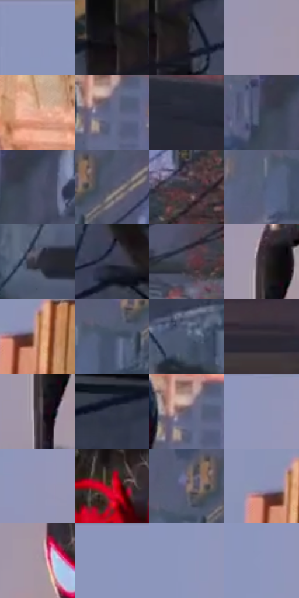

# 电影参考 677

- 状态：常规／活跃；来源世界：miles-home。
- 视角：rolled-or-dutch；景别：environment-wide；场景：street。
- 时段：daylight-time-unspecified（外观依据，中置信度；具体时间／晨昏未知）；光照：warm-day。
- 材质候选：fabric, glass, brick, metal, sky（帧级，不是像素分割）。
- 明暗组：dark；L* P5/P50/P95：7.59189 / 33.81825 / 66.64469。
- 资格门禁：无附加门禁。
- 原截图 SHA-256：`9ec8c851711aa2e08afc1aebb6ef831cde2377f790e6c4ddebd5a84113b1a2c7`；尺寸：2878 × 1200。
- sRGB 像素 SHA-256：`6c3d270922f7ead8ca06089f4aab193f0e895fd3db7c2d0e0549b695ca28f227`。

## 观察与迁移

倾转视角的建筑立面与街道，人物贴着原有墙面运动，不按城市组标签添加河水。

旋转取景中暖桃砖面和冷灰街道立面分区，黑电缆是实际结构，黑红人物保留强剪影；学习受光与窗组，不照搬旋转镜头、攀墙姿势或任意弯折楼体。

本公开版保存32个128×128原像素色卡上下文；图集格子并非原场景相邻位置。原rect、图集tile和像素SHA见 `data/palette-crops.json`。上下文不足时不得批准替色，不能以小样推断完整构图。

## 实测色卡

颜色比例分母为保留采样像素，不是材料面积；全部 32 色参与全库匹配。表内四舍五入仅用于阅读，原精度在 JSON。

| ID | HEX | Lab | 原图 xy | 像素数 | 比例 | 明度角色 |
| --- | --- | --- | --- | ---: | ---: | --- |
| 677-S01 | #8C96BC | [62.522881, 4.954858, -20.874189] | [32, 24] | 13584 | 7.051202% | light |
| 677-S02 | #131015 | [5.087109, 2.207679, -2.4849] | [2132, 168] | 10875 | 5.645011% | deep-shadow |
| 677-S03 | #1F1D24 | [11.257317, 2.780641, -4.414631] | [2192, 188] | 9907 | 5.142540% | deep-shadow |
| 677-S04 | #9D96AE | [63.373159, 7.328627, -11.579107] | [704, 188] | 9854 | 5.115028% | light |
| 677-S05 | #E3A68F | [73.278423, 19.542169, 20.775374] | [940, 120] | 9173 | 4.761534% | light |
| 677-S06 | #5F6886 | [44.310668, 3.91736, -17.702755] | [1092, 320] | 8436 | 4.378971% | midtone |
| 677-S07 | #252836 | [16.390843, 2.605524, -9.478277] | [2508, 996] | 8197 | 4.254911% | deep-shadow |
| 677-S08 | #394255 | [27.904592, 1.472738, -12.571711] | [1704, 60] | 7784 | 4.040530% | shadow |
| 677-S09 | #41485B | [30.673092, 2.079363, -12.153719] | [1764, 32] | 7742 | 4.018728% | shadow |
| 677-S10 | #525567 | [36.498884, 3.080856, -10.75135] | [1592, 360] | 7649 | 3.970454% | shadow |
| 677-S11 | #3A343B | [22.553634, 4.220405, -3.420958] | [1848, 452] | 7570 | 3.929446% | shadow |
| 677-S12 | #555F7A | [40.443549, 2.929283, -16.434927] | [1428, 448] | 7401 | 3.841722% | midtone |
| 677-S13 | #2F2F3B | [19.85503, 3.079633, -7.582289] | [2716, 860] | 6750 | 3.503800% | deep-shadow |
| 677-S14 | #373C4D | [25.501897, 2.402015, -11.024048] | [2460, 236] | 6628 | 3.440472% | shadow |
| 677-S15 | #4E414D | [29.25097, 8.065348, -5.148185] | [1700, 612] | 6567 | 3.408808% | shadow |
| 677-S16 | #382E34 | [20.214265, 5.817891, -2.138113] | [712, 588] | 6158 | 3.196503% | shadow |
| 677-S17 | #C1896C | [61.924044, 17.820197, 24.055219] | [180, 896] | 6037 | 3.133695% | light |
| 677-S18 | #435066 | [33.751873, 0.778549, -14.416003] | [1496, 416] | 5897 | 3.061023% | shadow |
| 677-S19 | #4D5971 | [37.688373, 1.538175, -15.182046] | [2752, 464] | 5214 | 2.706491% | shadow |
| 677-S20 | #2D2932 | [17.339169, 4.010291, -5.162756] | [1188, 956] | 4820 | 2.501973% | deep-shadow |
| 677-S21 | #423840 | [24.817677, 6.09072, -3.324755] | [708, 676] | 4290 | 2.226859% | shadow |
| 677-S22 | #2E3647 | [22.562877, 1.428531, -11.597006] | [2800, 200] | 4238 | 2.199867% | shadow |
| 677-S23 | #615D6D | [40.367857, 5.07544, -8.501649] | [1080, 304] | 4093 | 2.124600% | midtone |
| 677-S24 | #9296B9 | [62.865434, 6.13032, -18.624366] | [520, 24] | 3767 | 1.955380% | light |
| 677-S25 | #9495B5 | [62.614239, 6.418937, -16.739241] | [416, 624] | 3734 | 1.938250% | light |
| 677-S26 | #962026 | [33.262465, 48.186717, 27.316069] | [968, 572] | 3605 | 1.871289% | shadow |
| 677-S27 | #7E6D73 | [47.766161, 7.777279, -0.865148] | [1512, 356] | 3287 | 1.706221% | midtone |
| 677-S28 | #8891B5 | [60.62281, 4.845598, -19.851118] | [136, 880] | 2988 | 1.551015% | light |
| 677-S29 | #A594A0 | [63.108797, 8.475083, -3.996703] | [832, 352] | 2912 | 1.511565% | light |
| 677-S30 | #8C96BE | [62.596081, 5.444334, -21.886389] | [328, 48] | 1467 | 0.761492% | light |
| 677-S31 | #8D97BC | [62.865507, 4.698711, -20.34497] | [392, 260] | 1447 | 0.751111% | light |
| 677-S32 | #8F98BE | [63.353557, 5.239222, -20.710106] | [408, 168] | 577 | 0.299510% | light |

## 色阶与空间分布

- 采样 ROI：`[0.01, 0.02, 0.98, 0.94]`；步长：4；样本数：192648。
- 排除区：`[]`。
- 深暗、暗、中、亮、高光五段计数：`[40163, 76921, 22806, 52098, 660]`。
- RGB 各 256 箱、L* 100 箱、13×5 色相明度表和 3×3 空间统计全部保存在 [总数据](../film-library.json)。
- [可视化档案](../../references/library.html)按需绘制直方图，不存 2,094 张重复图表图片。

## 纹理特征占比

**这是分块图像特征的面积占比，不是波点／排线／丝网／错版的精确语义覆盖率。** 窗格、发丝、织物也会产生方向或周期特征。
原图 ROI 像素 3082368；已测块覆盖 3082368（100.0000%）；未测 0。

| 特征 | 块覆盖像素 | 占已测面积 | 阈值敏感范围 |
| --- | ---: | ---: | --- |
| low-contrast | 649344 | 21.0664% | 20.4643% ~ 23.7905% |
| directional-structure | 729088 | 23.6535% | 10.2986% ~ 37.3780% |
| periodic-structure | 1687552 | 54.7486% | 42.1577% ~ 61.8579% |
| mixed-detail | 16384 | 0.5315% | 0.0000% ~ 4.0530% |

阈值敏感范围不是统计置信区间。逐块坐标、尺度、对比、方向一致性、频谱集中度、频率与角度见 [全量特征记录](../texture-features.jsonl)，以帧号定位。
四种印刷层的真实像素覆盖仍标为 `null`，不能填 0，也不能拿上表代替。不得据这些代理测量删除唯一证据。

[测量方法与保留策略](../../references/library-retention.md) · [分类索引](../archive/README.md)
