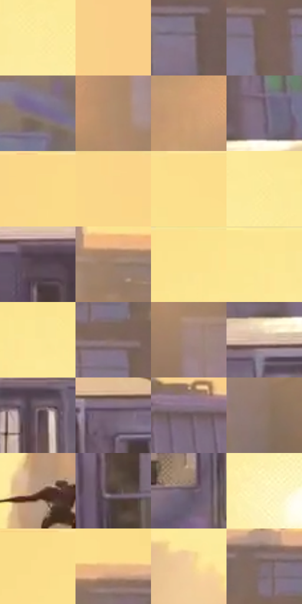

# 电影参考 678

- 状态：常规／活跃；来源世界：miles-home。
- 视角：near-level；景别：environment-wide；场景：city。
- 时段：daylight-time-unspecified（外观依据，中置信度；具体时间／晨昏未知）；光照：warm-day。
- 材质候选：fabric, glass, brick, metal, sky（帧级，不是像素分割）。
- 明暗组：light；L* P5/P50/P95：33.05808 / 63.38539 / 92.99638。
- 资格门禁：无附加门禁。
- 原截图 SHA-256：`824d8653b0afd39b8b06d12a511bd4a072ff852d9b55454b35a1a75d5a01436d`；尺寸：2880 × 1210。
- sRGB 像素 SHA-256：`2dfd9f784c46524fd9e44460dc0b7859c80f0419458c22050f026db4ed64eb85`。

## 观察与迁移

暖日光列车顶部与逆光楼群，金属车体、窗玻璃和天空分层；本帧没有可见河面。

金黄天空与远处灰紫楼体形成空气透视，列车银灰车身仍有冷紫阴面和细亮车顶；跳跃小剪影并非高亮焦点，暖环境不等于把所有材料染成同一金色。

本公开版保存32个128×128原像素色卡上下文；图集格子并非原场景相邻位置。原rect、图集tile和像素SHA见 `data/palette-crops.json`。上下文不足时不得批准替色，不能以小样推断完整构图。

## 实测色卡

颜色比例分母为保留采样像素，不是材料面积；全部 32 色参与全库匹配。表内四舍五入仅用于阅读，原精度在 JSON。

| ID | HEX | Lab | 原图 xy | 像素数 | 比例 | 明度角色 |
| --- | --- | --- | --- | ---: | ---: | --- |
| 678-S01 | #FDECA0 | [93.195454, -4.865088, 38.961833] | [1192, 228] | 11051 | 5.695100% | highlight |
| 678-S02 | #F9CF88 | [85.274373, 5.84563, 40.726437] | [2680, 348] | 9949 | 5.127188% | highlight |
| 678-S03 | #887788 | [52.069001, 9.794332, -6.829966] | [2304, 464] | 9185 | 4.733463% | midtone |
| 678-S04 | #7B645A | [44.324664, 7.580568, 9.149348] | [2160, 460] | 8650 | 4.457752% | midtone |
| 678-S05 | #7A6C7F | [47.488676, 9.256497, -8.480713] | [204, 500] | 7714 | 3.975387% | midtone |
| 678-S06 | #B08E6E | [61.397473, 8.300998, 21.917439] | [1628, 528] | 7356 | 3.790893% | light |
| 678-S07 | #CEA074 | [69.131167, 11.392474, 29.456282] | [484, 772] | 7300 | 3.762033% | light |
| 678-S08 | #6E5F72 | [42.3298, 9.8357, -8.49121] | [2480, 772] | 7206 | 3.713591% | midtone |
| 678-S09 | #FBD988 | [87.928056, 1.498921, 44.127634] | [288, 44] | 7044 | 3.630105% | highlight |
| 678-S10 | #FBD689 | [87.198486, 3.13071, 42.708041] | [2256, 28] | 6836 | 3.522912% | highlight |
| 678-S11 | #FCDF8C | [89.564807, -0.777541, 44.229641] | [1764, 44] | 6614 | 3.408505% | highlight |
| 678-S12 | #FCE99A | [92.269026, -4.397602, 40.736182] | [1352, 184] | 6430 | 3.313681% | highlight |
| 678-S13 | #57464E | [31.70838, 8.777307, -2.044014] | [1972, 912] | 6402 | 3.299252% | shadow |
| 678-S14 | #9B7E69 | [54.980801, 7.994318, 15.658526] | [1736, 312] | 6349 | 3.271938% | midtone |
| 678-S15 | #FCE38E | [90.592304, -2.607754, 44.540631] | [812, 28] | 6163 | 3.176084% | highlight |
| 678-S16 | #FCE592 | [91.149287, -3.217797, 43.27138] | [1080, 40] | 5986 | 3.084867% | highlight |
| 678-S17 | #FCE897 | [91.97383, -4.212934, 41.847611] | [1120, 80] | 5841 | 3.010142% | highlight |
| 678-S18 | #866F67 | [48.781367, 7.710475, 7.841573] | [2116, 408] | 5761 | 2.968914% | midtone |
| 678-S19 | #A2877F | [58.548514, 8.948503, 8.134605] | [1672, 644] | 5533 | 2.851415% | midtone |
| 678-S20 | #D9BDAD | [78.558214, 7.443117, 11.757189] | [2404, 856] | 5318 | 2.740616% | light |
| 678-S21 | #604F5B | [35.663259, 9.418521, -4.352256] | [840, 948] | 5276 | 2.718971% | shadow |
| 678-S22 | #766575 | [44.862336, 9.861119, -6.443042] | [2628, 896] | 5264 | 2.712787% | midtone |
| 678-S23 | #6A575C | [38.990773, 8.709022, 0.042672] | [2652, 488] | 5214 | 2.687019% | shadow |
| 678-S24 | #8F776B | [51.94511, 7.367561, 10.087931] | [1500, 712] | 5201 | 2.680320% | midtone |
| 678-S25 | #B89885 | [65.232889, 9.020943, 14.473044] | [1272, 712] | 4852 | 2.500464% | light |
| 678-S26 | #4C3B3B | [26.678847, 7.466647, 2.849805] | [2188, 1016] | 4825 | 2.486549% | shadow |
| 678-S27 | #6D5C66 | [41.000842, 8.790522, -3.138794] | [712, 1068] | 4696 | 2.420070% | midtone |
| 678-S28 | #FBF0BC | [94.509556, -4.208916, 26.53168] | [1120, 480] | 4382 | 2.258251% | highlight |
| 678-S29 | #FBDD89 | [88.937349, -0.444986, 44.90283] | [540, 32] | 3526 | 1.817114% | highlight |
| 678-S30 | #E8BB86 | [78.7064, 9.330095, 32.948031] | [1936, 268] | 2983 | 1.537280% | light |
| 678-S31 | #F4CF9A | [85.095665, 5.783918, 31.192017] | [952, 764] | 2725 | 1.404321% | highlight |
| 678-S32 | #847077 | [49.284628, 9.091626, -0.952636] | [2060, 328] | 2412 | 1.243017% | midtone |

## 色阶与空间分布

- 采样 ROI：`[0.01, 0.02, 0.98, 0.94]`；步长：4；样本数：194044。
- 排除区：`[]`。
- 深暗、暗、中、亮、高光五段计数：`[55, 21484, 68477, 24267, 79761]`。
- RGB 各 256 箱、L* 100 箱、13×5 色相明度表和 3×3 空间统计全部保存在 [总数据](../film-library.json)。
- [可视化档案](../../references/library.html)按需绘制直方图，不存 2,094 张重复图表图片。

## 纹理特征占比

**这是分块图像特征的面积占比，不是波点／排线／丝网／错版的精确语义覆盖率。** 窗格、发丝、织物也会产生方向或周期特征。
原图 ROI 像素 3109722；已测块覆盖 3109722（100.0000%）；未测 0。

| 特征 | 块覆盖像素 | 占已测面积 | 阈值敏感范围 |
| --- | ---: | ---: | --- |
| low-contrast | 843520 | 27.1253% | 27.1253% ~ 28.1790% |
| directional-structure | 669146 | 21.5179% | 14.8674% ~ 31.4830% |
| periodic-structure | 1552896 | 49.9368% | 40.4985% ~ 52.8539% |
| mixed-detail | 44160 | 1.4201% | 0.8932% ~ 4.0997% |

阈值敏感范围不是统计置信区间。逐块坐标、尺度、对比、方向一致性、频谱集中度、频率与角度见 [全量特征记录](../texture-features.jsonl)，以帧号定位。
四种印刷层的真实像素覆盖仍标为 `null`，不能填 0，也不能拿上表代替。不得据这些代理测量删除唯一证据。

[测量方法与保留策略](../../references/library-retention.md) · [分类索引](../archive/README.md)
