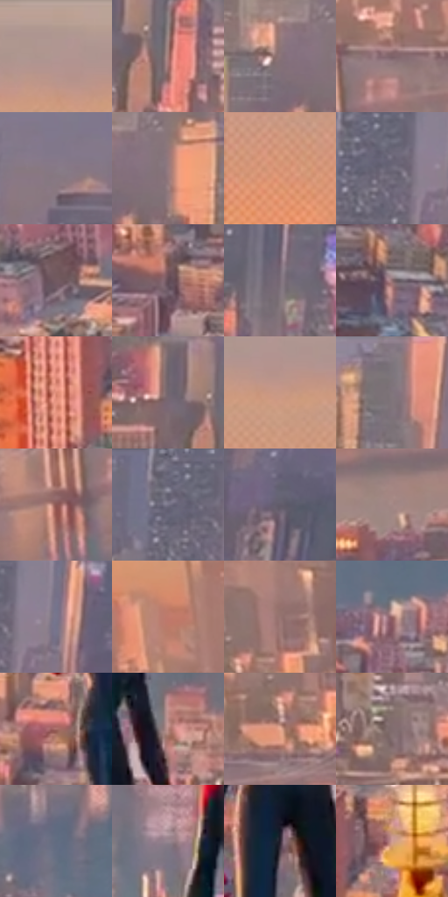

# 电影参考 679

- 状态：常规／活跃；来源世界：miles-home。
- 视角：high-angle；景别：environment-wide；场景：city。
- 时段：daylight-time-unspecified（外观依据，中置信度；具体时间／晨昏未知）；光照：warm-day。
- 材质候选：fabric, glass, stone, metal, water, sky（帧级，不是像素分割）。
- 明暗组：middle；L* P5/P50/P95：37.34941 / 50.85919 / 68.94816。
- 资格门禁：无附加门禁。
- 原截图 SHA-256：`f2071ccdb7b01a3e22bfdd0d7ec5f11e1d1cc7e0c2667c17dd75f91fd1616866`；尺寸：2880 × 1198。
- sRGB 像素 SHA-256：`69c1e91d17c0312af77cb0a9a0a518b96d0e34a87826b761b5f44df1c1f32dbb`。

## 观察与迁移

河岸高处俯视城市，水面映光、近楼与远岸分别分析，不把水面响应套到建筑上。

近区砖楼暖桃珊瑚面与灰屋顶交错，河面蓝灰并留暖色纵向映色，远城受光面暖、侧面冷紫；先读楼群、河道和天空层级，不把整城替换为霓虹玻璃。

本公开版保存32个128×128原像素色卡上下文；图集格子并非原场景相邻位置。原rect、图集tile和像素SHA见 `data/palette-crops.json`。上下文不足时不得批准替色，不能以小样推断完整构图。

## 实测色卡

颜色比例分母为保留采样像素，不是材料面积；全部 32 色参与全库匹配。表内四舍五入仅用于阅读，原精度在 JSON。

| ID | HEX | Lab | 原图 xy | 像素数 | 比例 | 明度角色 |
| --- | --- | --- | --- | ---: | ---: | --- |
| 679-S01 | #B09691 | [64.232195, 8.83321, 6.223568] | [292, 44] | 10334 | 5.364188% | light |
| 679-S02 | #A77B76 | [55.776881, 16.392389, 9.455671] | [1776, 336] | 8547 | 4.436589% | midtone |
| 679-S03 | #8B7479 | [51.106643, 9.835736, 0.609206] | [1372, 260] | 7939 | 4.120988% | midtone |
| 679-S04 | #7E6268 | [44.477209, 12.318999, 0.946781] | [476, 480] | 7892 | 4.096591% | midtone |
| 679-S05 | #877986 | [52.450204, 7.855479, -5.101275] | [2392, 156] | 7848 | 4.073751% | midtone |
| 679-S06 | #987B7F | [54.422019, 11.88053, 2.074087] | [1440, 264] | 7325 | 3.802272% | midtone |
| 679-S07 | #DB987A | [68.696796, 21.588594, 25.882051] | [52, 184] | 6961 | 3.613326% | light |
| 679-S08 | #716C7C | [46.566477, 5.29536, -8.153553] | [1976, 80] | 6867 | 3.564532% | midtone |
| 679-S09 | #725A61 | [40.821182, 11.054604, -0.268702] | [356, 1112] | 6798 | 3.528716% | midtone |
| 679-S10 | #614B55 | [34.456764, 11.128606, -2.334858] | [1092, 836] | 6367 | 3.304991% | shadow |
| 679-S11 | #7D6D79 | [47.851701, 8.555121, -4.33032] | [1860, 232] | 6314 | 3.277480% | midtone |
| 679-S12 | #8C6D70 | [49.109744, 12.772731, 3.051513] | [2560, 1020] | 6185 | 3.210519% | midtone |
| 679-S13 | #DC8975 | [65.274777, 29.526795, 24.084367] | [1148, 1076] | 6107 | 3.170030% | light |
| 679-S14 | #72646E | [43.970408, 7.503149, -3.576125] | [1704, 300] | 5939 | 3.082825% | midtone |
| 679-S15 | #C79885 | [66.74404, 14.939918, 16.803448] | [320, 112] | 5711 | 2.964474% | light |
| 679-S16 | #80747D | [50.169404, 6.360805, -3.249501] | [1636, 60] | 5710 | 2.963955% | midtone |
| 679-S17 | #8C5652 | [42.523373, 21.889921, 11.781957] | [388, 560] | 5617 | 2.915680% | midtone |
| 679-S18 | #696577 | [43.715718, 5.451711, -9.492948] | [1936, 40] | 5611 | 2.912566% | midtone |
| 679-S19 | #615B6A | [39.688304, 5.616107, -7.676192] | [2520, 340] | 5601 | 2.907375% | shadow |
| 679-S20 | #A48785 | [58.895432, 10.685864, 5.220379] | [192, 708] | 5485 | 2.847162% | midtone |
| 679-S21 | #78768D | [50.538063, 5.707733, -12.207872] | [2048, 72] | 5429 | 2.818093% | midtone |
| 679-S22 | #C07A6C | [58.236548, 25.683867, 19.071226] | [440, 328] | 5405 | 2.805635% | midtone |
| 679-S23 | #977572 | [52.417619, 12.838803, 6.774729] | [748, 364] | 5386 | 2.795773% | midtone |
| 679-S24 | #946565 | [47.680292, 18.971687, 7.685037] | [2640, 740] | 5347 | 2.775528% | midtone |
| 679-S25 | #A76D67 | [51.988099, 22.334622, 12.886092] | [1404, 952] | 5121 | 2.658216% | midtone |
| 679-S26 | #B6867F | [60.36394, 17.399113, 10.995642] | [1588, 712] | 5119 | 2.657178% | light |
| 679-S27 | #EBAD96 | [75.918387, 19.724822, 20.739239] | [700, 448] | 5069 | 2.631224% | light |
| 679-S28 | #816C6F | [47.675659, 8.812871, 1.42654] | [1096, 424] | 4981 | 2.585545% | midtone |
| 679-S29 | #616C80 | [45.393023, 0.605473, -12.444541] | [2224, 624] | 4837 | 2.510797% | midtone |
| 679-S30 | #97868F | [57.667938, 8.055255, -2.460231] | [1376, 660] | 4523 | 2.347805% | midtone |
| 679-S31 | #2A2330 | [14.995271, 6.461559, -7.324462] | [1484, 804] | 3347 | 1.737366% | deep-shadow |
| 679-S32 | #D19E94 | [69.5758, 17.538446, 12.596452] | [1252, 1028] | 2926 | 1.518832% | light |

## 色阶与空间分布

- 采样 ROI：`[0.01, 0.02, 0.98, 0.94]`；步长：4；样本数：192648。
- 排除区：`[]`。
- 深暗、暗、中、亮、高光五段计数：`[2745, 12356, 134575, 42051, 921]`。
- RGB 各 256 箱、L* 100 箱、13×5 色相明度表和 3×3 空间统计全部保存在 [总数据](../film-library.json)。
- [可视化档案](../../references/library.html)按需绘制直方图，不存 2,094 张重复图表图片。

## 纹理特征占比

**这是分块图像特征的面积占比，不是波点／排线／丝网／错版的精确语义覆盖率。** 窗格、发丝、织物也会产生方向或周期特征。
原图 ROI 像素 3081782；已测块覆盖 3081782（100.0000%）；未测 0。

| 特征 | 块覆盖像素 | 占已测面积 | 阈值敏感范围 |
| --- | ---: | ---: | --- |
| low-contrast | 92672 | 3.0071% | 2.4755% ~ 4.6020% |
| directional-structure | 203904 | 6.6164% | 1.5035% ~ 15.6543% |
| periodic-structure | 2366208 | 76.7805% | 64.3036% ~ 77.0855% |
| mixed-detail | 418998 | 13.5960% | 4.7848% ~ 29.5909% |

阈值敏感范围不是统计置信区间。逐块坐标、尺度、对比、方向一致性、频谱集中度、频率与角度见 [全量特征记录](../texture-features.jsonl)，以帧号定位。
四种印刷层的真实像素覆盖仍标为 `null`，不能填 0，也不能拿上表代替。不得据这些代理测量删除唯一证据。

[测量方法与保留策略](../../references/library-retention.md) · [分类索引](../archive/README.md)
