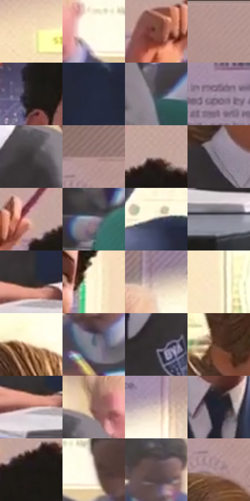

# 电影参考 680

- 状态：常规／活跃；来源世界：miles-home。
- 视角：near-level；景别：medium；场景：classroom。
- 时段：daylight-time-unspecified（外观依据，中置信度；具体时间／晨昏未知）；光照：warm-day。
- 材质候选：skin, hair, fabric, paper, paint, plastic（帧级，不是像素分割）。
- 明暗组：middle；L* P5/P50/P95：11.41103 / 57.53907 / 97.98161。
- 资格门禁：无附加门禁。
- 原截图 SHA-256：`886402db5f8d6afe188c50e3797b1a498a94aec91d1fde817c5fb4cfee32ce0c`；尺寸：2880 × 1212。
- sRGB 像素 SHA-256：`d34271712d79bfdc4bfd1e05ca2674817c7383680be99ee2c27987f3552b4c74`。

## 观察与迁移

日光课堂与校服脸部，墙面大亮区不吞没人物。

奶白墙受暖日光，蓝外套、灰背心、白领、绿椅与灰桌各保留固有色角色；后排人物简化，纸面与亮墙不一律纯白，墙上教学文字只作为图像内容。

本公开版保存32个128×128原像素色卡上下文；图集格子并非原场景相邻位置。原rect、图集tile和像素SHA见 `data/palette-crops.json`。上下文不足时不得批准替色，不能以小样推断完整构图。

## 实测色卡

颜色比例分母为保留采样像素，不是材料面积；全部 32 色参与全库匹配。表内四舍五入仅用于阅读，原精度在 JSON。

| ID | HEX | Lab | 原图 xy | 像素数 | 比例 | 明度角色 |
| --- | --- | --- | --- | ---: | ---: | --- |
| 680-S01 | #F7E0B8 | [90.113302, 1.894946, 22.494954] | [1864, 304] | 11581 | 5.968234% | highlight |
| 680-S02 | #FCFAEB | [98.059653, -1.882567, 7.427709] | [484, 692] | 9758 | 5.028756% | highlight |
| 680-S03 | #7D4A3D | [37.106426, 20.165429, 16.978396] | [1312, 208] | 8549 | 4.405702% | shadow |
| 680-S04 | #B49490 | [64.078166, 11.316885, 6.616214] | [544, 36] | 8353 | 4.304694% | light |
| 680-S05 | #1F1D1B | [10.915341, 0.484, 1.720595] | [1392, 372] | 8105 | 4.176888% | deep-shadow |
| 680-S06 | #262B40 | [17.963186, 4.034567, -13.991963] | [1300, 664] | 7685 | 3.960442% | deep-shadow |
| 680-S07 | #43454C | [29.339877, 0.816938, -4.481804] | [448, 844] | 7531 | 3.881079% | shadow |
| 680-S08 | #A895A8 | [63.874254, 10.519068, -7.349438] | [628, 340] | 7397 | 3.812022% | light |
| 680-S09 | #3C3738 | [23.600583, 2.400408, 0.165901] | [280, 728] | 7359 | 3.792439% | shadow |
| 680-S10 | #9F7D78 | [55.477184, 12.361141, 7.752867] | [80, 180] | 7116 | 3.667209% | midtone |
| 680-S11 | #BEA29D | [68.912708, 9.441569, 6.409475] | [1532, 164] | 6841 | 3.525489% | light |
| 680-S12 | #7E7585 | [50.513246, 6.670867, -7.481296] | [2428, 688] | 6818 | 3.513636% | midtone |
| 680-S13 | #CFAA9E | [72.551641, 11.665311, 11.264496] | [1424, 172] | 6787 | 3.497660% | light |
| 680-S14 | #9C8FA0 | [61.002581, 8.056722, -7.203722] | [2092, 892] | 6624 | 3.413659% | light |
| 680-S15 | #535761 | [36.963672, 0.717867, -6.304773] | [1196, 584] | 6538 | 3.369339% | shadow |
| 680-S16 | #8B8998 | [57.700596, 3.787013, -7.701589] | [128, 1044] | 6105 | 3.146194% | midtone |
| 680-S17 | #322B2B | [18.278103, 3.197859, 1.176095] | [1536, 948] | 5570 | 2.870483% | deep-shadow |
| 680-S18 | #FDF7D9 | [96.989702, -2.875273, 15.155778] | [1688, 448] | 5352 | 2.758137% | highlight |
| 680-S19 | #CAB6B1 | [75.567974, 6.282465, 5.13954] | [452, 544] | 5293 | 2.727732% | light |
| 680-S20 | #F9ECC7 | [93.561473, -1.404621, 19.552888] | [2248, 308] | 5242 | 2.701449% | highlight |
| 680-S21 | #ECCEAD | [84.481057, 5.607362, 20.305619] | [2536, 280] | 5130 | 2.643730% | highlight |
| 680-S22 | #5E6472 | [42.321001, 0.900925, -8.650163] | [652, 816] | 5100 | 2.628270% | midtone |
| 680-S23 | #353134 | [20.833329, 2.454276, -1.262881] | [2616, 820] | 4960 | 2.556121% | shadow |
| 680-S24 | #523426 | [24.921501, 11.679912, 14.367472] | [2360, 496] | 4879 | 2.514378% | shadow |
| 680-S25 | #C19B90 | [67.123227, 12.452936, 11.12533] | [1516, 984] | 4406 | 2.270619% | light |
| 680-S26 | #8C625B | [45.726092, 16.046995, 10.791911] | [344, 656] | 4178 | 2.153120% | midtone |
| 680-S27 | #D7C3BD | [80.265277, 6.026976, 5.568424] | [892, 452] | 4107 | 2.116530% | highlight |
| 680-S28 | #242532 | [15.107166, 3.138017, -8.631711] | [1496, 688] | 4056 | 2.090248% | deep-shadow |
| 680-S29 | #1C1815 | [8.604873, 1.302194, 2.765313] | [1492, 224] | 3397 | 1.750634% | deep-shadow |
| 680-S30 | #E9DCD1 | [88.502263, 2.601434, 6.995253] | [568, 704] | 3381 | 1.742388% | highlight |
| 680-S31 | #5B4947 | [32.798012, 7.261946, 4.076112] | [1916, 720] | 3030 | 1.561502% | shadow |
| 680-S32 | #A7898C | [59.889814, 11.859238, 2.686885] | [56, 256] | 2816 | 1.451217% | midtone |

## 色阶与空间分布

- 采样 ROI：`[0.01, 0.02, 0.98, 0.94]`；步长：4；样本数：194044。
- 排除区：`[]`。
- 深暗、暗、中、亮、高光五段计数：`[28602, 41861, 32927, 48508, 42146]`。
- RGB 各 256 箱、L* 100 箱、13×5 色相明度表和 3×3 空间统计全部保存在 [总数据](../film-library.json)。
- [可视化档案](../../references/library.html)按需绘制直方图，不存 2,094 张重复图表图片。

## 纹理特征占比

**这是分块图像特征的面积占比，不是波点／排线／丝网／错版的精确语义覆盖率。** 窗格、发丝、织物也会产生方向或周期特征。
原图 ROI 像素 3115310；已测块覆盖 3115310（100.0000%）；未测 0。

| 特征 | 块覆盖像素 | 占已测面积 | 阈值敏感范围 |
| --- | ---: | ---: | --- |
| low-contrast | 245760 | 7.8888% | 5.7851% ~ 8.4147% |
| directional-structure | 1121710 | 36.0064% | 26.6302% ~ 43.8048% |
| periodic-structure | 1665920 | 53.4753% | 49.8842% ~ 60.2218% |
| mixed-detail | 81920 | 2.6296% | 0.5259% ~ 4.7333% |

阈值敏感范围不是统计置信区间。逐块坐标、尺度、对比、方向一致性、频谱集中度、频率与角度见 [全量特征记录](../texture-features.jsonl)，以帧号定位。
四种印刷层的真实像素覆盖仍标为 `null`，不能填 0，也不能拿上表代替。不得据这些代理测量删除唯一证据。

[测量方法与保留策略](../../references/library-retention.md) · [分类索引](../archive/README.md)
