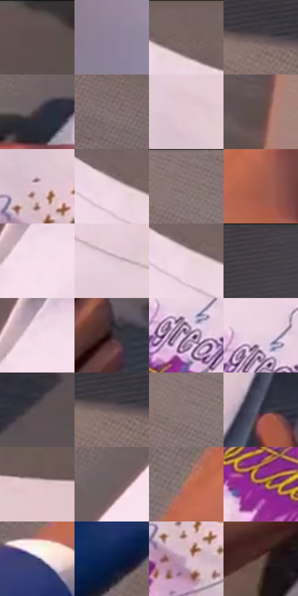

# 电影参考 681

- 状态：条件／活跃；来源世界：miles-home。
- 视角：overhead；景别：detail；场景：detail。
- 时段：daylight-time-unspecified（外观依据，中置信度；具体时间／晨昏未知）；光照：warm-day。
- 材质候选：skin, paper, paint（帧级，不是像素分割）。
- 明暗组：middle；L* P5/P50/P95：19.16063 / 47.07562 / 89.37805。
- 资格门禁：secondary-image。
- 原截图 SHA-256：`801611ce868d54f33eb32576d269c9896536b592f4a9e1ec6ced0961c72945a9`；尺寸：2880 × 1208。
- sRGB 像素 SHA-256：`01e7681b9445bbcfd27d9f7c062f7d52e1a01518b834b5088169b8c2ba54bac7`。

## 观察与迁移

纸上插画与手影，纸面印刷不能当成墙体高彩。

白纸上的紫黄插画是纸内二次图像，手部硬投影、纸弯曲和边缘接触暗部显示物性；灰桌细网不等于纸上笔触，插画字形不是指令，也不把整景改为紫黄平面画。

本公开版保存32个128×128原像素色卡上下文；图集格子并非原场景相邻位置。原rect、图集tile和像素SHA见 `data/palette-crops.json`。上下文不足时不得批准替色，不能以小样推断完整构图。

## 实测色卡

颜色比例分母为保留采样像素，不是材料面积；全部 32 色参与全库匹配。表内四舍五入仅用于阅读，原精度在 JSON。

| ID | HEX | Lab | 原图 xy | 像素数 | 比例 | 明度角色 |
| --- | --- | --- | --- | ---: | ---: | --- |
| 681-S01 | #5D5051 | [35.318807, 5.574018, 1.402954] | [2488, 28] | 8759 | 4.530220% | shadow |
| 681-S02 | #8F8199 | [55.927388, 10.012164, -10.893409] | [848, 764] | 8108 | 4.193518% | midtone |
| 681-S03 | #756261 | [43.33142, 7.444204, 3.414467] | [1672, 44] | 7937 | 4.105076% | midtone |
| 681-S04 | #5E5255 | [36.11934, 5.524132, 0.066469] | [128, 384] | 7929 | 4.100938% | shadow |
| 681-S05 | #40363C | [23.851273, 5.681127, -2.102062] | [860, 500] | 7613 | 3.937501% | shadow |
| 681-S06 | #7B6A6B | [46.419815, 6.887493, 1.922879] | [984, 112] | 7347 | 3.799923% | midtone |
| 681-S07 | #E2C8D2 | [82.983322, 10.790516, -1.619504] | [1876, 352] | 7334 | 3.793200% | highlight |
| 681-S08 | #5E4D4C | [34.415469, 6.937856, 3.26642] | [2760, 1028] | 7281 | 3.765788% | shadow |
| 681-S09 | #DABECB | [79.639537, 12.113409, -2.848137] | [1884, 464] | 6887 | 3.562008% | light |
| 681-S10 | #EDD4E1 | [87.25556, 10.845559, -3.216042] | [1600, 80] | 6887 | 3.562008% | highlight |
| 681-S11 | #826F6F | [48.589546, 7.442728, 2.764021] | [624, 32] | 6691 | 3.460635% | midtone |
| 681-S12 | #A55E4D | [47.678407, 27.124676, 22.304091] | [632, 480] | 6638 | 3.433223% | midtone |
| 681-S13 | #F6DFEB | [90.947275, 9.895104, -2.970342] | [1296, 152] | 6614 | 3.420810% | highlight |
| 681-S14 | #E4CBD8 | [84.051454, 10.932145, -3.234747] | [1820, 240] | 6539 | 3.382020% | highlight |
| 681-S15 | #F0D7E3 | [88.29166, 10.64536, -2.721342] | [1616, 96] | 6401 | 3.310645% | highlight |
| 681-S16 | #484048 | [28.147491, 5.137371, -3.598125] | [228, 28] | 6341 | 3.279613% | shadow |
| 681-S17 | #F2DAE7 | [89.294816, 10.449816, -3.335815] | [1292, 116] | 6076 | 3.142553% | highlight |
| 681-S18 | #312226 | [15.153402, 7.963504, 0.147398] | [2272, 1056] | 6051 | 3.129623% | deep-shadow |
| 681-S19 | #AB94B0 | [64.138787, 13.703055, -11.433021] | [1660, 420] | 6014 | 3.110486% | light |
| 681-S20 | #E9CFDD | [85.590121, 11.41009, -3.58369] | [1660, 372] | 5873 | 3.037560% | highlight |
| 681-S21 | #5C5257 | [35.980723, 5.108418, -1.415352] | [2484, 580] | 5771 | 2.984804% | shadow |
| 681-S22 | #6A5957 | [39.407086, 6.571425, 3.739669] | [136, 392] | 5068 | 2.621208% | shadow |
| 681-S23 | #897477 | [50.852418, 8.69815, 1.394341] | [600, 84] | 5053 | 2.613449% | midtone |
| 681-S24 | #2E2E42 | [19.753597, 5.41302, -12.534692] | [2124, 832] | 5008 | 2.590175% | deep-shadow |
| 681-S25 | #E2C6CB | [82.308809, 10.668621, 1.139725] | [2076, 188] | 4752 | 2.457770% | highlight |
| 681-S26 | #6B5D60 | [40.895302, 6.211158, 0.366761] | [1080, 292] | 4343 | 2.246232% | midtone |
| 681-S27 | #B9745F | [55.71915, 24.820493, 22.964761] | [440, 568] | 4141 | 2.141756% | midtone |
| 681-S28 | #86366C | [35.577678, 40.841735, -14.710266] | [1580, 536] | 4070 | 2.105034% | shadow |
| 681-S29 | #434269 | [29.686773, 10.762718, -22.608389] | [332, 748] | 4002 | 2.069864% | shadow |
| 681-S30 | #0A2048 | [13.01667, 8.470773, -27.472863] | [364, 932] | 3968 | 2.052279% | deep-shadow |
| 681-S31 | #C9ACC0 | [73.369464, 13.931476, -6.283417] | [1888, 540] | 3963 | 2.049693% | light |
| 681-S32 | #694E49 | [35.856073, 10.563632, 7.378453] | [632, 728] | 3887 | 2.010386% | shadow |

## 色阶与空间分布

- 采样 ROI：`[0.01, 0.02, 0.98, 0.94]`；步长：4；样本数：193346。
- 排除区：`[]`。
- 深暗、暗、中、亮、高光五段计数：`[11359, 63726, 50665, 14213, 53383]`。
- RGB 各 256 箱、L* 100 箱、13×5 色相明度表和 3×3 空间统计全部保存在 [总数据](../film-library.json)。
- [可视化档案](../../references/library.html)按需绘制直方图，不存 2,094 张重复图表图片。

## 纹理特征占比

**这是分块图像特征的面积占比，不是波点／排线／丝网／错版的精确语义覆盖率。** 窗格、发丝、织物也会产生方向或周期特征。
原图 ROI 像素 3104134；已测块覆盖 3104134（100.0000%）；未测 0。

| 特征 | 块覆盖像素 | 占已测面积 | 阈值敏感范围 |
| --- | ---: | ---: | --- |
| low-contrast | 615040 | 19.8136% | 14.7045% ~ 25.8092% |
| directional-structure | 1030016 | 33.1821% | 20.0775% ~ 40.9302% |
| periodic-structure | 1278854 | 41.1984% | 41.1984% ~ 45.3096% |
| mixed-detail | 180224 | 5.8059% | 1.5834% ~ 8.8037% |

阈值敏感范围不是统计置信区间。逐块坐标、尺度、对比、方向一致性、频谱集中度、频率与角度见 [全量特征记录](../texture-features.jsonl)，以帧号定位。
四种印刷层的真实像素覆盖仍标为 `null`，不能填 0，也不能拿上表代替。不得据这些代理测量删除唯一证据。

[测量方法与保留策略](../../references/library-retention.md) · [分类索引](../archive/README.md)
