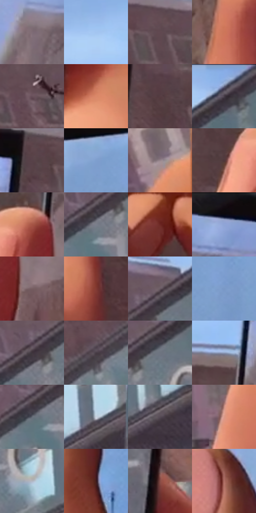

# 电影参考 682

- 状态：条件／活跃；来源世界：miles-home。
- 视角：low-angle；景别：environment-wide；场景：detail。
- 时段：daylight-time-unspecified（外观依据，中置信度；具体时间／晨昏未知）；光照：neutral-day。
- 材质候选：skin, screen, glass, brick, sky（帧级，不是像素分割）。
- 明暗组：middle；L* P5/P50/P95：22.12359 / 45.96686 / 78.55586。
- 资格门禁：secondary-image。
- 原截图 SHA-256：`e4a6c75c3cedd5ba6186e87814101c1aca1cb588983723ef4d24d586e103cc28`；尺寸：2880 × 1210。
- sRGB 像素 SHA-256：`524b4250414f5844a43ee7f5bf3c1d89f781fbde675daa77ea70e640a37861d5`。

## 观察与迁移

手机画面与真实校桥重叠，屏内不重复计入场景。

两部手机显示同一方向但不同框取与录制UI，区别于镜面或透明玻璃；后方暖砖和蓝灰玻璃桥保持立柱节奏。屏内图像可研究显示材质，不默认加设备或UI。

本公开版保存32个128×128原像素色卡上下文；图集格子并非原场景相邻位置。原rect、图集tile和像素SHA见 `data/palette-crops.json`。上下文不足时不得批准替色，不能以小样推断完整构图。

## 实测色卡

颜色比例分母为保留采样像素，不是材料面积；全部 32 色参与全库匹配。表内四舍五入仅用于阅读，原精度在 JSON。

| ID | HEX | Lab | 原图 xy | 像素数 | 比例 | 明度角色 |
| --- | --- | --- | --- | ---: | ---: | --- |
| 682-S01 | #7E6C75 | [47.553536, 8.750025, -2.371484] | [720, 156] | 11733 | 6.046567% | midtone |
| 682-S02 | #A3C5F0 | [78.466381, -1.433244, -24.937094] | [520, 80] | 10807 | 5.569355% | light |
| 682-S03 | #614850 | [33.468714, 12.065312, -0.607228] | [1424, 116] | 9436 | 4.862815% | shadow |
| 682-S04 | #CD765A | [58.674604, 31.324235, 30.128504] | [404, 660] | 8562 | 4.412401% | midtone |
| 682-S05 | #685059 | [36.747035, 11.641822, -1.397646] | [1492, 260] | 8444 | 4.351590% | shadow |
| 682-S06 | #DB8869 | [64.717287, 28.545083, 29.958887] | [1152, 804] | 8364 | 4.310363% | light |
| 682-S07 | #553D42 | [28.544284, 11.397165, 1.08102] | [1204, 220] | 8347 | 4.301602% | shadow |
| 682-S08 | #8DADDE | [70.050851, 0.978867, -28.192513] | [1980, 32] | 8078 | 4.162973% | light |
| 682-S09 | #574249 | [30.409562, 10.349059, -0.727001] | [1176, 88] | 8076 | 4.161943% | shadow |
| 682-S10 | #7F9FCF | [64.812656, 0.97943, -28.05629] | [2616, 244] | 7798 | 4.018676% | light |
| 682-S11 | #95848C | [56.866253, 7.88887, -1.930653] | [2136, 732] | 7228 | 3.724928% | midtone |
| 682-S12 | #4F363A | [25.58251, 11.87493, 1.979796] | [464, 420] | 7051 | 3.633712% | shadow |
| 682-S13 | #A75546 | [45.848317, 32.246602, 24.10906] | [584, 372] | 6649 | 3.426542% | midtone |
| 682-S14 | #7B7F8B | [53.225863, 1.058481, -6.983466] | [1776, 244] | 6445 | 3.321412% | midtone |
| 682-S15 | #6C2623 | [25.852452, 30.980259, 18.371086] | [748, 1084] | 6366 | 3.280699% | shadow |
| 682-S16 | #130C10 | [3.963798, 3.132181, -1.015209] | [844, 28] | 6186 | 3.187937% | deep-shadow |
| 682-S17 | #765E61 | [42.339046, 10.258872, 1.993182] | [652, 472] | 6027 | 3.105997% | midtone |
| 682-S18 | #813A32 | [33.825818, 29.946103, 19.645205] | [1268, 916] | 5379 | 2.772052% | shadow |
| 682-S19 | #675861 | [39.11558, 7.858103, -2.907542] | [1836, 144] | 5228 | 2.694234% | shadow |
| 682-S20 | #7998C6 | [62.165939, 0.85113, -27.144974] | [2692, 304] | 5153 | 2.655583% | light |
| 682-S21 | #3F353D | [23.471936, 6.141268, -3.347765] | [1792, 200] | 5107 | 2.631877% | shadow |
| 682-S22 | #483D46 | [27.178806, 6.65013, -3.724253] | [1512, 388] | 4965 | 2.558698% | shadow |
| 682-S23 | #6D747F | [48.603472, -0.208131, -6.933612] | [1868, 184] | 4943 | 2.547360% | midtone |
| 682-S24 | #8F9FC0 | [65.31081, 1.78316, -18.849718] | [588, 216] | 4602 | 2.371627% | light |
| 682-S25 | #656B76 | [45.067266, 0.16632, -6.901038] | [1748, 256] | 4201 | 2.164973% | midtone |
| 682-S26 | #C9D4E0 | [84.424697, -1.385399, -7.179354] | [2208, 224] | 4174 | 2.151059% | highlight |
| 682-S27 | #554B54 | [33.143377, 6.033032, -3.784053] | [2052, 356] | 3821 | 1.969141% | shadow |
| 682-S28 | #DC9A89 | [69.566288, 22.5659, 18.839612] | [192, 1080] | 3747 | 1.931005% | light |
| 682-S29 | #B1B6C2 | [73.995943, 0.609548, -6.669792] | [1936, 308] | 2492 | 1.284245% | light |
| 682-S30 | #3D1A1C | [14.484718, 17.369281, 6.65271] | [2372, 760] | 1932 | 0.995650% | deep-shadow |
| 682-S31 | #844A44 | [38.237302, 23.890144, 14.337537] | [1100, 656] | 1442 | 0.743130% | shadow |
| 682-S32 | #B07067 | [53.813871, 24.266866, 15.584209] | [2296, 560] | 1261 | 0.649853% | midtone |

## 色阶与空间分布

- 采样 ROI：`[0.01, 0.02, 0.98, 0.94]`；步长：4；样本数：194044。
- 排除区：`[]`。
- 深暗、暗、中、亮、高光五段计数：`[8539, 71363, 54209, 52731, 7202]`。
- RGB 各 256 箱、L* 100 箱、13×5 色相明度表和 3×3 空间统计全部保存在 [总数据](../film-library.json)。
- [可视化档案](../../references/library.html)按需绘制直方图，不存 2,094 张重复图表图片。

## 纹理特征占比

**这是分块图像特征的面积占比，不是波点／排线／丝网／错版的精确语义覆盖率。** 窗格、发丝、织物也会产生方向或周期特征。
原图 ROI 像素 3109722；已测块覆盖 3109722（100.0000%）；未测 0。

| 特征 | 块覆盖像素 | 占已测面积 | 阈值敏感范围 |
| --- | ---: | ---: | --- |
| low-contrast | 126080 | 4.0544% | 1.9469% ~ 6.1618% |
| directional-structure | 1161984 | 37.3662% | 18.0286% ~ 51.9126% |
| periodic-structure | 1706970 | 54.8914% | 44.0331% ~ 71.5946% |
| mixed-detail | 114688 | 3.6880% | 2.1075% ~ 4.2149% |

阈值敏感范围不是统计置信区间。逐块坐标、尺度、对比、方向一致性、频谱集中度、频率与角度见 [全量特征记录](../texture-features.jsonl)，以帧号定位。
四种印刷层的真实像素覆盖仍标为 `null`，不能填 0，也不能拿上表代替。不得据这些代理测量删除唯一证据。

[测量方法与保留策略](../../references/library-retention.md) · [分类索引](../archive/README.md)
