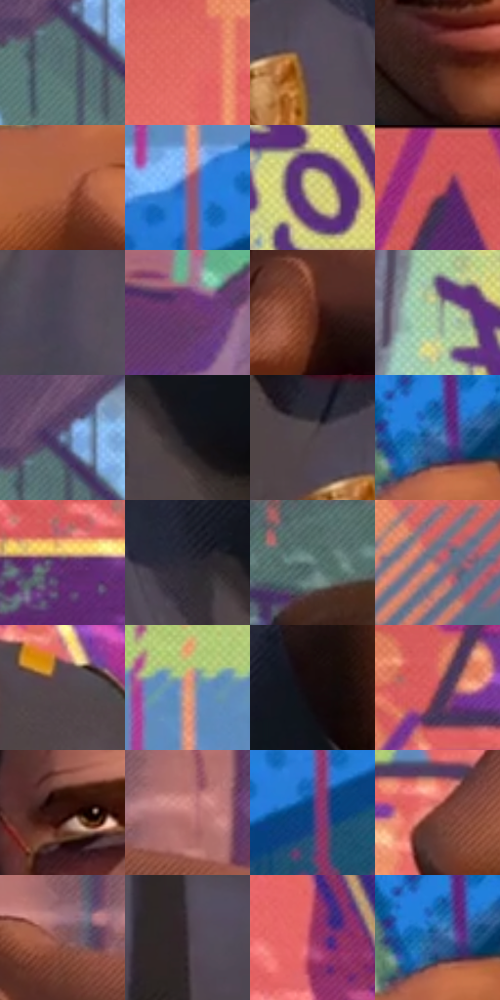

# 电影参考 683

- 状态：常规／活跃；来源世界：miles-home。
- 视角：near-level；景别：medium；场景：street。
- 时段：daylight-time-unspecified（外观依据，中置信度；具体时间／晨昏未知）；光照：warm-day。
- 材质候选：skin, hair, fabric, paint, painted-metal（帧级，不是像素分割）。
- 明暗组：middle；L* P5/P50/P95：8.64893 / 41.08006 / 76.58145。
- 资格门禁：无附加门禁。
- 原截图 SHA-256：`6bf494bc6b75cc96bfffe3053d97ba74d787be2cdd1fe66c284d2ccbbb1477d3`；尺寸：2880 × 1210。
- sRGB 像素 SHA-256：`4c98f49f95f5c44d65ee4b7b6d9d064687546cdeb491edf68a7741b4866317d7`。

## 观察与迁移

墙绘背景与近景皮肤、制服分层，脸上棕色不当砖色，手写签名不可移植。

棕暖皮肤、灰蓝制服、金色徽章和镜片暖映与高彩壁画并存，背景橙青紫绿点线属于真实墙上绘画；皮肤排线、衣纹与墙绘图案分别布置，不全身沾上壁画配色。

本公开版保存32个128×128原像素色卡上下文；图集格子并非原场景相邻位置。原rect、图集tile和像素SHA见 `data/palette-crops.json`。上下文不足时不得批准替色，不能以小样推断完整构图。

## 实测色卡

颜色比例分母为保留采样像素，不是材料面积；全部 32 色参与全库匹配。表内四舍五入仅用于阅读，原精度在 JSON。

| ID | HEX | Lab | 原图 xy | 像素数 | 比例 | 明度角色 |
| --- | --- | --- | --- | ---: | ---: | --- |
| 683-S01 | #566F73 | [45.059925, -8.138925, -5.22799] | [2384, 616] | 14342 | 7.391107% | midtone |
| 683-S02 | #E56E67 | [60.599096, 45.584542, 25.955277] | [576, 96] | 10490 | 5.405990% | light |
| 683-S03 | #584E60 | [34.737908, 8.00819, -8.97059] | [1724, 796] | 9572 | 4.932902% | shadow |
| 683-S04 | #422219 | [17.333236, 14.239395, 12.720561] | [1432, 668] | 8857 | 4.564429% | deep-shadow |
| 683-S05 | #AE6243 | [49.667436, 27.794903, 30.845141] | [1020, 312] | 8790 | 4.529900% | midtone |
| 683-S06 | #805E8B | [44.884078, 22.362764, -19.558551] | [524, 1004] | 8544 | 4.403125% | midtone |
| 683-S07 | #D2CD7E | [81.221257, -9.657111, 39.915117] | [2716, 400] | 8255 | 4.254190% | highlight |
| 683-S08 | #D55858 | [53.850637, 49.252899, 25.287305] | [308, 44] | 7662 | 3.948589% | midtone |
| 683-S09 | #4C4656 | [30.851574, 6.128024, -8.583442] | [1120, 852] | 7611 | 3.922306% | shadow |
| 683-S10 | #6D3A6E | [32.708477, 30.976807, -20.709805] | [2404, 268] | 6835 | 3.522397% | shadow |
| 683-S11 | #642E20 | [26.064337, 23.092002, 20.247241] | [1808, 320] | 6533 | 3.366762% | shadow |
| 683-S12 | #A3C0A3 | [74.906538, -15.39493, 11.386401] | [2576, 304] | 6357 | 3.276061% | light |
| 683-S13 | #7A90B5 | [59.360281, 1.141235, -21.868166] | [2396, 560] | 6083 | 3.134856% | midtone |
| 683-S14 | #17161D | [7.629893, 2.415653, -4.730914] | [1932, 816] | 5921 | 3.051370% | deep-shadow |
| 683-S15 | #4D4347 | [29.531058, 5.071937, -0.847584] | [1644, 748] | 5921 | 3.051370% | shadow |
| 683-S16 | #4877B2 | [49.233146, 2.192599, -36.093027] | [1052, 188] | 5837 | 3.008081% | midtone |
| 683-S17 | #592E6B | [27.12861, 30.916739, -27.749153] | [116, 776] | 5794 | 2.985921% | shadow |
| 683-S18 | #2A2934 | [17.11279, 3.29378, -6.934355] | [1840, 760] | 5731 | 2.953454% | deep-shadow |
| 683-S19 | #657F7D | [51.181411, -9.772101, -2.00459] | [1356, 192] | 5515 | 2.842139% | midtone |
| 683-S20 | #AF6571 | [51.399771, 31.179679, 6.295909] | [2748, 848] | 5421 | 2.793696% | midtone |
| 683-S21 | #52464A | [31.040501, 5.876691, -0.51438] | [924, 572] | 5094 | 2.625178% | shadow |
| 683-S22 | #EA9978 | [70.618497, 26.784903, 29.826977] | [528, 860] | 5078 | 2.616932% | light |
| 683-S23 | #150A0C | [3.641044, 4.139263, 0.555882] | [1996, 628] | 4537 | 2.338129% | deep-shadow |
| 683-S24 | #9B495D | [42.039698, 36.303389, 4.636189] | [152, 396] | 4444 | 2.290202% | midtone |
| 683-S25 | #34120E | [10.517393, 16.764392, 10.18392] | [1360, 452] | 4141 | 2.134052% | deep-shadow |
| 683-S26 | #C57E7A | [60.068721, 27.056142, 13.688112] | [1980, 196] | 3932 | 2.026345% | light |
| 683-S27 | #2A3F7B | [28.051775, 12.53628, -36.702254] | [620, 1056] | 3459 | 1.782585% | shadow |
| 683-S28 | #763C31 | [32.493681, 24.167787, 18.208959] | [492, 472] | 3312 | 1.706829% | shadow |
| 683-S29 | #895A5A | [43.315431, 19.359277, 7.955729] | [1860, 212] | 2978 | 1.534703% | midtone |
| 683-S30 | #3F353D | [23.471936, 6.141268, -3.347765] | [1460, 1016] | 2580 | 1.329595% | shadow |
| 683-S31 | #9A335C | [37.864343, 46.427205, -0.808973] | [716, 192] | 2470 | 1.272907% | shadow |
| 683-S32 | #2C5995 | [37.570054, 5.400713, -37.486815] | [1044, 192] | 1948 | 1.003896% | shadow |

## 色阶与空间分布

- 采样 ROI：`[0.01, 0.02, 0.98, 0.94]`；步长：4；样本数：194044。
- 排除区：`[]`。
- 深暗、暗、中、亮、高光五段计数：`[26714, 67607, 69726, 24653, 5344]`。
- RGB 各 256 箱、L* 100 箱、13×5 色相明度表和 3×3 空间统计全部保存在 [总数据](../film-library.json)。
- [可视化档案](../../references/library.html)按需绘制直方图，不存 2,094 张重复图表图片。

## 纹理特征占比

**这是分块图像特征的面积占比，不是波点／排线／丝网／错版的精确语义覆盖率。** 窗格、发丝、织物也会产生方向或周期特征。
原图 ROI 像素 3109722；已测块覆盖 3109722（100.0000%）；未测 0。

| 特征 | 块覆盖像素 | 占已测面积 | 阈值敏感范围 |
| --- | ---: | ---: | --- |
| low-contrast | 11392 | 0.3663% | 0.0000% ~ 0.3663% |
| directional-structure | 411008 | 13.2169% | 3.6880% ~ 31.0850% |
| periodic-structure | 2643162 | 84.9967% | 68.9150% ~ 91.5249% |
| mixed-detail | 44160 | 1.4201% | 0.0000% ~ 4.4207% |

阈值敏感范围不是统计置信区间。逐块坐标、尺度、对比、方向一致性、频谱集中度、频率与角度见 [全量特征记录](../texture-features.jsonl)，以帧号定位。
四种印刷层的真实像素覆盖仍标为 `null`，不能填 0，也不能拿上表代替。不得据这些代理测量删除唯一证据。

[测量方法与保留策略](../../references/library-retention.md) · [分类索引](../archive/README.md)
