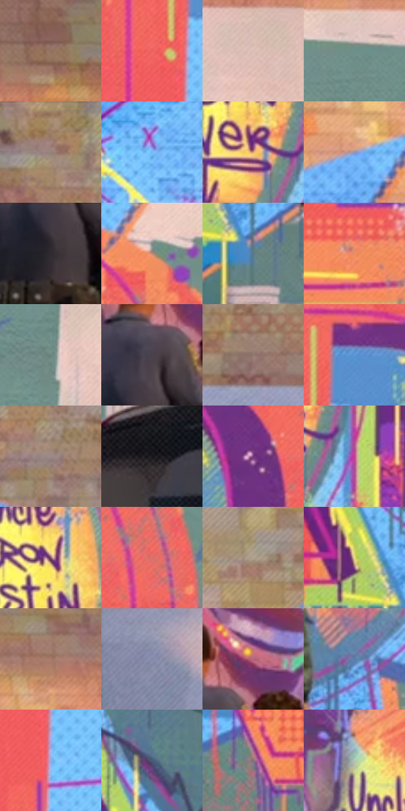

# 电影参考 684

- 状态：条件／活跃；来源世界：miles-home。
- 视角：near-level；景别：environment-wide；场景：street。
- 时段：daylight-time-unspecified（外观依据，中置信度；具体时间／晨昏未知）；光照：warm-day。
- 材质候选：skin, hair, fabric, brick, paint, painted-metal（帧级，不是像素分割）。
- 明暗组：middle；L* P5/P50/P95：18.77642 / 56.89288 / 79.77349。
- 资格门禁：secondary-image。
- 原截图 SHA-256：`bb9630d2ac922a0be09c8312a2dfbad6b74990d9fa35bf61fe61853a1fdd6dca`；尺寸：2880 × 1230。
- sRGB 像素 SHA-256：`592ce1c9f1da1462bd104be31f7ddf1dee30e8f5dfde4df1d30c48552ae27e40`。

## 观察与迁移

墙绘主导的二次图像与砖基底分开，图案和手写签名不可移植。

上方自然砖纹、中央绿底橙蓝紫墙绘与下方深色车尾分层，人物站在壁画前保持遮挡；肖像、字母和黄色冠形是墙内二次图像，不授权添加纪念文字或整图涂鸦。

本公开版保存32个128×128原像素色卡上下文；图集格子并非原场景相邻位置。原rect、图集tile和像素SHA见 `data/palette-crops.json`。上下文不足时不得批准替色，不能以小样推断完整构图。

## 实测色卡

颜色比例分母为保留采样像素，不是材料面积；全部 32 色参与全库匹配。表内四舍五入仅用于阅读，原精度在 JSON。

| ID | HEX | Lab | 原图 xy | 像素数 | 比例 | 明度角色 |
| --- | --- | --- | --- | ---: | ---: | --- |
| 684-S01 | #906F5C | [49.583187, 10.272119, 15.603745] | [2536, 128] | 13619 | 6.894509% | midtone |
| 684-S02 | #EC605D | [58.968839, 53.892831, 29.73176] | [1952, 668] | 11825 | 5.986311% | midtone |
| 684-S03 | #DCBDB5 | [79.011677, 9.764341, 8.129487] | [2720, 440] | 11167 | 5.653204% | light |
| 684-S04 | #6E8F8A | [56.874267, -12.618108, -1.121027] | [2492, 436] | 10484 | 5.307441% | midtone |
| 684-S05 | #9F8769 | [57.770172, 4.557033, 19.534975] | [1136, 28] | 9842 | 4.982433% | midtone |
| 684-S06 | #75BCF9 | [73.923027, -5.523417, -36.974182] | [1728, 320] | 9454 | 4.786012% | light |
| 684-S07 | #DDAA72 | [73.114889, 11.922734, 35.970221] | [1716, 772] | 8754 | 4.431642% | light |
| 684-S08 | #9393B4 | [61.968105, 6.997985, -17.162159] | [2256, 316] | 8609 | 4.358237% | light |
| 684-S09 | #302B30 | [18.23029, 3.421898, -2.402965] | [1384, 860] | 8043 | 4.071704% | deep-shadow |
| 684-S10 | #C18A6C | [62.168017, 17.268312, 24.380111] | [2292, 452] | 7414 | 3.753278% | light |
| 684-S11 | #587889 | [48.651967, -6.95101, -12.925198] | [1220, 1072] | 7408 | 3.750240% | midtone |
| 684-S12 | #ED8F63 | [68.42756, 31.483154, 38.363701] | [2012, 968] | 7405 | 3.748722% | light |
| 684-S13 | #6B8680 | [53.743552, -10.939096, 0.045937] | [2608, 604] | 6467 | 3.273867% | midtone |
| 684-S14 | #49414B | [28.655935, 5.576984, -4.789192] | [1404, 764] | 5999 | 3.036946% | shadow |
| 684-S15 | #947770 | [52.575654, 10.168779, 8.127874] | [460, 336] | 5950 | 3.012140% | midtone |
| 684-S16 | #6098D9 | [61.611443, 0.40744, -38.720765] | [2028, 564] | 5833 | 2.952909% | light |
| 684-S17 | #9D8987 | [58.797425, 7.183167, 3.846718] | [776, 180] | 5611 | 2.840524% | midtone |
| 684-S18 | #181519 | [7.232774, 2.426173, -2.252406] | [2676, 952] | 5279 | 2.672451% | deep-shadow |
| 684-S19 | #6F3476 | [32.132339, 36.585376, -26.639407] | [2228, 632] | 4964 | 2.512985% | shadow |
| 684-S20 | #BC458F | [48.175834, 55.380172, -16.204445] | [1800, 800] | 4956 | 2.508935% | midtone |
| 684-S21 | #825077 | [40.921772, 27.253048, -13.458249] | [1708, 640] | 4921 | 2.491217% | midtone |
| 684-S22 | #DC706A | [59.751692, 41.54599, 22.889894] | [2348, 628] | 4139 | 2.095335% | midtone |
| 684-S23 | #B2A490 | [68.042958, 1.736738, 12.22551] | [1720, 108] | 3875 | 1.961688% | light |
| 684-S24 | #EBE184 | [88.53383, -9.266812, 46.561196] | [1144, 996] | 3853 | 1.950550% | highlight |
| 684-S25 | #A7796A | [55.002612, 15.910683, 15.315087] | [2284, 148] | 3838 | 1.942957% | midtone |
| 684-S26 | #8185A6 | [56.282303, 5.872667, -17.961166] | [64, 704] | 3732 | 1.889295% | midtone |
| 684-S27 | #B7637C | [52.340478, 36.646009, 1.265538] | [1464, 692] | 3317 | 1.679205% | midtone |
| 684-S28 | #5A7FA9 | [52.080128, -1.278401, -26.369294] | [1640, 956] | 3283 | 1.661992% | midtone |
| 684-S29 | #94ADE2 | [70.644258, 3.951487, -29.43004] | [1996, 760] | 2178 | 1.102595% | light |
| 684-S30 | #4B5977 | [37.792221, 2.615805, -18.733952] | [1152, 828] | 2137 | 1.081839% | shadow |
| 684-S31 | #7E747D | [49.98634, 5.605383, -3.54028] | [964, 1000] | 1809 | 0.915792% | midtone |
| 684-S32 | #AEC8B1 | [78.158061, -13.167029, 8.577888] | [1624, 524] | 1369 | 0.693045% | light |

## 色阶与空间分布

- 采样 ROI：`[0.01, 0.02, 0.98, 0.94]`；步长：4；样本数：197534。
- 排除区：`[{"label": "approximate bottom letterbox", "rect": [0, 0.97, 1, 1]}]`。
- 深暗、暗、中、亮、高光五段计数：`[10528, 17344, 94415, 65871, 9376]`。
- RGB 各 256 箱、L* 100 箱、13×5 色相明度表和 3×3 空间统计全部保存在 [总数据](../film-library.json)。
- [可视化档案](../../references/library.html)按需绘制直方图，不存 2,094 张重复图表图片。

## 纹理特征占比

**这是分块图像特征的面积占比，不是波点／排线／丝网／错版的精确语义覆盖率。** 窗格、发丝、织物也会产生方向或周期特征。
原图 ROI 像素 3162808；已测块覆盖 3162808（100.0000%）；未测 0。

| 特征 | 块覆盖像素 | 占已测面积 | 阈值敏感范围 |
| --- | ---: | ---: | --- |
| low-contrast | 0 | 0.0000% | 0.0000% ~ 0.0000% |
| directional-structure | 284416 | 8.9925% | 1.0360% ~ 18.7540% |
| periodic-structure | 2766264 | 87.4623% | 80.2042% ~ 87.4623% |
| mixed-detail | 112128 | 3.5452% | 0.5180% ~ 18.7598% |

阈值敏感范围不是统计置信区间。逐块坐标、尺度、对比、方向一致性、频谱集中度、频率与角度见 [全量特征记录](../texture-features.jsonl)，以帧号定位。
四种印刷层的真实像素覆盖仍标为 `null`，不能填 0，也不能拿上表代替。不得据这些代理测量删除唯一证据。

[测量方法与保留策略](../../references/library-retention.md) · [分类索引](../archive/README.md)
