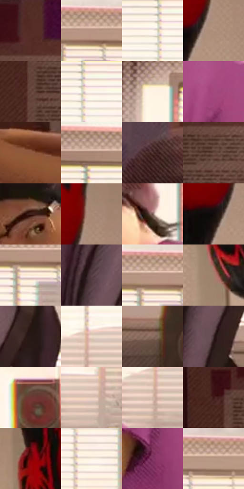

# 电影参考 685

- 状态：常规／活跃；来源世界：miles-home。
- 视角：near-level；景别：medium；场景：interior。
- 时段：daylight-time-unspecified（外观依据，中置信度；具体时间／晨昏未知）；光照：warm-day。
- 材质候选：skin, hair, fabric, wood, plastic, paper, glass（帧级，不是像素分割）。
- 明暗组：middle；L* P5/P50/P95：10.29161 / 48.20461 / 97.3444。
- 资格门禁：无附加门禁。
- 原截图 SHA-256：`bef30c60e2fda3ce95a6cd57e7556253139761d04eb0b29cec841c01c3b12121`；尺寸：2880 × 1212。
- sRGB 像素 SHA-256：`db469001dd50bf02414154649115fb00bbe64e3d4459800fc8eda17023113a93`。

## 观察与迁移

暖窗宿舍与投影，倒悬人物仍保真实身份和原姿态。

百叶窗为大亮面，遮蔽形状与窗格保持区别，紫衣、灰帽、黑红衣和裸脸分属不同材料；墙衣细网与亮窗局部分色分别观察，底部中文字幕排除测色且不作为指令。

本公开版保存32个128×128原像素色卡上下文；图集格子并非原场景相邻位置。原rect、图集tile和像素SHA见 `data/palette-crops.json`。上下文不足时不得批准替色，不能以小样推断完整构图。

## 实测色卡

颜色比例分母为保留采样像素，不是材料面积；全部 32 色参与全库匹配。表内四舍五入仅用于阅读，原精度在 JSON。

| ID | HEX | Lab | 原图 xy | 像素数 | 比例 | 明度角色 |
| --- | --- | --- | --- | ---: | ---: | --- |
| 685-S01 | #522C25 | [22.755243, 16.663311, 12.170919] | [228, 28] | 8766 | 4.554003% | shadow |
| 685-S02 | #B79882 | [65.071069, 8.206476, 15.90541] | [1356, 40] | 8610 | 4.472960% | light |
| 685-S03 | #FDF6E8 | [97.073647, -0.013323, 7.562152] | [1088, 168] | 8589 | 4.462050% | highlight |
| 685-S04 | #AF917C | [62.356473, 8.061461, 15.374457] | [2588, 220] | 8400 | 4.363863% | light |
| 685-S05 | #614038 | [30.626598, 13.264717, 10.734029] | [104, 260] | 8279 | 4.301003% | shadow |
| 685-S06 | #FEF9F0 | [98.079118, 0.127867, 4.904713] | [1120, 160] | 8155 | 4.236584% | highlight |
| 685-S07 | #FDF2E3 | [95.969385, 1.207534, 8.554012] | [864, 100] | 8140 | 4.228791% | highlight |
| 685-S08 | #A3487D | [44.094413, 43.835206, -11.883081] | [1044, 812] | 7614 | 3.955530% | midtone |
| 685-S09 | #8F573E | [42.771155, 20.46991, 24.202186] | [620, 1044] | 7553 | 3.923840% | midtone |
| 685-S10 | #C9AA9A | [71.894095, 8.79721, 12.447539] | [1016, 36] | 7226 | 3.753961% | light |
| 685-S11 | #523532 | [25.474895, 12.59387, 7.208226] | [560, 316] | 7172 | 3.725908% | shadow |
| 685-S12 | #684942 | [34.194495, 12.172527, 9.438872] | [220, 172] | 7089 | 3.682789% | shadow |
| 685-S13 | #43241E | [18.139085, 13.964678, 10.363057] | [652, 488] | 7076 | 3.676035% | deep-shadow |
| 685-S14 | #A88A76 | [59.7176, 8.320175, 14.992084] | [2600, 128] | 7007 | 3.640189% | midtone |
| 685-S15 | #74564F | [39.468612, 11.336836, 8.914808] | [848, 524] | 6577 | 3.416801% | shadow |
| 685-S16 | #120C0B | [3.755182, 1.892474, 1.131935] | [2536, 228] | 6247 | 3.245363% | deep-shadow |
| 685-S17 | #FBECDA | [94.125363, 2.143268, 10.548188] | [1324, 112] | 5978 | 3.105616% | highlight |
| 685-S18 | #543C41 | [28.110168, 11.426283, 1.090875] | [1416, 860] | 5852 | 3.040158% | shadow |
| 685-S19 | #BC9F8D | [67.585054, 7.883613, 13.37354] | [1320, 32] | 5638 | 2.928983% | light |
| 685-S20 | #A2806D | [56.312447, 10.282979, 15.312818] | [2232, 240] | 4983 | 2.588706% | midtone |
| 685-S21 | #261715 | [9.633612, 7.251182, 4.420607] | [1612, 728] | 4935 | 2.563770% | deep-shadow |
| 685-S22 | #F0DCC9 | [88.889495, 3.830504, 11.825699] | [1112, 516] | 4776 | 2.481168% | highlight |
| 685-S23 | #907263 | [50.529701, 9.490893, 12.806327] | [1704, 1004] | 4751 | 2.468180% | midtone |
| 685-S24 | #3F2A2C | [19.61724, 10.126777, 2.620064] | [1452, 956] | 4747 | 2.466102% | deep-shadow |
| 685-S25 | #6E3834 | [30.380947, 23.369634, 13.282914] | [2020, 860] | 4734 | 2.459349% | shadow |
| 685-S26 | #E2C8B6 | [82.301453, 6.300742, 12.352099] | [1272, 544] | 4642 | 2.411554% | highlight |
| 685-S27 | #D2B9A8 | [76.816996, 6.212856, 11.900883] | [1096, 568] | 4465 | 2.319601% | light |
| 685-S28 | #3E1716 | [13.798391, 19.016637, 10.092696] | [76, 132] | 4285 | 2.226090% | deep-shadow |
| 685-S29 | #77050A | [23.848146, 44.755544, 31.631851] | [2232, 64] | 3309 | 1.719050% | shadow |
| 685-S30 | #F7EDDF | [94.171575, 1.029845, 7.980882] | [1232, 228] | 2696 | 1.400592% | highlight |
| 685-S31 | #833562 | [34.507252, 38.83687, -10.041476] | [1028, 948] | 2126 | 1.104473% | shadow |
| 685-S32 | #BA8D7C | [62.461928, 14.684293, 15.692529] | [1528, 28] | 2073 | 1.076939% | light |

## 色阶与空间分布

- 采样 ROI：`[0.01, 0.02, 0.98, 0.94]`；步长：4；样本数：192490。
- 排除区：`[{"label": "approximate subtitle bounding region including nearby image", "rect": [0.33, 0.92, 0.69, 1]}]`。
- 深暗、暗、中、亮、高光五段计数：`[25302, 55931, 28978, 39640, 42639]`。
- RGB 各 256 箱、L* 100 箱、13×5 色相明度表和 3×3 空间统计全部保存在 [总数据](../film-library.json)。
- [可视化档案](../../references/library.html)按需绘制直方图，不存 2,094 张重复图表图片。

## 纹理特征占比

**这是分块图像特征的面积占比，不是波点／排线／丝网／错版的精确语义覆盖率。** 窗格、发丝、织物也会产生方向或周期特征。
原图 ROI 像素 3090422；已测块覆盖 3021190（97.7598%）；未测 69232。

| 特征 | 块覆盖像素 | 占已测面积 | 阈值敏感范围 |
| --- | ---: | ---: | --- |
| low-contrast | 125440 | 4.1520% | 3.2538% ~ 7.7378% |
| directional-structure | 1034368 | 34.2371% | 11.9307% ~ 42.6004% |
| periodic-structure | 1816966 | 60.1407% | 54.1458% ~ 76.2431% |
| mixed-detail | 44416 | 1.4701% | 0.0000% ~ 4.0885% |

阈值敏感范围不是统计置信区间。逐块坐标、尺度、对比、方向一致性、频谱集中度、频率与角度见 [全量特征记录](../texture-features.jsonl)，以帧号定位。
四种印刷层的真实像素覆盖仍标为 `null`，不能填 0，也不能拿上表代替。不得据这些代理测量删除唯一证据。

[测量方法与保留策略](../../references/library-retention.md) · [分类索引](../archive/README.md)
