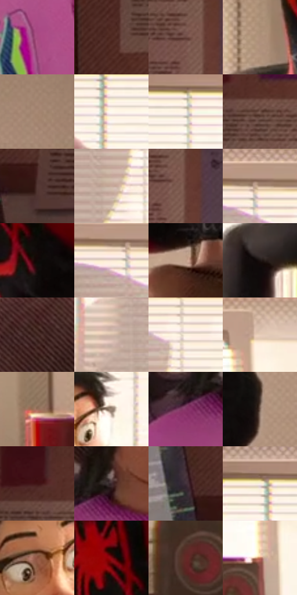

# 电影参考 686

- 状态：常规／活跃；来源世界：miles-home。
- 视角：near-level；景别：medium；场景：interior。
- 时段：daylight-time-unspecified（外观依据，中置信度；具体时间／晨昏未知）；光照：warm-day。
- 材质候选：skin, hair, fabric, wood, plastic, paper, glass（帧级，不是像素分割）。
- 明暗组：middle；L* P5/P50/P95：7.0992 / 46.56348 / 97.14355。
- 资格门禁：无附加门禁。
- 原截图 SHA-256：`f94ba0a8fbd04c10f6e7ebd3cd701dbc260ab2df696cb4fe15f8380a4f135556`；尺寸：2880 × 1214。
- sRGB 像素 SHA-256：`4d87ac20e14aea8babf09d29984d62fe289f172461c06668a277fb74c8da9491`。

## 观察与迁移

暖窗宿舍与投影，倒悬人物仍保真实身份和原姿态。

同室内改变表情与姿势后，暖肤色、紫衣印花、白百叶和深音箱仍各自成立；窗前遮蔽形状不凭空断定成因，衣上彩色图案不是全画面印刷网纹。

本公开版保存32个128×128原像素色卡上下文；图集格子并非原场景相邻位置。原rect、图集tile和像素SHA见 `data/palette-crops.json`。上下文不足时不得批准替色，不能以小样推断完整构图。

## 实测色卡

颜色比例分母为保留采样像素，不是材料面积；全部 32 色参与全库匹配。表内四舍五入仅用于阅读，原精度在 JSON。

| ID | HEX | Lab | 原图 xy | 像素数 | 比例 | 明度角色 |
| --- | --- | --- | --- | ---: | ---: | --- |
| 686-S01 | #A84B81 | [45.557102, 44.552925, -12.03112] | [1168, 812] | 11131 | 5.715768% | midtone |
| 686-S02 | #502B23 | [22.142084, 16.150868, 12.641736] | [80, 496] | 10243 | 5.259780% | shadow |
| 686-S03 | #68443F | [32.781254, 14.842634, 9.37645] | [320, 256] | 9760 | 5.011759% | shadow |
| 686-S04 | #AF907B | [62.076306, 8.478931, 15.54779] | [2184, 212] | 9335 | 4.793522% | light |
| 686-S05 | #A78974 | [59.314302, 8.199019, 15.551642] | [2816, 172] | 9078 | 4.661552% | midtone |
| 686-S06 | #FEF9EF | [98.055425, -0.038577, 5.384736] | [1020, 164] | 8812 | 4.524961% | highlight |
| 686-S07 | #FDF4E7 | [96.555788, 0.836883, 7.332504] | [1096, 132] | 8308 | 4.266157% | highlight |
| 686-S08 | #6F5046 | [37.040208, 11.518899, 11.011896] | [256, 144] | 7908 | 4.060757% | shadow |
| 686-S09 | #553836 | [26.809721, 12.623208, 6.490398] | [212, 996] | 7484 | 3.843033% | shadow |
| 686-S10 | #C7AA9B | [71.730782, 8.182016, 11.642126] | [1512, 296] | 7474 | 3.837898% | light |
| 686-S11 | #643E34 | [30.407522, 15.359491, 13.066881] | [352, 268] | 7026 | 3.607850% | shadow |
| 686-S12 | #B69883 | [64.995588, 7.94955, 15.228509] | [1488, 104] | 6869 | 3.527231% | light |
| 686-S13 | #100908 | [2.918386, 1.971367, 1.122373] | [2388, 200] | 6578 | 3.377802% | deep-shadow |
| 686-S14 | #F3E2D1 | [90.803715, 3.039556, 10.400203] | [1452, 128] | 6083 | 3.123620% | highlight |
| 686-S15 | #C29F8A | [68.095902, 9.804592, 15.833485] | [2376, 420] | 5650 | 2.901275% | light |
| 686-S16 | #1D1413 | [7.303828, 4.319922, 2.209498] | [2048, 376] | 5440 | 2.793440% | deep-shadow |
| 686-S17 | #3A211C | [15.857045, 11.352668, 8.447962] | [796, 280] | 5426 | 2.786251% | deep-shadow |
| 686-S18 | #D2B9A8 | [76.816996, 6.212856, 11.900883] | [1348, 496] | 5240 | 2.690740% | light |
| 686-S19 | #FEF2DF | [95.956935, 0.922898, 10.611089] | [1576, 176] | 5220 | 2.680470% | highlight |
| 686-S20 | #E7CDB8 | [84.025092, 5.81459, 13.788454] | [1864, 104] | 5217 | 2.678929% | highlight |
| 686-S21 | #9A705C | [50.957986, 13.913058, 17.660276] | [2252, 984] | 5072 | 2.604472% | midtone |
| 686-S22 | #988171 | [55.653667, 6.207725, 11.945686] | [1060, 360] | 5063 | 2.599850% | midtone |
| 686-S23 | #873668 | [35.576493, 40.543809, -12.169722] | [736, 648] | 4777 | 2.452989% | shadow |
| 686-S24 | #7B6457 | [44.253028, 7.121247, 10.854277] | [2716, 656] | 4639 | 2.382126% | midtone |
| 686-S25 | #401214 | [13.06744, 22.552053, 10.573191] | [188, 92] | 4532 | 2.327182% | deep-shadow |
| 686-S26 | #3D292C | [19.055848, 9.876495, 1.776811] | [800, 600] | 4156 | 2.134106% | deep-shadow |
| 686-S27 | #43323D | [23.038367, 9.858214, -3.942461] | [124, 936] | 3995 | 2.051432% | shadow |
| 686-S28 | #FAEFE0 | [94.924575, 1.212802, 8.57468] | [992, 104] | 3734 | 1.917409% | highlight |
| 686-S29 | #8E5440 | [41.942721, 21.95261, 21.930945] | [952, 400] | 3255 | 1.671442% | midtone |
| 686-S30 | #81080F | [26.380896, 47.124205, 32.506896] | [2320, 104] | 2883 | 1.480420% | shadow |
| 686-S31 | #642826 | [24.851303, 26.957077, 14.819642] | [1776, 1024] | 2870 | 1.473745% | shadow |
| 686-S32 | #C47A5F | [58.493487, 25.986466, 26.868507] | [1840, 828] | 1484 | 0.762034% | midtone |

## 色阶与空间分布

- 采样 ROI：`[0.01, 0.02, 0.98, 0.94]`；步长：4；样本数：194742。
- 排除区：`[]`。
- 深暗、暗、中、亮、高光五段计数：`[26629, 57302, 35607, 37742, 37462]`。
- RGB 各 256 箱、L* 100 箱、13×5 色相明度表和 3×3 空间统计全部保存在 [总数据](../film-library.json)。
- [可视化档案](../../references/library.html)按需绘制直方图，不存 2,094 张重复图表图片。

## 纹理特征占比

**这是分块图像特征的面积占比，不是波点／排线／丝网／错版的精确语义覆盖率。** 窗格、发丝、织物也会产生方向或周期特征。
原图 ROI 像素 3120898；已测块覆盖 3120898（100.0000%）；未测 0。

| 特征 | 块覆盖像素 | 占已测面积 | 阈值敏感范围 |
| --- | ---: | ---: | --- |
| low-contrast | 46336 | 1.4847% | 1.0500% ~ 4.1301% |
| directional-structure | 1058944 | 33.9307% | 14.2687% ~ 49.1592% |
| periodic-structure | 1950082 | 62.4846% | 49.2659% ~ 78.0166% |
| mixed-detail | 65536 | 2.0999% | 0.5250% ~ 3.5846% |

阈值敏感范围不是统计置信区间。逐块坐标、尺度、对比、方向一致性、频谱集中度、频率与角度见 [全量特征记录](../texture-features.jsonl)，以帧号定位。
四种印刷层的真实像素覆盖仍标为 `null`，不能填 0，也不能拿上表代替。不得据这些代理测量删除唯一证据。

[测量方法与保留策略](../../references/library-retention.md) · [分类索引](../archive/README.md)
