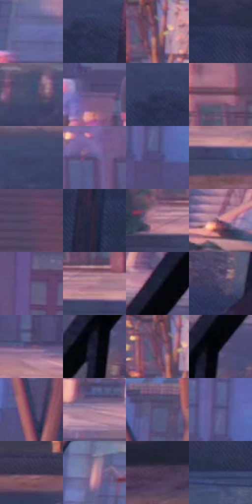

# 电影参考 687

- 状态：常规／活跃；来源世界：peter-b-native。
- 视角：high-angle；景别：full-body；场景：street。
- 时段：daylight-time-unspecified（外观依据，中置信度；具体时间／晨昏未知）；光照：warm-day。
- 材质候选：skin, hair, fabric, brick, glass, foliage, asphalt（帧级，不是像素分割）。
- 明暗组：dark；L* P5/P50/P95：12.2637 / 33.33866 / 58.50803。
- 资格门禁：无附加门禁。
- 原截图 SHA-256：`56a51f324047bd2efe8042d6ec02cf1da80ba04349a5d3f6a7aca6b75e8c6d48`；尺寸：2880 × 1214。
- sRGB 像素 SHA-256：`0254ff68b5634489e5099361f29203f27a64e8b556620d706ac410535d74d6ab`。

## 观察与迁移

暖粉街区与近脸，世界标签按序列连续性推断，不冒充片源时间码核验。

彼得B回归街区序列：灰西装花束人物居中，前景黑栏杆、暖桃立面与冷紫阴影分层，街面有局部映色；看似湿亮不证明天气，台阶窗组先于砖纹，保留原照建筑。

本公开版保存32个128×128原像素色卡上下文；图集格子并非原场景相邻位置。原rect、图集tile和像素SHA见 `data/palette-crops.json`。上下文不足时不得批准替色，不能以小样推断完整构图。

## 实测色卡

颜色比例分母为保留采样像素，不是材料面积；全部 32 色参与全库匹配。表内四舍五入仅用于阅读，原精度在 JSON。

| ID | HEX | Lab | 原图 xy | 像素数 | 比例 | 明度角色 |
| --- | --- | --- | --- | ---: | ---: | --- |
| 687-S01 | #6C6DA7 | [48.152376, 13.901368, -31.224459] | [2508, 264] | 8826 | 4.532150% | midtone |
| 687-S02 | #2A304D | [20.603005, 6.177369, -18.689489] | [2072, 736] | 8771 | 4.503908% | shadow |
| 687-S03 | #5D4A6A | [34.529567, 14.759877, -15.534694] | [680, 224] | 8138 | 4.178862% | shadow |
| 687-S04 | #34395D | [25.095409, 8.37462, -22.167985] | [2280, 796] | 8085 | 4.151647% | shadow |
| 687-S05 | #444D70 | [33.363281, 5.996067, -21.287486] | [2380, 648] | 8023 | 4.119810% | shadow |
| 687-S06 | #6F5C85 | [42.349338, 16.364784, -19.993195] | [2356, 372] | 7762 | 3.985786% | midtone |
| 687-S07 | #303656 | [23.466645, 6.895073, -20.15747] | [2040, 716] | 7369 | 3.783981% | shadow |
| 687-S08 | #7A5268 | [39.869088, 20.330668, -5.891707] | [924, 368] | 7323 | 3.760360% | shadow |
| 687-S09 | #3D446A | [29.828963, 7.892287, -23.05808] | [1932, 652] | 7205 | 3.699767% | shadow |
| 687-S10 | #615D92 | [41.914702, 14.618396, -28.603156] | [928, 60] | 6904 | 3.545203% | midtone |
| 687-S11 | #504E7A | [35.121067, 12.051719, -24.70257] | [2052, 292] | 6802 | 3.492826% | shadow |
| 687-S12 | #3D4063 | [28.272713, 8.356921, -21.019553] | [1040, 556] | 6783 | 3.483070% | shadow |
| 687-S13 | #564464 | [31.881491, 14.588476, -15.873316] | [1152, 392] | 6722 | 3.451746% | shadow |
| 687-S14 | #2D263D | [16.897771, 9.187913, -13.517027] | [2152, 852] | 6423 | 3.298210% | deep-shadow |
| 687-S15 | #A06F83 | [52.378198, 22.51219, -3.156143] | [872, 504] | 6165 | 3.165727% | midtone |
| 687-S16 | #8D6075 | [46.060879, 21.624442, -4.391949] | [304, 376] | 6067 | 3.115404% | midtone |
| 687-S17 | #5D507C | [36.965945, 15.506933, -22.972349] | [1640, 92] | 6045 | 3.104107% | shadow |
| 687-S18 | #B5879B | [61.237451, 20.744393, -3.74121] | [988, 500] | 5681 | 2.917193% | light |
| 687-S19 | #1F223A | [14.06332, 6.128019, -15.944375] | [2724, 536] | 5505 | 2.826817% | deep-shadow |
| 687-S20 | #494463 | [30.523932, 9.707503, -17.43826] | [2800, 776] | 5442 | 2.794467% | shadow |
| 687-S21 | #675276 | [38.245416, 16.177284, -17.211779] | [1956, 488] | 5430 | 2.788305% | shadow |
| 687-S22 | #191A2E | [10.127463, 5.818824, -13.546999] | [2680, 672] | 4961 | 2.547473% | deep-shadow |
| 687-S23 | #6A445D | [33.960345, 20.590645, -8.039763] | [652, 220] | 4868 | 2.499718% | shadow |
| 687-S24 | #070912 | [2.567184, 0.996383, -4.319576] | [2716, 628] | 4747 | 2.437584% | deep-shadow |
| 687-S25 | #3B3C5C | [26.545982, 8.239442, -19.204345] | [2192, 276] | 4738 | 2.432963% | shadow |
| 687-S26 | #9F7C98 | [56.141732, 18.425617, -9.836676] | [2576, 520] | 4664 | 2.394964% | midtone |
| 687-S27 | #504B6B | [33.560715, 9.773061, -17.762999] | [2192, 44] | 4636 | 2.380586% | shadow |
| 687-S28 | #565A88 | [39.69447, 10.325382, -26.104762] | [2044, 228] | 4552 | 2.337452% | shadow |
| 687-S29 | #3B334A | [22.970972, 9.114901, -12.876007] | [524, 584] | 4466 | 2.293291% | shadow |
| 687-S30 | #D59AA0 | [69.325231, 22.900045, 5.635142] | [2380, 128] | 3907 | 2.006244% | light |
| 687-S31 | #4C3952 | [26.939024, 13.630234, -11.927794] | [200, 704] | 3889 | 1.997001% | shadow |
| 687-S32 | #3D4A71 | [31.991636, 6.185436, -24.093934] | [1084, 972] | 3843 | 1.973380% | shadow |

## 色阶与空间分布

- 采样 ROI：`[0.01, 0.02, 0.98, 0.94]`；步长：4；样本数：194742。
- 排除区：`[]`。
- 深暗、暗、中、亮、高光五段计数：`[23672, 116649, 46476, 7726, 219]`。
- RGB 各 256 箱、L* 100 箱、13×5 色相明度表和 3×3 空间统计全部保存在 [总数据](../film-library.json)。
- [可视化档案](../../references/library.html)按需绘制直方图，不存 2,094 张重复图表图片。

## 纹理特征占比

**这是分块图像特征的面积占比，不是波点／排线／丝网／错版的精确语义覆盖率。** 窗格、发丝、织物也会产生方向或周期特征。
原图 ROI 像素 3120898；已测块覆盖 3120898（100.0000%）；未测 0。

| 特征 | 块覆盖像素 | 占已测面积 | 阈值敏感范围 |
| --- | ---: | ---: | --- |
| low-contrast | 44672 | 1.4314% | 0.0000% ~ 2.4813% |
| directional-structure | 439680 | 14.0883% | 4.5812% ~ 32.1754% |
| periodic-structure | 2570882 | 82.3764% | 67.4432% ~ 85.0587% |
| mixed-detail | 65664 | 2.1040% | 0.3814% ~ 7.8788% |

阈值敏感范围不是统计置信区间。逐块坐标、尺度、对比、方向一致性、频谱集中度、频率与角度见 [全量特征记录](../texture-features.jsonl)，以帧号定位。
四种印刷层的真实像素覆盖仍标为 `null`，不能填 0，也不能拿上表代替。不得据这些代理测量删除唯一证据。

[测量方法与保留策略](../../references/library-retention.md) · [分类索引](../archive/README.md)
