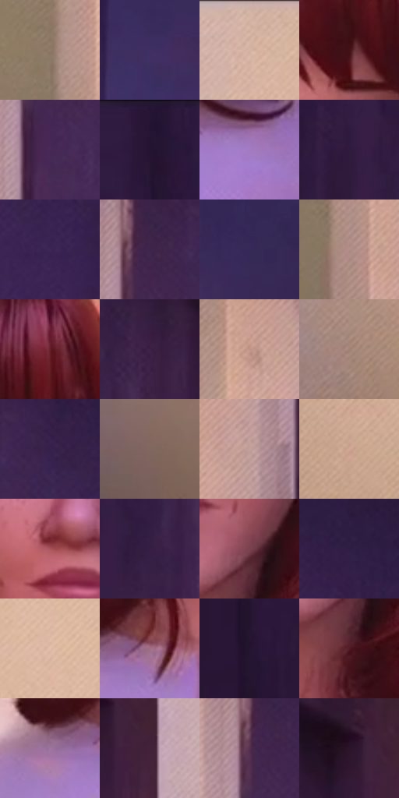

# 电影参考 688

- 状态：常规／活跃；来源世界：peter-b-native。
- 视角：near-level；景别：close-up；场景：street。
- 时段：daylight-time-unspecified（外观依据，中置信度；具体时间／晨昏未知）；光照：warm-day。
- 材质候选：skin, hair, fabric, brick, glass, foliage, asphalt（帧级，不是像素分割）。
- 明暗组：dark；L* P5/P50/P95：11.52068 / 23.37655 / 74.56213。
- 资格门禁：无附加门禁。
- 原截图 SHA-256：`0d902d0cbe238c7d3120a997927842bf3c9bc47782cf94cf51bb3ff3bd39c075`；尺寸：2880 × 1210。
- sRGB 像素 SHA-256：`197e2b45e1532da77eaf3b5b52b9728f256382dd758ec099cbe41c8598802e4c`。

## 观察与迁移

暖粉街区与近脸，世界标签按序列连续性推断，不冒充片源时间码核验。

门口暖浅色室内与深紫门框夹住红发人物，头发铜红宽亮束和暖轮廓光区别于浅紫衣物柔面；脸部雀斑与选择性排线不淹没眼神，不复制角色身份或发型。

本公开版保存32个128×128原像素色卡上下文；图集格子并非原场景相邻位置。原rect、图集tile和像素SHA见 `data/palette-crops.json`。上下文不足时不得批准替色，不能以小样推断完整构图。

## 实测色卡

颜色比例分母为保留采样像素，不是材料面积；全部 32 色参与全库匹配。表内四舍五入仅用于阅读，原精度在 JSON。

| ID | HEX | Lab | 原图 xy | 像素数 | 比例 | 明度角色 |
| --- | --- | --- | --- | ---: | ---: | --- |
| 688-S01 | #8F7966 | [52.369466, 5.465826, 13.594454] | [1856, 408] | 10421 | 5.370431% | midtone |
| 688-S02 | #402F63 | [23.749754, 20.669572, -28.132336] | [2600, 280] | 9920 | 5.112243% | shadow |
| 688-S03 | #D3B0A0 | [74.469967, 10.235708, 12.936897] | [752, 28] | 9730 | 5.014327% | light |
| 688-S04 | #421018 | [13.200411, 24.735151, 7.978476] | [1456, 316] | 9595 | 4.944755% | deep-shadow |
| 688-S05 | #462955 | [22.102387, 22.586713, -21.475008] | [2096, 276] | 9139 | 4.709757% | shadow |
| 688-S06 | #2A1738 | [11.894699, 17.221808, -17.859288] | [48, 44] | 8926 | 4.599988% | deep-shadow |
| 688-S07 | #A27BC4 | [57.878083, 29.193604, -32.398776] | [1616, 1012] | 8758 | 4.513409% | midtone |
| 688-S08 | #301A3C | [13.788452, 18.365092, -17.655278] | [176, 196] | 8641 | 4.453114% | deep-shadow |
| 688-S09 | #3C2655 | [20.054803, 21.301582, -24.797503] | [2380, 368] | 8114 | 4.181526% | shadow |
| 688-S10 | #3F244C | [19.392934, 21.143641, -19.755877] | [2096, 132] | 7455 | 3.841912% | deep-shadow |
| 688-S11 | #362957 | [20.275267, 18.049857, -25.824609] | [2772, 264] | 7277 | 3.750180% | shadow |
| 688-S12 | #B18D89 | [61.830088, 12.981473, 7.317089] | [1888, 656] | 7259 | 3.740904% | light |
| 688-S13 | #66202A | [23.756505, 32.203794, 10.738569] | [1572, 216] | 7256 | 3.739358% | shadow |
| 688-S14 | #3D2145 | [17.96183, 20.625974, -17.240141] | [332, 140] | 6528 | 3.364185% | deep-shadow |
| 688-S15 | #C19588 | [65.44526, 14.629698, 13.227642] | [1944, 80] | 6452 | 3.325019% | light |
| 688-S16 | #A28274 | [56.986385, 10.125825, 12.235023] | [692, 684] | 6316 | 3.254932% | midtone |
| 688-S17 | #36214C | [17.431178, 20.14937, -22.935832] | [2208, 124] | 6283 | 3.237925% | deep-shadow |
| 688-S18 | #806760 | [45.818338, 8.83224, 7.726645] | [668, 988] | 5803 | 2.990559% | midtone |
| 688-S19 | #C3A09B | [68.832118, 12.112597, 7.466395] | [2000, 704] | 5792 | 2.984890% | light |
| 688-S20 | #D2A794 | [71.879081, 13.041008, 15.840096] | [964, 536] | 5701 | 2.937993% | light |
| 688-S21 | #A8545A | [46.185025, 35.023688, 12.597366] | [1356, 544] | 5392 | 2.778751% | midtone |
| 688-S22 | #351E43 | [15.956233, 19.306467, -19.089571] | [248, 264] | 5364 | 2.764321% | deep-shadow |
| 688-S23 | #79424E | [35.027892, 25.246679, 3.319786] | [1496, 648] | 4618 | 2.379873% | shadow |
| 688-S24 | #301D44 | [15.085639, 18.597417, -21.205626] | [2340, 120] | 4546 | 2.342768% | deep-shadow |
| 688-S25 | #E4BEAB | [79.763466, 10.736512, 14.675846] | [1004, 248] | 4434 | 2.285049% | light |
| 688-S26 | #A16D89 | [52.198923, 25.032461, -6.943307] | [1284, 920] | 3477 | 1.791862% | midtone |
| 688-S27 | #24132E | [9.304756, 15.032822, -14.749299] | [80, 936] | 3243 | 1.671270% | deep-shadow |
| 688-S28 | #511B25 | [18.658727, 26.241239, 6.570574] | [1488, 740] | 2210 | 1.138917% | deep-shadow |
| 688-S29 | #9E75A0 | [54.585275, 23.646928, -16.834042] | [1196, 936] | 2098 | 1.081198% | midtone |
| 688-S30 | #422238 | [18.312135, 18.96337, -7.623791] | [528, 136] | 1447 | 0.745707% | deep-shadow |
| 688-S31 | #553050 | [25.637509, 22.352789, -12.500747] | [2072, 156] | 1441 | 0.742615% | shadow |
| 688-S32 | #2C152A | [10.842358, 15.69076, -9.310791] | [464, 92] | 408 | 0.210262% | deep-shadow |

## 色阶与空间分布

- 采样 ROI：`[0.01, 0.02, 0.98, 0.94]`；步长：4；样本数：194044。
- 排除区：`[]`。
- 深暗、暗、中、亮、高光五段计数：`[71055, 41857, 40262, 39874, 996]`。
- RGB 各 256 箱、L* 100 箱、13×5 色相明度表和 3×3 空间统计全部保存在 [总数据](../film-library.json)。
- [可视化档案](../../references/library.html)按需绘制直方图，不存 2,094 张重复图表图片。

## 纹理特征占比

**这是分块图像特征的面积占比，不是波点／排线／丝网／错版的精确语义覆盖率。** 窗格、发丝、织物也会产生方向或周期特征。
原图 ROI 像素 3109722；已测块覆盖 3109722（100.0000%）；未测 0。

| 特征 | 块覆盖像素 | 占已测面积 | 阈值敏感范围 |
| --- | ---: | ---: | --- |
| low-contrast | 897242 | 28.8528% | 19.3240% ~ 36.0684% |
| directional-structure | 859776 | 27.6480% | 12.6900% ~ 48.9284% |
| periodic-structure | 1215232 | 39.0785% | 27.5328% ~ 47.1872% |
| mixed-detail | 137472 | 4.4207% | 4.0544% ~ 4.4207% |

阈值敏感范围不是统计置信区间。逐块坐标、尺度、对比、方向一致性、频谱集中度、频率与角度见 [全量特征记录](../texture-features.jsonl)，以帧号定位。
四种印刷层的真实像素覆盖仍标为 `null`，不能填 0，也不能拿上表代替。不得据这些代理测量删除唯一证据。

[测量方法与保留策略](../../references/library-retention.md) · [分类索引](../archive/README.md)
