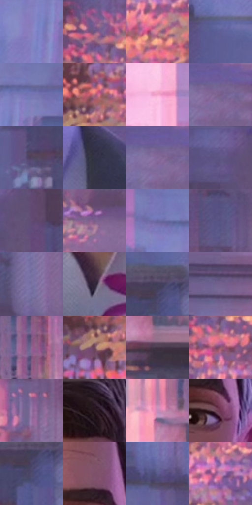

# 电影参考 689

- 状态：常规／活跃；来源世界：peter-b-native。
- 视角：near-level；景别：close-up；场景：street。
- 时段：daylight-time-unspecified（外观依据，中置信度；具体时间／晨昏未知）；光照：warm-day。
- 材质候选：skin, hair, fabric, brick, glass, foliage, asphalt（帧级，不是像素分割）。
- 明暗组：middle；L* P5/P50/P95：19.87171 / 42.99112 / 66.90177。
- 资格门禁：无附加门禁。
- 原截图 SHA-256：`75d6e19d1cd1ad82dc580eea773379c4b52b8c9338afcce95e65196243d65709`；尺寸：2880 × 1212。
- sRGB 像素 SHA-256：`c768189bc666576c56fb7a49d07291a5cb03b7b7895c9197818502f93e761499`。

## 观察与迁移

暖粉街区与近脸，世界标签按序列连续性推断，不冒充片源时间码核验。

成年脸一侧暖、另一侧灰紫，胡茬短线保留年龄感，灰西装、粉花和绿茎彼此分开；后方建筑以柔和粉蓝体面、窗组及暖叶团退后，不让全部窗格自发光。

本公开版保存32个128×128原像素色卡上下文；图集格子并非原场景相邻位置。原rect、图集tile和像素SHA见 `data/palette-crops.json`。上下文不足时不得批准替色，不能以小样推断完整构图。

## 实测色卡

颜色比例分母为保留采样像素，不是材料面积；全部 32 色参与全库匹配。表内四舍五入仅用于阅读，原精度在 JSON。

| ID | HEX | Lab | 原图 xy | 像素数 | 比例 | 明度角色 |
| --- | --- | --- | --- | ---: | ---: | --- |
| 689-S01 | #8780BE | [56.393079, 16.652886, -31.48523] | [2308, 188] | 10236 | 5.275092% | midtone |
| 689-S02 | #715682 | [40.861252, 20.006758, -20.45016] | [152, 300] | 8108 | 4.178434% | midtone |
| 689-S03 | #D07E8A | [61.800145, 33.196191, 7.172706] | [220, 500] | 8040 | 4.143390% | light |
| 689-S04 | #5F6097 | [42.812007, 13.579695, -30.203266] | [2276, 492] | 7794 | 4.016615% | midtone |
| 689-S05 | #7575B3 | [51.562849, 14.988766, -32.816939] | [2380, 116] | 7729 | 3.983117% | midtone |
| 689-S06 | #AE6876 | [52.072912, 29.805266, 4.28142] | [160, 648] | 7583 | 3.907877% | midtone |
| 689-S07 | #F2A9CA | [76.993133, 31.550655, -5.942137] | [2016, 84] | 7491 | 3.860465% | light |
| 689-S08 | #7B6797 | [47.165091, 18.03935, -23.238935] | [980, 52] | 7466 | 3.847581% | midtone |
| 689-S09 | #524460 | [31.283557, 12.141852, -14.278004] | [2444, 804] | 7240 | 3.731113% | shadow |
| 689-S10 | #323347 | [21.946514, 4.913611, -12.513759] | [1716, 764] | 7134 | 3.676486% | shadow |
| 689-S11 | #6F6190 | [44.150066, 16.017908, -23.828524] | [952, 44] | 7107 | 3.662571% | midtone |
| 689-S12 | #65578C | [40.371326, 17.942645, -27.374897] | [184, 56] | 7073 | 3.645050% | midtone |
| 689-S13 | #614C74 | [35.928867, 17.337302, -19.595502] | [268, 96] | 7004 | 3.609491% | shadow |
| 689-S14 | #7A5F8B | [44.498785, 19.706583, -20.205102] | [420, 444] | 6807 | 3.507967% | midtone |
| 689-S15 | #6B67A1 | [46.175778, 15.603821, -30.797778] | [2240, 96] | 6595 | 3.398714% | midtone |
| 689-S16 | #575381 | [37.476293, 13.048809, -25.292481] | [452, 152] | 5583 | 2.877182% | shadow |
| 689-S17 | #7973A1 | [50.569056, 12.658062, -23.878784] | [916, 356] | 5538 | 2.853992% | midtone |
| 689-S18 | #35293B | [18.621024, 9.665495, -9.40012] | [1448, 988] | 5326 | 2.744738% | deep-shadow |
| 689-S19 | #404059 | [28.055079, 6.392766, -14.884416] | [2552, 688] | 5286 | 2.724124% | shadow |
| 689-S20 | #66557D | [39.245635, 15.6565, -19.983823] | [1740, 40] | 5203 | 2.681351% | shadow |
| 689-S21 | #8D6490 | [47.995859, 24.372746, -17.650653] | [2808, 292] | 5203 | 2.681351% | midtone |
| 689-S22 | #704959 | [35.852411, 19.180056, -2.604538] | [116, 716] | 5014 | 2.583950% | shadow |
| 689-S23 | #47394A | [26.040744, 9.780457, -8.07825] | [2760, 484] | 4980 | 2.566428% | shadow |
| 689-S24 | #935870 | [44.735715, 27.697792, -3.238293] | [184, 388] | 4867 | 2.508194% | midtone |
| 689-S25 | #9675A5 | [53.945753, 21.952411, -20.785368] | [468, 856] | 4696 | 2.420070% | midtone |
| 689-S26 | #2B1924 | [11.527066, 11.134642, -3.853353] | [1572, 56] | 4462 | 2.299478% | deep-shadow |
| 689-S27 | #C08DB9 | [64.771762, 26.598273, -15.34059] | [2692, 372] | 4382 | 2.258251% | light |
| 689-S28 | #6F3551 | [30.689461, 29.269044, -5.146615] | [1612, 340] | 4322 | 2.227330% | shadow |
| 689-S29 | #4F4C71 | [34.031063, 10.44642, -20.804985] | [2552, 732] | 4265 | 2.197955% | shadow |
| 689-S30 | #7E5069 | [39.904623, 23.231549, -6.405314] | [1580, 236] | 4089 | 2.107254% | shadow |
| 689-S31 | #5C5D8C | [41.211306, 11.410147, -26.122098] | [2160, 436] | 3897 | 2.008307% | midtone |
| 689-S32 | #B47AA9 | [58.497548, 30.106702, -15.865353] | [372, 604] | 3524 | 1.816083% | midtone |

## 色阶与空间分布

- 采样 ROI：`[0.01, 0.02, 0.98, 0.94]`；步长：4；样本数：194044。
- 排除区：`[]`。
- 深暗、暗、中、亮、高光五段计数：`[9874, 62632, 104221, 15230, 2087]`。
- RGB 各 256 箱、L* 100 箱、13×5 色相明度表和 3×3 空间统计全部保存在 [总数据](../film-library.json)。
- [可视化档案](../../references/library.html)按需绘制直方图，不存 2,094 张重复图表图片。

## 纹理特征占比

**这是分块图像特征的面积占比，不是波点／排线／丝网／错版的精确语义覆盖率。** 窗格、发丝、织物也会产生方向或周期特征。
原图 ROI 像素 3115310；已测块覆盖 3115310（100.0000%）；未测 0。

| 特征 | 块覆盖像素 | 占已测面积 | 阈值敏感范围 |
| --- | ---: | ---: | --- |
| low-contrast | 23296 | 0.7478% | 0.3739% ~ 1.4956% |
| directional-structure | 441646 | 14.1766% | 7.5205% ~ 26.9918% |
| periodic-structure | 2463232 | 79.0686% | 69.9349% ~ 79.0686% |
| mixed-detail | 187136 | 6.0070% | 2.6994% ~ 12.6221% |

阈值敏感范围不是统计置信区间。逐块坐标、尺度、对比、方向一致性、频谱集中度、频率与角度见 [全量特征记录](../texture-features.jsonl)，以帧号定位。
四种印刷层的真实像素覆盖仍标为 `null`，不能填 0，也不能拿上表代替。不得据这些代理测量删除唯一证据。

[测量方法与保留策略](../../references/library-retention.md) · [分类索引](../archive/README.md)
