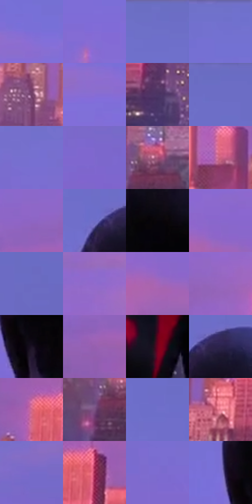

# 电影参考 690

- 状态：常规／活跃；来源世界：miles-home。
- 视角：near-level；景别：environment-wide；场景：city。
- 时段：twilight-appearance（外观依据，中置信度；具体时间／晨昏未知）；光照：dusk。
- 材质候选：fabric, glass, brick, metal, sky（帧级，不是像素分割）。
- 明暗组：middle；L* P5/P50/P95：8.63797 / 50.82478 / 55.20056。
- 资格门禁：无附加门禁。
- 原截图 SHA-256：`ed4e505ea971a8917ca0660828edf227a472b6760c1b9d477cfe833d4bb6d76a`；尺寸：2880 × 1210。
- sRGB 像素 SHA-256：`8d4cf20d780260b348b65b283d581cd213a036edd07222a1dc59ac1fb500f9b0`。

## 观察与迁移

暖粉日暮楼面与天空，建筑窗组和桥架是结构不是排线。

紫蓝天空保留安静大面，楼体上部珊瑚粉暖、下城灰紫并点缀小青粉灯，近黑红背影较暗；暖立面不等于自身发光，天际线与天线结构不重排。

本公开版保存32个128×128原像素色卡上下文；图集格子并非原场景相邻位置。原rect、图集tile和像素SHA见 `data/palette-crops.json`。上下文不足时不得批准替色，不能以小样推断完整构图。

## 实测色卡

颜色比例分母为保留采样像素，不是材料面积；全部 32 色参与全库匹配。表内四舍五入仅用于阅读，原精度在 JSON。

| ID | HEX | Lab | 原图 xy | 像素数 | 比例 | 明度角色 |
| --- | --- | --- | --- | ---: | ---: | --- |
| 690-S01 | #7C6FD8 | [52.520548, 30.829194, -52.424762] | [1204, 332] | 15085 | 7.774010% | midtone |
| 690-S02 | #836CD6 | [52.29137, 33.739026, -51.623256] | [524, 276] | 11817 | 6.089856% | midtone |
| 690-S03 | #6C6DC5 | [49.684007, 22.600244, -46.194534] | [1272, 28] | 9437 | 4.863330% | midtone |
| 690-S04 | #7270CF | [51.461298, 25.212253, -49.053189] | [480, 60] | 8657 | 4.461359% | midtone |
| 690-S05 | #703F66 | [33.89862, 27.525954, -13.773714] | [672, 908] | 8605 | 4.434561% | shadow |
| 690-S06 | #896CD4 | [52.725603, 34.704565, -49.764244] | [1152, 388] | 8287 | 4.270681% | midtone |
| 690-S07 | #4B3564 | [26.626583, 20.464542, -24.147244] | [580, 1060] | 7966 | 4.105254% | shadow |
| 690-S08 | #6A6CC4 | [49.220264, 22.422504, -46.36733] | [1656, 28] | 7761 | 3.999608% | midtone |
| 690-S09 | #766FD0 | [51.579803, 27.075218, -49.414926] | [112, 96] | 7595 | 3.914061% | midtone |
| 690-S10 | #7F68CD | [50.47535, 32.619716, -49.420712] | [2628, 712] | 7404 | 3.815629% | midtone |
| 690-S11 | #A55176 | [45.898742, 38.928768, -4.888805] | [1280, 1024] | 7317 | 3.770794% | midtone |
| 690-S12 | #CB617E | [54.819464, 44.991834, 4.027991] | [984, 908] | 7102 | 3.659995% | midtone |
| 690-S13 | #8D65C4 | [50.634824, 35.678113, -43.928466] | [128, 656] | 7005 | 3.610006% | midtone |
| 690-S14 | #6F6EC8 | [50.334609, 23.620514, -46.865096] | [1896, 292] | 6765 | 3.486323% | midtone |
| 690-S15 | #09050A | [1.703037, 1.741129, -1.523399] | [1968, 428] | 6561 | 3.381192% | deep-shadow |
| 690-S16 | #8867CD | [51.084752, 35.497099, -48.399436] | [1044, 692] | 6528 | 3.364185% | midtone |
| 690-S17 | #6B6BC2 | [48.927204, 22.676523, -45.678874] | [2484, 224] | 6187 | 3.188452% | midtone |
| 690-S18 | #916BCD | [52.886441, 35.572963, -45.481427] | [372, 544] | 5596 | 2.883882% | midtone |
| 690-S19 | #A666B9 | [53.07315, 39.774078, -33.567165] | [1020, 744] | 5582 | 2.876667% | midtone |
| 690-S20 | #9666BE | [51.501472, 36.182888, -39.043999] | [308, 656] | 4703 | 2.423677% | midtone |
| 690-S21 | #1B1224 | [7.163087, 9.230604, -10.724719] | [1924, 572] | 4701 | 2.422646% | deep-shadow |
| 690-S22 | #955FAF | [49.092734, 36.43125, -34.141381] | [60, 744] | 4570 | 2.355136% | midtone |
| 690-S23 | #71011E | [22.398887, 44.628439, 17.665035] | [2148, 1084] | 4360 | 2.246913% | shadow |
| 690-S24 | #2B224A | [16.265295, 15.419145, -23.503012] | [1964, 292] | 4216 | 2.172703% | deep-shadow |
| 690-S25 | #D3698C | [57.893187, 45.423705, 0.426815] | [140, 832] | 3973 | 2.047474% | midtone |
| 690-S26 | #7B5282 | [40.988934, 25.83894, -20.160526] | [1216, 1080] | 3933 | 2.026860% | midtone |
| 690-S27 | #706FCB | [50.832063, 24.148291, -47.783924] | [1820, 236] | 3618 | 1.864526% | midtone |
| 690-S28 | #EB8094 | [65.937222, 43.125163, 7.858786] | [104, 984] | 2759 | 1.421842% | light |
| 690-S29 | #766BCA | [50.251575, 27.742661, -48.108437] | [2740, 624] | 2479 | 1.277545% | midtone |
| 690-S30 | #982046 | [34.298697, 50.802309, 8.161706] | [208, 848] | 2070 | 1.066768% | shadow |
| 690-S31 | #7E6CD0 | [51.512, 30.83824, -49.483628] | [108, 184] | 845 | 0.435468% | midtone |
| 690-S32 | #7C70D2 | [52.426063, 28.528482, -49.174366] | [1848, 500] | 560 | 0.288594% | midtone |

## 色阶与空间分布

- 采样 ROI：`[0.01, 0.02, 0.98, 0.94]`；步长：4；样本数：194044。
- 排除区：`[]`。
- 深暗、暗、中、亮、高光五段计数：`[15647, 24558, 148994, 4771, 74]`。
- RGB 各 256 箱、L* 100 箱、13×5 色相明度表和 3×3 空间统计全部保存在 [总数据](../film-library.json)。
- [可视化档案](../../references/library.html)按需绘制直方图，不存 2,094 张重复图表图片。

## 纹理特征占比

**这是分块图像特征的面积占比，不是波点／排线／丝网／错版的精确语义覆盖率。** 窗格、发丝、织物也会产生方向或周期特征。
原图 ROI 像素 3109722；已测块覆盖 3109722（100.0000%）；未测 0。

| 特征 | 块覆盖像素 | 占已测面积 | 阈值敏感范围 |
| --- | ---: | ---: | --- |
| low-contrast | 1695616 | 54.5263% | 53.9994% ~ 55.5800% |
| directional-structure | 312704 | 10.0557% | 5.7955% ~ 14.1101% |
| periodic-structure | 820058 | 26.3708% | 23.0038% ~ 26.5766% |
| mixed-detail | 281344 | 9.0472% | 5.3139% ~ 15.6207% |

阈值敏感范围不是统计置信区间。逐块坐标、尺度、对比、方向一致性、频谱集中度、频率与角度见 [全量特征记录](../texture-features.jsonl)，以帧号定位。
四种印刷层的真实像素覆盖仍标为 `null`，不能填 0，也不能拿上表代替。不得据这些代理测量删除唯一证据。

[测量方法与保留策略](../../references/library-retention.md) · [分类索引](../archive/README.md)
