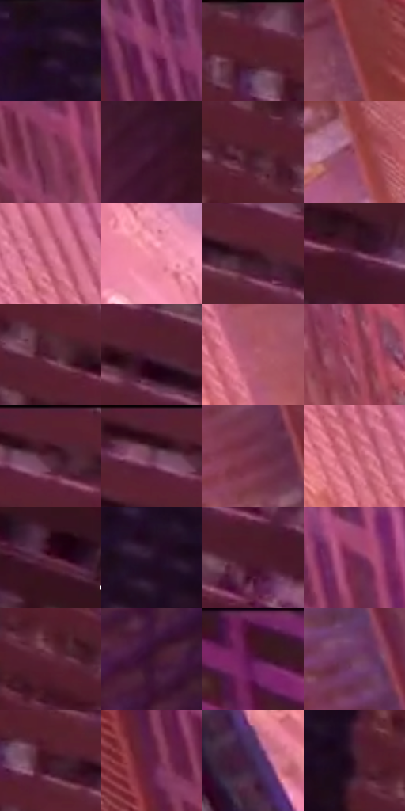

# 电影参考 691

- 状态：常规／活跃；来源世界：miles-home。
- 视角：high-angle；景别：environment-wide；场景：city。
- 时段：twilight-appearance（外观依据，中置信度；具体时间／晨昏未知）；光照：dusk。
- 材质候选：fabric, glass, brick, metal, sky（帧级，不是像素分割）。
- 明暗组：dark；L* P5/P50/P95：8.05997 / 22.37257 / 64.01695。
- 资格门禁：无附加门禁。
- 原截图 SHA-256：`08220185d51784e63488c9cce77b884480ba6bf8780bf755e67ae8b3adb65082`；尺寸：2880 × 1206。
- sRGB 像素 SHA-256：`290832ee156aad3b1ffc15365c0bc4b7d334fff553f627dd17ecafc6776a43b2`。

## 观察与迁移

暖粉日暮楼面与天空，建筑窗组和桥架是结构不是排线。

近楼粉红与深酒红面、中央紫暗侧面、远街桃色亮区建立纵深；窗带重复但可概括软化，近面并非全都更亮，暖色也有深暗层级，不擅自改楼高与比例。

本公开版保存32个128×128原像素色卡上下文；图集格子并非原场景相邻位置。原rect、图集tile和像素SHA见 `data/palette-crops.json`。上下文不足时不得批准替色，不能以小样推断完整构图。

## 实测色卡

颜色比例分母为保留采样像素，不是材料面积；全部 32 色参与全库匹配。表内四舍五入仅用于阅读，原精度在 JSON。

| ID | HEX | Lab | 原图 xy | 像素数 | 比例 | 明度角色 |
| --- | --- | --- | --- | ---: | ---: | --- |
| 691-S01 | #200C1E | [5.996098, 13.324151, -7.850638] | [1636, 68] | 7531 | 3.895090% | deep-shadow |
| 691-S02 | #7F2E5E | [32.425414, 40.348269, -10.694724] | [680, 128] | 7510 | 3.884228% | shadow |
| 691-S03 | #582031 | [21.319889, 27.672641, 2.118791] | [1964, 48] | 7455 | 3.855782% | shadow |
| 691-S04 | #85353F | [33.759047, 35.262168, 11.409589] | [516, 572] | 7362 | 3.807682% | shadow |
| 691-S05 | #87405B | [37.067135, 33.508738, -1.710807] | [808, 460] | 7336 | 3.794234% | shadow |
| 691-S06 | #441B35 | [16.845315, 23.469455, -7.711843] | [1536, 1096] | 7196 | 3.721825% | deep-shadow |
| 691-S07 | #471926 | [16.380779, 23.480206, 2.369209] | [1888, 236] | 7032 | 3.637003% | deep-shadow |
| 691-S08 | #96455A | [40.377546, 36.209433, 4.014231] | [596, 828] | 7015 | 3.628211% | midtone |
| 691-S09 | #DB7D97 | [63.313877, 39.372172, 2.106585] | [136, 392] | 6977 | 3.608557% | light |
| 691-S10 | #F493A9 | [71.534015, 39.113436, 4.268512] | [536, 1016] | 6869 | 3.552698% | light |
| 691-S11 | #3B101E | [11.920162, 22.652158, 1.507753] | [2136, 136] | 6549 | 3.387192% | deep-shadow |
| 691-S12 | #61314B | [27.425861, 25.336701, -6.313643] | [2640, 96] | 6474 | 3.348401% | shadow |
| 691-S13 | #4E2031 | [19.535608, 23.7796, -0.694723] | [2008, 212] | 6454 | 3.338057% | deep-shadow |
| 691-S14 | #53263B | [22.093372, 23.772716, -3.745886] | [2372, 196] | 6429 | 3.325127% | shadow |
| 691-S15 | #AF596F | [48.770759, 37.378315, 3.717229] | [372, 660] | 6402 | 3.311162% | midtone |
| 691-S16 | #A34C65 | [44.084719, 38.599773, 2.804424] | [928, 852] | 6274 | 3.244960% | midtone |
| 691-S17 | #3C1321 | [12.837974, 21.792537, 0.630135] | [2196, 56] | 6118 | 3.164275% | deep-shadow |
| 691-S18 | #300E1B | [9.171287, 18.944936, -0.494196] | [2140, 48] | 6072 | 3.140484% | deep-shadow |
| 691-S19 | #75324C | [30.844802, 32.393972, -1.549667] | [384, 372] | 6069 | 3.138932% | shadow |
| 691-S20 | #C9687A | [55.812679, 40.286291, 7.764029] | [216, 552] | 5873 | 3.037560% | midtone |
| 691-S21 | #511F34 | [19.954204, 25.950961, -2.114982] | [2772, 568] | 5791 | 2.995149% | deep-shadow |
| 691-S22 | #281229 | [9.351779, 15.905432, -10.929164] | [1660, 332] | 5704 | 2.950152% | deep-shadow |
| 691-S23 | #4C1A2C | [17.725444, 25.671222, 0.142727] | [2556, 240] | 5282 | 2.731890% | deep-shadow |
| 691-S24 | #70264F | [27.835276, 37.136796, -8.097708] | [848, 216] | 5281 | 2.731373% | shadow |
| 691-S25 | #60293B | [24.918028, 27.11307, 0.658907] | [1856, 416] | 5114 | 2.644999% | shadow |
| 691-S26 | #3B152D | [13.566084, 22.153584, -7.110536] | [1436, 432] | 5047 | 2.610346% | deep-shadow |
| 691-S27 | #431321 | [14.226019, 24.546416, 2.809248] | [1084, 40] | 5022 | 2.597416% | deep-shadow |
| 691-S28 | #703F5D | [33.543101, 25.87127, -8.587852] | [304, 92] | 4622 | 2.390533% | shadow |
| 691-S29 | #411524 | [14.331839, 23.067043, 0.714064] | [2020, 112] | 4478 | 2.316055% | deep-shadow |
| 691-S30 | #621F42 | [23.574122, 34.001943, -6.040906] | [668, 328] | 4429 | 2.290712% | shadow |
| 691-S31 | #41264C | [20.171283, 20.539297, -18.514519] | [148, 884] | 3848 | 1.990214% | shadow |
| 691-S32 | #341324 | [11.437797, 19.020815, -3.834009] | [1784, 356] | 3731 | 1.929701% | deep-shadow |

## 色阶与空间分布

- 采样 ROI：`[0.01, 0.02, 0.98, 0.94]`；步长：4；样本数：193346。
- 排除区：`[]`。
- 深暗、暗、中、亮、高光五段计数：`[80551, 76836, 22475, 13395, 89]`。
- RGB 各 256 箱、L* 100 箱、13×5 色相明度表和 3×3 空间统计全部保存在 [总数据](../film-library.json)。
- [可视化档案](../../references/library.html)按需绘制直方图，不存 2,094 张重复图表图片。

## 纹理特征占比

**这是分块图像特征的面积占比，不是波点／排线／丝网／错版的精确语义覆盖率。** 窗格、发丝、织物也会产生方向或周期特征。
原图 ROI 像素 3098546；已测块覆盖 3098546（100.0000%）；未测 0。

| 特征 | 块覆盖像素 | 占已测面积 | 阈值敏感范围 |
| --- | ---: | ---: | --- |
| low-contrast | 60032 | 1.9374% | 1.4087% ~ 1.9374% |
| directional-structure | 1064960 | 34.3697% | 11.1040% ~ 60.0850% |
| periodic-structure | 1973554 | 63.6929% | 38.5064% ~ 85.0211% |
| mixed-detail | 0 | 0.0000% | 0.0000% ~ 1.9374% |

阈值敏感范围不是统计置信区间。逐块坐标、尺度、对比、方向一致性、频谱集中度、频率与角度见 [全量特征记录](../texture-features.jsonl)，以帧号定位。
四种印刷层的真实像素覆盖仍标为 `null`，不能填 0，也不能拿上表代替。不得据这些代理测量删除唯一证据。

[测量方法与保留策略](../../references/library-retention.md) · [分类索引](../archive/README.md)
