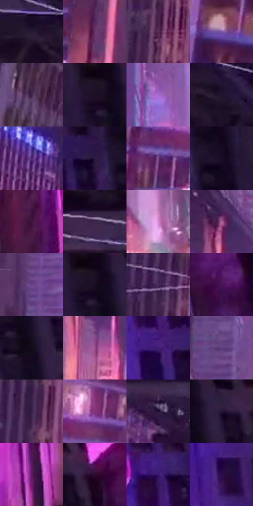

# 电影参考 692

- 状态：常规／活跃；来源世界：miles-home。
- 视角：low-angle；景别：environment-wide；场景：city。
- 时段：twilight-appearance（外观依据，中置信度；具体时间／晨昏未知）；光照：dusk。
- 材质候选：fabric, glass, brick, metal, sky（帧级，不是像素分割）。
- 明暗组：very-dark；L* P5/P50/P95：3.88893 / 19.9594 / 56.60934。
- 资格门禁：无附加门禁。
- 原截图 SHA-256：`b2a8da84a4c3c9ae95f7d570b09388d72dd952930a6179c2cc128fcde16fefb6`；尺寸：2880 × 1194。
- sRGB 像素 SHA-256：`860204f9cb8f193e4fb2ae60852608153a844156ede3dff55ff6b02e58a7fe39`。

## 观察与迁移

暖粉日暮楼面与天空，建筑窗组和桥架是结构不是排线。

左侧高架钢梁斜贯、右侧楼面粉紫与暗窗组对照，远处青点和地面暖灯分层；白色蛛丝是影片实体而非通用速度线，不能新增高架桥、灯牌或蛛丝。

本公开版保存32个128×128原像素色卡上下文；图集格子并非原场景相邻位置。原rect、图集tile和像素SHA见 `data/palette-crops.json`。上下文不足时不得批准替色，不能以小样推断完整构图。

## 实测色卡

颜色比例分母为保留采样像素，不是材料面积；全部 32 色参与全库匹配。表内四舍五入仅用于阅读，原精度在 JSON。

| ID | HEX | Lab | 原图 xy | 像素数 | 比例 | 明度角色 |
| --- | --- | --- | --- | ---: | ---: | --- |
| 692-S01 | #2A1A34 | [12.473797, 14.004039, -14.077814] | [312, 160] | 10977 | 5.718677% | deep-shadow |
| 692-S02 | #673667 | [30.644163, 29.847101, -19.529532] | [768, 1096] | 9261 | 4.824694% | shadow |
| 692-S03 | #562B54 | [24.785603, 26.567768, -16.451871] | [920, 300] | 8835 | 4.602761% | shadow |
| 692-S04 | #7C57A5 | [43.970742, 31.323264, -36.517474] | [112, 924] | 7949 | 4.141183% | midtone |
| 692-S05 | #412449 | [19.501969, 21.082804, -17.52595] | [96, 408] | 7874 | 4.102110% | deep-shadow |
| 692-S06 | #1F1329 | [8.281264, 11.703312, -12.700853] | [2304, 48] | 7692 | 4.007294% | deep-shadow |
| 692-S07 | #A56ACA | [54.62865, 40.952886, -40.879577] | [1320, 584] | 7489 | 3.901537% | midtone |
| 692-S08 | #231630 | [10.141766, 13.108492, -14.906589] | [448, 204] | 7261 | 3.782756% | deep-shadow |
| 692-S09 | #522C7A | [26.735444, 33.928576, -37.99484] | [688, 724] | 7170 | 3.735348% | shadow |
| 692-S10 | #2D1B3F | [13.830516, 17.516074, -19.729593] | [2104, 68] | 7081 | 3.688982% | deep-shadow |
| 692-S11 | #784B87 | [39.198548, 30.060693, -26.017773] | [516, 1052] | 7057 | 3.676478% | shadow |
| 692-S12 | #1A0C25 | [5.565441, 12.484142, -13.971265] | [2188, 68] | 6907 | 3.598333% | deep-shadow |
| 692-S13 | #3D113C | [13.939958, 27.910075, -17.274381] | [1632, 628] | 6854 | 3.570722% | deep-shadow |
| 692-S14 | #1A0C1F | [5.252652, 10.324511, -9.827483] | [120, 24] | 6813 | 3.549362% | deep-shadow |
| 692-S15 | #DA8CD5 | [68.36381, 40.795389, -25.254451] | [1420, 1080] | 6728 | 3.505079% | light |
| 692-S16 | #AA5D9A | [50.345302, 39.946782, -19.665885] | [1144, 848] | 6657 | 3.468091% | midtone |
| 692-S17 | #6A4386 | [35.595891, 30.186593, -31.181079] | [1084, 320] | 6318 | 3.291482% | shadow |
| 692-S18 | #100415 | [2.268561, 6.297079, -6.631279] | [2324, 28] | 6051 | 3.152383% | deep-shadow |
| 692-S19 | #482C5B | [23.453534, 22.878059, -23.301003] | [896, 184] | 5774 | 3.008075% | shadow |
| 692-S20 | #471352 | [17.528336, 34.386213, -26.710573] | [2712, 552] | 5128 | 2.671529% | deep-shadow |
| 692-S21 | #120B1C | [4.08086, 6.114403, -9.322398] | [2360, 128] | 5099 | 2.656421% | deep-shadow |
| 692-S22 | #964C8B | [43.5337, 39.898474, -21.410547] | [1176, 1020] | 4857 | 2.530346% | midtone |
| 692-S23 | #421E74 | [21.385236, 36.408525, -42.931153] | [1984, 180] | 4455 | 2.320917% | shadow |
| 692-S24 | #5F407C | [33.038181, 26.154856, -29.111935] | [1124, 620] | 4437 | 2.311539% | shadow |
| 692-S25 | #371F46 | [16.672296, 20.128284, -20.015918] | [944, 64] | 4412 | 2.298515% | deep-shadow |
| 692-S26 | #85337A | [35.51857, 44.296761, -23.601962] | [604, 980] | 4041 | 2.105236% | shadow |
| 692-S27 | #1E0A31 | [6.457071, 19.569177, -21.551224] | [484, 516] | 3718 | 1.936963% | deep-shadow |
| 692-S28 | #311F3E | [15.385925, 15.868296, -16.538791] | [2400, 36] | 3299 | 1.718677% | deep-shadow |
| 692-S29 | #5D1765 | [23.270265, 41.9893, -29.959243] | [1776, 924] | 3053 | 1.590518% | shadow |
| 692-S30 | #2D0C2E | [9.141948, 22.561263, -14.906334] | [2540, 64] | 3022 | 1.574368% | deep-shadow |
| 692-S31 | #37176A | [17.761469, 35.123899, -42.425968] | [1980, 68] | 2937 | 1.530086% | deep-shadow |
| 692-S32 | #2D1048 | [11.933097, 27.032709, -29.072953] | [1984, 468] | 2744 | 1.429539% | deep-shadow |

## 色阶与空间分布

- 采样 ROI：`[0.01, 0.02, 0.98, 0.94]`；步长：4；样本数：191950。
- 排除区：`[]`。
- 深暗、暗、中、亮、高光五段计数：`[96091, 61412, 27860, 6205, 382]`。
- RGB 各 256 箱、L* 100 箱、13×5 色相明度表和 3×3 空间统计全部保存在 [总数据](../film-library.json)。
- [可视化档案](../../references/library.html)按需绘制直方图，不存 2,094 张重复图表图片。

## 纹理特征占比

**这是分块图像特征的面积占比，不是波点／排线／丝网／错版的精确语义覆盖率。** 窗格、发丝、织物也会产生方向或周期特征。
原图 ROI 像素 3070606；已测块覆盖 3070606（100.0000%）；未测 0。

| 特征 | 块覆盖像素 | 占已测面积 | 阈值敏感范围 |
| --- | ---: | ---: | --- |
| low-contrast | 28800 | 0.9379% | 0.3126% ~ 1.1968% |
| directional-structure | 1024256 | 33.3568% | 18.0123% ~ 46.0334% |
| periodic-structure | 2017550 | 65.7053% | 53.6540% ~ 76.5222% |
| mixed-detail | 0 | 0.0000% | 0.0000% ~ 4.2686% |

阈值敏感范围不是统计置信区间。逐块坐标、尺度、对比、方向一致性、频谱集中度、频率与角度见 [全量特征记录](../texture-features.jsonl)，以帧号定位。
四种印刷层的真实像素覆盖仍标为 `null`，不能填 0，也不能拿上表代替。不得据这些代理测量删除唯一证据。

[测量方法与保留策略](../../references/library-retention.md) · [分类索引](../archive/README.md)
