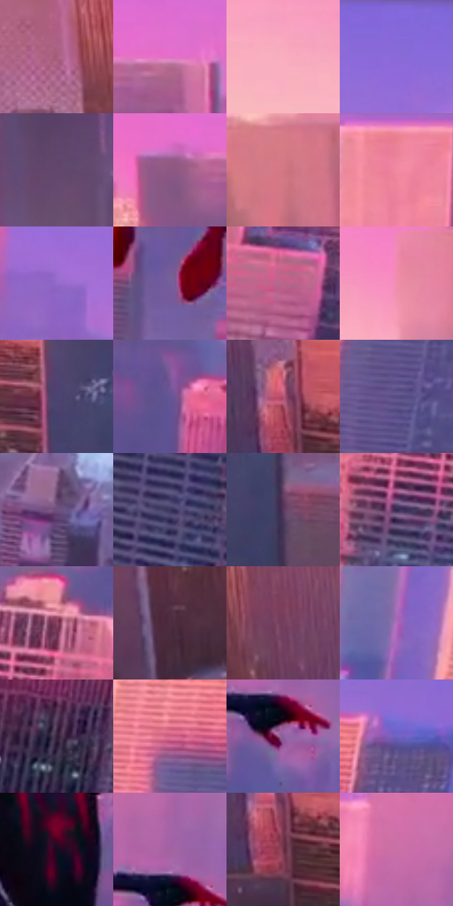

# 电影参考 693

- 状态：常规／活跃；来源世界：miles-home。
- 视角：high-angle；景别：environment-wide；场景：city。
- 时段：twilight-appearance（外观依据，中置信度；具体时间／晨昏未知）；光照：dusk。
- 材质候选：fabric, glass, brick, metal, sky（帧级，不是像素分割）。
- 明暗组：middle；L* P5/P50/P95：17.72139 / 46.08241 / 71.11911。
- 资格门禁：无附加门禁。
- 原截图 SHA-256：`1019a8c08ab3b631c4fafd691a10404291710802905618ddf4c5010a887f40cd`；尺寸：2880 × 1202。
- sRGB 像素 SHA-256：`3fdc458ad34dddc9524156ac1a3f9dcc74019d30a35d247a95a49ed2da17c976`。

## 观察与迁移

暖粉日暮楼面与天空，建筑窗组和桥架是结构不是排线。

暖桃粉天空照出珊瑚色楼面，冷紫侧面和远处空气保留深度，规则窗格内有不均匀暗映形；不能凭映形猜反射对象，也不把所有玻璃变成同一塑料亮片。

本公开版保存32个128×128原像素色卡上下文；图集格子并非原场景相邻位置。原rect、图集tile和像素SHA见 `data/palette-crops.json`。上下文不足时不得批准替色，不能以小样推断完整构图。

## 实测色卡

颜色比例分母为保留采样像素，不是材料面积；全部 32 色参与全库匹配。表内四舍五入仅用于阅读，原精度在 JSON。

| ID | HEX | Lab | 原图 xy | 像素数 | 比例 | 明度角色 |
| --- | --- | --- | --- | ---: | ---: | --- |
| 693-S01 | #A65F7A | [49.127987, 32.342324, -2.514991] | [188, 716] | 8418 | 4.369628% | midtone |
| 693-S02 | #E071C5 | [63.087227, 53.716085, -24.325109] | [1192, 192] | 8328 | 4.322910% | light |
| 693-S03 | #F8AEBE | [78.432361, 29.241679, 2.775507] | [176, 96] | 7738 | 4.016652% | light |
| 693-S04 | #8669D7 | [51.923933, 36.493986, -52.761596] | [2248, 48] | 7648 | 3.969935% | midtone |
| 693-S05 | #63476D | [34.525558, 19.500681, -17.369082] | [1056, 800] | 7422 | 3.852622% | shadow |
| 693-S06 | #8E5682 | [44.260056, 30.086785, -14.94447] | [1080, 212] | 7339 | 3.809539% | midtone |
| 693-S07 | #D17784 | [60.264492, 36.545053, 8.441978] | [588, 360] | 7263 | 3.770088% | light |
| 693-S08 | #E88093 | [65.518102, 41.947334, 7.77364] | [1412, 32] | 7063 | 3.666272% | light |
| 693-S09 | #956CCB | [53.412785, 35.598057, -43.482212] | [1956, 152] | 6801 | 3.530273% | midtone |
| 693-S10 | #725E9B | [44.159851, 21.609319, -30.355004] | [1376, 704] | 6766 | 3.512105% | midtone |
| 693-S11 | #B8668A | [53.524896, 37.341538, -5.251425] | [2200, 676] | 6689 | 3.472136% | midtone |
| 693-S12 | #F08EAE | [70.127589, 40.947399, -0.621501] | [684, 176] | 6596 | 3.423861% | light |
| 693-S13 | #4D4371 | [31.310349, 15.630319, -25.066631] | [772, 892] | 6572 | 3.411403% | shadow |
| 693-S14 | #665596 | [40.448424, 22.191714, -33.278635] | [1564, 464] | 6451 | 3.348594% | midtone |
| 693-S15 | #B55574 | [48.987714, 42.183669, 1.132035] | [504, 912] | 6434 | 3.339770% | midtone |
| 693-S16 | #584D84 | [36.076711, 18.020052, -29.321675] | [2520, 464] | 6360 | 3.301358% | shadow |
| 693-S17 | #6D517E | [38.971769, 20.760719, -20.960738] | [1492, 1036] | 6242 | 3.240106% | shadow |
| 693-S18 | #3D365F | [25.126539, 13.853935, -23.366654] | [2028, 988] | 5672 | 2.944230% | shadow |
| 693-S19 | #55395C | [28.460181, 19.340239, -16.018689] | [856, 964] | 5629 | 2.921909% | shadow |
| 693-S20 | #312A4E | [19.46948, 12.972249, -21.101234] | [1984, 704] | 5616 | 2.915161% | deep-shadow |
| 693-S21 | #8E4766 | [39.944949, 33.82134, -4.24639] | [2088, 592] | 5603 | 2.908413% | shadow |
| 693-S22 | #4E2D41 | [23.265292, 18.528298, -6.156858] | [260, 968] | 5523 | 2.866887% | shadow |
| 693-S23 | #753F5D | [34.247968, 27.734486, -7.457462] | [372, 756] | 5469 | 2.838856% | shadow |
| 693-S24 | #B26CBC | [55.909078, 40.750028, -30.764032] | [2344, 328] | 5380 | 2.792658% | midtone |
| 693-S25 | #321F3A | [15.295112, 15.158824, -13.862318] | [2716, 896] | 5302 | 2.752170% | deep-shadow |
| 693-S26 | #D36488 | [56.825283, 47.413227, 1.206264] | [2480, 320] | 4990 | 2.590216% | midtone |
| 693-S27 | #8A619C | [47.434582, 27.667399, -25.656913] | [1768, 340] | 4261 | 2.211806% | midtone |
| 693-S28 | #6F61C1 | [46.682071, 29.439339, -48.663537] | [2620, 256] | 4209 | 2.184814% | midtone |
| 693-S29 | #140E21 | [5.172149, 7.198393, -11.558117] | [1436, 416] | 4206 | 2.183257% | deep-shadow |
| 693-S30 | #A263A0 | [50.855377, 35.178236, -22.500589] | [1752, 264] | 3819 | 1.982372% | midtone |
| 693-S31 | #6F2F45 | [29.012962, 30.852179, 0.248854] | [516, 968] | 3538 | 1.836510% | shadow |
| 693-S32 | #C96EA5 | [58.309732, 42.979756, -13.600853] | [1692, 172] | 3301 | 1.713488% | midtone |

## 色阶与空间分布

- 采样 ROI：`[0.01, 0.02, 0.98, 0.94]`；步长：4；样本数：192648。
- 排除区：`[]`。
- 深暗、暗、中、亮、高光五段计数：`[12969, 58078, 87112, 32171, 2318]`。
- RGB 各 256 箱、L* 100 箱、13×5 色相明度表和 3×3 空间统计全部保存在 [总数据](../film-library.json)。
- [可视化档案](../../references/library.html)按需绘制直方图，不存 2,094 张重复图表图片。

## 纹理特征占比

**这是分块图像特征的面积占比，不是波点／排线／丝网／错版的精确语义覆盖率。** 窗格、发丝、织物也会产生方向或周期特征。
原图 ROI 像素 3087370；已测块覆盖 3087370（100.0000%）；未测 0。

| 特征 | 块覆盖像素 | 占已测面积 | 阈值敏感范围 |
| --- | ---: | ---: | --- |
| low-contrast | 144640 | 4.6849% | 2.0315% ~ 4.6849% |
| directional-structure | 576128 | 18.6608% | 7.0398% ~ 30.6176% |
| periodic-structure | 2208778 | 71.5424% | 65.9537% ~ 77.1725% |
| mixed-detail | 157824 | 5.1119% | 1.3972% ~ 11.1028% |

阈值敏感范围不是统计置信区间。逐块坐标、尺度、对比、方向一致性、频谱集中度、频率与角度见 [全量特征记录](../texture-features.jsonl)，以帧号定位。
四种印刷层的真实像素覆盖仍标为 `null`，不能填 0，也不能拿上表代替。不得据这些代理测量删除唯一证据。

[测量方法与保留策略](../../references/library-retention.md) · [分类索引](../archive/README.md)
