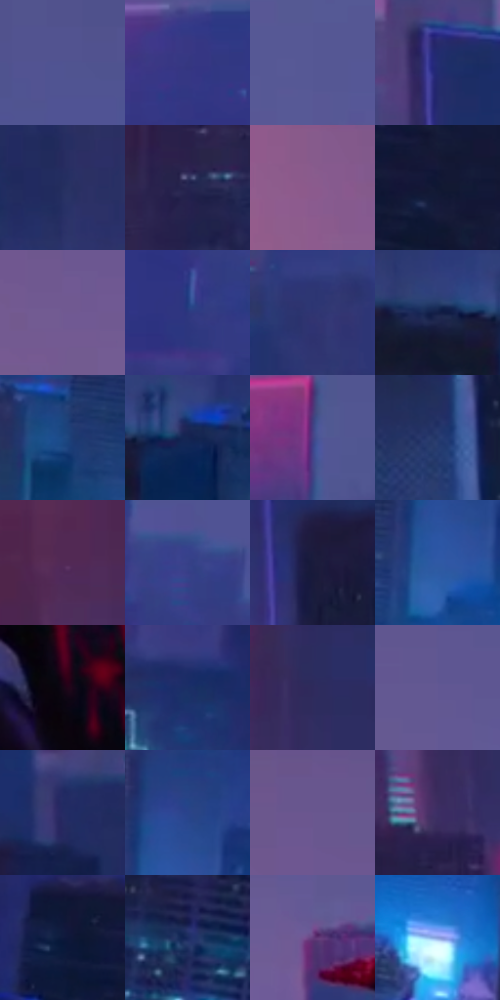

# 电影参考 694

- 状态：常规／活跃；来源世界：miles-home。
- 视角：high-angle；景别：environment-wide；场景：city。
- 时段：night-appearance（外观依据，中置信度；具体时间／晨昏未知）；光照：night-mixed。
- 材质候选：fabric, glass, stone, sky（帧级，不是像素分割）。
- 明暗组：dark；L* P5/P50/P95：8.82858 / 25.34289 / 43.42227。
- 资格门禁：无附加门禁。
- 原截图 SHA-256：`b2034c2d32134ff0ac6e6d0ff44964bdc8449eecc412e70d88d2a97b40ea8ba1`；尺寸：2880 × 1204。
- sRGB 像素 SHA-256：`33489c75791426985c63c156f50b70b39044d4b0b62c0f6cd206a9645f7055dd`。

## 观察与迁移

暖暮转蓝夜的城市，姿态也变化，不作为纯曝光实验。

与693相近城景转为蓝色大暗面，少量粉色楼缘、青色窗组和下方亮空气承担分离；姿态与取景仍变化，不是像素配准实验，也不据静帧断定真实经过时间。

本公开版保存32个128×128原像素色卡上下文；图集格子并非原场景相邻位置。原rect、图集tile和像素SHA见 `data/palette-crops.json`。上下文不足时不得批准替色，不能以小样推断完整构图。

## 实测色卡

颜色比例分母为保留采样像素，不是材料面积；全部 32 色参与全库匹配。表内四舍五入仅用于阅读，原精度在 JSON。

| ID | HEX | Lab | 原图 xy | 像素数 | 比例 | 明度角色 |
| --- | --- | --- | --- | ---: | ---: | --- |
| 694-S01 | #505391 | [37.726719, 15.793493, -34.689458] | [2392, 120] | 13589 | 7.053798% | shadow |
| 694-S02 | #353780 | [26.868828, 22.064727, -41.707432] | [2136, 224] | 9743 | 5.057410% | shadow |
| 694-S03 | #565794 | [39.466217, 15.794571, -33.718699] | [1404, 196] | 9243 | 4.797870% | shadow |
| 694-S04 | #232D72 | [21.757322, 20.351982, -41.171874] | [700, 432] | 8932 | 4.636435% | shadow |
| 694-S05 | #252F5F | [21.026995, 12.03036, -30.004838] | [976, 608] | 8928 | 4.634359% | shadow |
| 694-S06 | #252450 | [16.670568, 14.355251, -26.977877] | [316, 700] | 8785 | 4.560130% | deep-shadow |
| 694-S07 | #8B5A8D | [45.255193, 28.888004, -20.081071] | [244, 144] | 8736 | 4.534695% | midtone |
| 694-S08 | #0F1732 | [8.520624, 6.677232, -19.069355] | [2772, 764] | 8498 | 4.411154% | deep-shadow |
| 694-S09 | #715992 | [42.354601, 22.048368, -27.806356] | [648, 228] | 7806 | 4.051950% | midtone |
| 694-S10 | #2C367E | [25.801575, 20.249636, -42.208913] | [2292, 368] | 7146 | 3.709356% | shadow |
| 694-S11 | #2F3471 | [24.48804, 17.457275, -36.073885] | [1160, 528] | 6825 | 3.542731% | shadow |
| 694-S12 | #141E47 | [12.810088, 11.269543, -27.087394] | [1088, 768] | 6578 | 3.414518% | deep-shadow |
| 694-S13 | #1D4884 | [30.785857, 7.791003, -37.963571] | [1576, 936] | 6231 | 3.234396% | shadow |
| 694-S14 | #142652 | [16.224771, 9.875832, -29.112466] | [1200, 772] | 6206 | 3.221419% | deep-shadow |
| 694-S15 | #474085 | [31.112446, 21.953654, -37.918302] | [1844, 192] | 6092 | 3.162244% | shadow |
| 694-S16 | #23396B | [24.779491, 9.156692, -31.802613] | [696, 920] | 6062 | 3.146672% | shadow |
| 694-S17 | #522955 | [23.789511, 26.60159, -18.710076] | [80, 548] | 5445 | 2.826398% | shadow |
| 694-S18 | #374088 | [30.049095, 19.266975, -41.551567] | [2356, 252] | 5201 | 2.699743% | shadow |
| 694-S19 | #191B3B | [11.318743, 9.906674, -21.034645] | [740, 604] | 4981 | 2.585545% | deep-shadow |
| 694-S20 | #2F59A4 | [38.60002, 11.542404, -44.823244] | [1720, 916] | 4919 | 2.553362% | shadow |
| 694-S21 | #150615 | [3.105921, 7.49258, -5.355139] | [1432, 428] | 4775 | 2.478614% | deep-shadow |
| 694-S22 | #1A3066 | [21.178698, 11.910819, -34.375381] | [1736, 644] | 4644 | 2.410614% | shadow |
| 694-S23 | #2E2A5C | [20.080893, 16.724326, -29.501824] | [448, 452] | 4481 | 2.326004% | shadow |
| 694-S24 | #625893 | [40.706623, 18.315129, -31.092809] | [1008, 124] | 4446 | 2.307836% | midtone |
| 694-S25 | #242A64 | [19.845504, 17.281369, -35.191502] | [860, 520] | 3836 | 1.991196% | deep-shadow |
| 694-S26 | #29438B | [30.276273, 15.750466, -43.080463] | [1744, 836] | 3597 | 1.867136% | shadow |
| 694-S27 | #69568F | [40.641033, 20.604849, -28.73831] | [684, 84] | 3338 | 1.732694% | midtone |
| 694-S28 | #3B2E64 | [23.011579, 20.188654, -29.9927] | [392, 560] | 3322 | 1.724389% | shadow |
| 694-S29 | #0D193C | [9.852161, 9.021535, -24.149624] | [2648, 680] | 3249 | 1.686496% | deep-shadow |
| 694-S30 | #19295D | [18.287697, 13.132512, -33.132044] | [2312, 800] | 3038 | 1.576969% | deep-shadow |
| 694-S31 | #653C7C | [32.818382, 30.398025, -29.410932] | [1116, 268] | 2815 | 1.461214% | shadow |
| 694-S32 | #869DD8 | [65.072244, 6.453107, -32.612337] | [1900, 1084] | 1161 | 0.602654% | light |

## 色阶与空间分布

- 采样 ROI：`[0.01, 0.02, 0.98, 0.94]`；步长：4；样本数：192648。
- 排除区：`[]`。
- 深暗、暗、中、亮、高光五段计数：`[53709, 113188, 25302, 219, 230]`。
- RGB 各 256 箱、L* 100 箱、13×5 色相明度表和 3×3 空间统计全部保存在 [总数据](../film-library.json)。
- [可视化档案](../../references/library.html)按需绘制直方图，不存 2,094 张重复图表图片。

## 纹理特征占比

**这是分块图像特征的面积占比，不是波点／排线／丝网／错版的精确语义覆盖率。** 窗格、发丝、织物也会产生方向或周期特征。
原图 ROI 像素 3092958；已测块覆盖 3092958（100.0000%）；未测 0。

| 特征 | 块覆盖像素 | 占已测面积 | 阈值敏感范围 |
| --- | ---: | ---: | --- |
| low-contrast | 700928 | 22.6621% | 20.2907% ~ 26.1839% |
| directional-structure | 425088 | 13.7437% | 9.1625% ~ 23.7794% |
| periodic-structure | 1765470 | 57.0803% | 52.5942% ~ 57.0803% |
| mixed-detail | 201472 | 6.5139% | 3.3356% ~ 8.4465% |

阈值敏感范围不是统计置信区间。逐块坐标、尺度、对比、方向一致性、频谱集中度、频率与角度见 [全量特征记录](../texture-features.jsonl)，以帧号定位。
四种印刷层的真实像素覆盖仍标为 `null`，不能填 0，也不能拿上表代替。不得据这些代理测量删除唯一证据。

[测量方法与保留策略](../../references/library-retention.md) · [分类索引](../archive/README.md)
