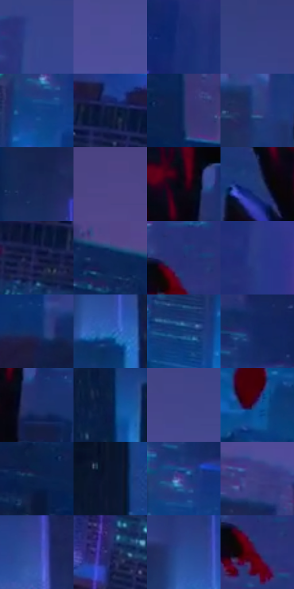

# 电影参考 695

- 状态：常规／活跃；来源世界：miles-home。
- 视角：high-angle；景别：environment-wide；场景：city。
- 时段：night-appearance（外观依据，中置信度；具体时间／晨昏未知）；光照：night-mixed。
- 材质候选：fabric, glass, stone, sky（帧级，不是像素分割）。
- 明暗组：dark；L* P5/P50/P95：8.31362 / 24.06316 / 36.12964。
- 资格门禁：无附加门禁。
- 原截图 SHA-256：`76f0ea627a8bbc1ad47fc2e3ce04e4af230b2d3fc63aec502f3b1845ca4c2178`；尺寸：2880 × 1200。
- sRGB 像素 SHA-256：`56296b05f33ec62643a475194a01b7cefb8d6569313cbd68f43e25fdc2758e79`。

## 观察与迁移

暖暮转蓝夜的城市，姿态也变化，不作为纯曝光实验。

青蓝窗组断续落在深蓝楼面，局部紫色冠边与粉色灯点面积有限，远楼对比更低；改变的手腿姿态另记，立面窗组是结构，不等于全幅网点。

本公开版保存32个128×128原像素色卡上下文；图集格子并非原场景相邻位置。原rect、图集tile和像素SHA见 `data/palette-crops.json`。上下文不足时不得批准替色，不能以小样推断完整构图。

## 实测色卡

颜色比例分母为保留采样像素，不是材料面积；全部 32 色参与全库匹配。表内四舍五入仅用于阅读，原精度在 JSON。

| ID | HEX | Lab | 原图 xy | 像素数 | 比例 | 明度角色 |
| --- | --- | --- | --- | ---: | ---: | --- |
| 695-S01 | #37458D | [31.785874, 17.704719, -41.838169] | [2024, 220] | 11305 | 5.868216% | shadow |
| 695-S02 | #4D4C97 | [35.946352, 21.433203, -41.171516] | [900, 312] | 10409 | 5.403119% | shadow |
| 695-S03 | #1B2D75 | [21.555754, 20.332251, -43.442058] | [2396, 576] | 9836 | 5.105685% | shadow |
| 695-S04 | #374083 | [29.705929, 17.489101, -39.00215] | [2052, 112] | 8587 | 4.457352% | shadow |
| 695-S05 | #104186 | [28.409226, 12.050829, -43.04767] | [1876, 856] | 8439 | 4.380528% | shadow |
| 695-S06 | #0E1B3C | [10.581837, 7.645764, -22.971721] | [2508, 712] | 7647 | 3.969416% | deep-shadow |
| 695-S07 | #192E60 | [20.063065, 10.716754, -32.249287] | [156, 384] | 7483 | 3.884286% | shadow |
| 695-S08 | #343B7C | [27.607619, 17.722682, -38.009241] | [1240, 512] | 7481 | 3.883248% | shadow |
| 695-S09 | #192658 | [16.975317, 13.286897, -31.922641] | [352, 556] | 7455 | 3.869752% | deep-shadow |
| 695-S10 | #4F4588 | [33.340797, 21.741963, -36.169405] | [184, 96] | 7192 | 3.733234% | shadow |
| 695-S11 | #170714 | [3.474545, 7.782376, -4.116394] | [1512, 400] | 6961 | 3.613326% | deep-shadow |
| 695-S12 | #1F3973 | [25.121254, 11.604368, -36.382217] | [1368, 444] | 6860 | 3.560899% | shadow |
| 695-S13 | #1A1F49 | [13.712008, 12.634882, -26.994925] | [2372, 748] | 6654 | 3.453968% | deep-shadow |
| 695-S14 | #0D2656 | [16.222188, 10.559874, -31.828012] | [72, 248] | 6618 | 3.435281% | deep-shadow |
| 695-S15 | #262D72 | [21.956136, 20.87338, -40.839885] | [1908, 400] | 6402 | 3.323159% | shadow |
| 695-S16 | #273984 | [26.799618, 19.598892, -44.365939] | [2096, 448] | 6249 | 3.243740% | shadow |
| 695-S17 | #0F306A | [21.039544, 12.127137, -37.220822] | [980, 548] | 6206 | 3.221419% | shadow |
| 695-S18 | #2A63B5 | [42.384651, 10.841335, -48.795778] | [848, 836] | 5635 | 2.925024% | midtone |
| 695-S19 | #113A72 | [24.826119, 8.585201, -36.247993] | [1776, 936] | 5246 | 2.723101% | shadow |
| 695-S20 | #0F2762 | [17.617512, 15.296514, -37.545754] | [1936, 704] | 5032 | 2.612018% | deep-shadow |
| 695-S21 | #1E306C | [21.843432, 15.015449, -37.182949] | [1568, 452] | 4793 | 2.487957% | shadow |
| 695-S22 | #0B1D47 | [11.988161, 10.484393, -28.440623] | [1056, 804] | 4588 | 2.381546% | deep-shadow |
| 695-S23 | #42468A | [32.641181, 18.426866, -38.580503] | [900, 168] | 4538 | 2.355592% | shadow |
| 695-S24 | #1E4990 | [31.928811, 12.073554, -43.509968] | [1524, 1040] | 4213 | 2.186890% | shadow |
| 695-S25 | #09224E | [14.127415, 9.528405, -29.803944] | [32, 408] | 4172 | 2.165608% | deep-shadow |
| 695-S26 | #0A142F | [6.955195, 6.37128, -19.38746] | [40, 1032] | 4163 | 2.160936% | deep-shadow |
| 695-S27 | #343E8A | [29.436557, 20.729402, -43.786714] | [1900, 796] | 4005 | 2.078921% | shadow |
| 695-S28 | #404084 | [30.453509, 19.900749, -38.386826] | [512, 380] | 3742 | 1.942403% | shadow |
| 695-S29 | #354DA0 | [35.205573, 18.92911, -47.874142] | [400, 776] | 3642 | 1.890495% | shadow |
| 695-S30 | #21275F | [18.366129, 16.898011, -34.304224] | [2192, 968] | 3357 | 1.742556% | deep-shadow |
| 695-S31 | #2A4A95 | [33.046354, 15.01272, -44.734247] | [812, 768] | 2905 | 1.507932% | shadow |
| 695-S32 | #3E245D | [20.34625, 25.449734, -29.641267] | [1908, 452] | 833 | 0.432395% | shadow |

## 色阶与空间分布

- 采样 ROI：`[0.01, 0.02, 0.98, 0.94]`；步长：4；样本数：192648。
- 排除区：`[]`。
- 深暗、暗、中、亮、高光五段计数：`[62420, 126788, 3256, 160, 24]`。
- RGB 各 256 箱、L* 100 箱、13×5 色相明度表和 3×3 空间统计全部保存在 [总数据](../film-library.json)。
- [可视化档案](../../references/library.html)按需绘制直方图，不存 2,094 张重复图表图片。

## 纹理特征占比

**这是分块图像特征的面积占比，不是波点／排线／丝网／错版的精确语义覆盖率。** 窗格、发丝、织物也会产生方向或周期特征。
原图 ROI 像素 3084576；已测块覆盖 3084576（100.0000%）；未测 0。

| 特征 | 块覆盖像素 | 占已测面积 | 阈值敏感范围 |
| --- | ---: | ---: | --- |
| low-contrast | 643584 | 20.8646% | 20.3334% ~ 22.4581% |
| directional-structure | 410880 | 13.3205% | 5.4444% ~ 21.7526% |
| periodic-structure | 1786400 | 57.9140% | 55.9885% ~ 59.3746% |
| mixed-detail | 243712 | 7.9010% | 1.9255% ~ 12.7229% |

阈值敏感范围不是统计置信区间。逐块坐标、尺度、对比、方向一致性、频谱集中度、频率与角度见 [全量特征记录](../texture-features.jsonl)，以帧号定位。
四种印刷层的真实像素覆盖仍标为 `null`，不能填 0，也不能拿上表代替。不得据这些代理测量删除唯一证据。

[测量方法与保留策略](../../references/library-retention.md) · [分类索引](../archive/README.md)
