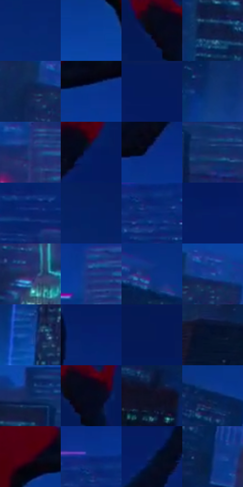

# 电影参考 696

- 状态：常规／活跃；来源世界：miles-home。
- 视角：near-level；景别：medium；场景：city。
- 时段：night-appearance（外观依据，中置信度；具体时间／晨昏未知）；光照：night-mixed。
- 材质候选：fabric, glass, stone, sky（帧级，不是像素分割）。
- 明暗组：very-dark；L* P5/P50/P95：2.78946 / 17.54784 / 31.58069。
- 资格门禁：无附加门禁。
- 原截图 SHA-256：`d2ab710e5a468e5b1a8c91dcb0952304446ec3ed5918182803e418e1897835bd`；尺寸：2878 × 1190。
- sRGB 像素 SHA-256：`00d83ba53f674ea3f4cbdc6d290236371331c5a90b44e3ece245c18b7ec01a12`。

## 观察与迁移

暖暮转蓝夜的城市，姿态也变化，不作为纯曝光实验。

人物更近、更大且仍偏黑蓝，红色肩背保留低明度，纯净深蓝天与下方细小窗光分开；主角不是最亮对象，不能为读清细纹而全面提亮前景。

本公开版保存32个128×128原像素色卡上下文；图集格子并非原场景相邻位置。原rect、图集tile和像素SHA见 `data/palette-crops.json`。上下文不足时不得批准替色，不能以小样推断完整构图。

## 实测色卡

颜色比例分母为保留采样像素，不是材料面积；全部 32 色参与全库匹配。表内四舍五入仅用于阅读，原精度在 JSON。

| ID | HEX | Lab | 原图 xy | 像素数 | 比例 | 明度角色 |
| --- | --- | --- | --- | ---: | ---: | --- |
| 696-S01 | #082872 | [19.155203, 20.849457, -45.46784] | [160, 212] | 11702 | 6.118629% | deep-shadow |
| 696-S02 | #063E9D | [29.20225, 23.192023, -55.884685] | [1264, 536] | 9829 | 5.139293% | shadow |
| 696-S03 | #090612 | [2.095568, 2.721063, -4.994253] | [912, 64] | 9748 | 5.096940% | deep-shadow |
| 696-S04 | #0E1B3E | [10.739559, 8.526697, -24.137326] | [1688, 968] | 9683 | 5.062954% | deep-shadow |
| 696-S05 | #11224F | [14.554481, 11.093028, -29.778977] | [648, 696] | 8703 | 4.550541% | deep-shadow |
| 696-S06 | #09358F | [25.522591, 23.817196, -53.326888] | [1800, 472] | 8274 | 4.326229% | shadow |
| 696-S07 | #041A5C | [12.841019, 21.355457, -41.388453] | [2736, 40] | 7703 | 4.027670% | deep-shadow |
| 696-S08 | #103474 | [23.089205, 13.627096, -40.330403] | [556, 920] | 7283 | 3.808065% | shadow |
| 696-S09 | #263779 | [25.334139, 16.572031, -39.828328] | [2040, 764] | 7147 | 3.736954% | shadow |
| 696-S10 | #051D60 | [14.145818, 20.953733, -41.912588] | [2192, 88] | 7041 | 3.681530% | deep-shadow |
| 696-S11 | #062C82 | [21.766492, 24.601699, -51.376653] | [1952, 428] | 6998 | 3.659047% | shadow |
| 696-S12 | #122B61 | [18.881419, 12.269783, -34.830593] | [1860, 800] | 6834 | 3.573296% | deep-shadow |
| 696-S13 | #06226D | [16.923584, 22.935617, -45.895227] | [2580, 748] | 6577 | 3.438918% | deep-shadow |
| 696-S14 | #052064 | [15.408047, 20.469811, -42.489604] | [344, 116] | 6296 | 3.291992% | deep-shadow |
| 696-S15 | #0A2779 | [19.619988, 24.632209, -49.191696] | [2520, 596] | 5914 | 3.092255% | deep-shadow |
| 696-S16 | #061D66 | [14.824267, 23.585848, -44.76665] | [2252, 180] | 5855 | 3.061406% | deep-shadow |
| 696-S17 | #232D63 | [20.574998, 14.550375, -33.362558] | [1948, 984] | 5595 | 2.925460% | shadow |
| 696-S18 | #1D3F88 | [28.361301, 15.601803, -44.346361] | [2056, 552] | 5360 | 2.802585% | shadow |
| 696-S19 | #093382 | [23.792173, 19.791249, -48.057346] | [272, 436] | 5339 | 2.791605% | shadow |
| 696-S20 | #2A59AA | [38.790835, 13.121289, -48.092079] | [724, 676] | 5087 | 2.659841% | shadow |
| 696-S21 | #0F45A0 | [31.565688, 20.030268, -53.838868] | [1088, 992] | 5068 | 2.649907% | shadow |
| 696-S22 | #05206A | [16.030941, 23.040805, -45.407472] | [1640, 240] | 4294 | 2.245205% | deep-shadow |
| 696-S23 | #051956 | [11.951628, 19.579935, -38.804449] | [1156, 40] | 4269 | 2.232134% | deep-shadow |
| 696-S24 | #04132E | [6.221075, 4.967608, -19.836843] | [76, 936] | 4258 | 2.226382% | deep-shadow |
| 696-S25 | #0C2A5F | [18.187338, 11.428371, -34.645631] | [1760, 736] | 3997 | 2.089913% | deep-shadow |
| 696-S26 | #050A1E | [3.098683, 3.249337, -12.461513] | [956, 60] | 3888 | 2.032920% | deep-shadow |
| 696-S27 | #0F1025 | [5.470946, 5.752372, -14.201514] | [376, 732] | 3865 | 2.020894% | deep-shadow |
| 696-S28 | #05204D | [13.235243, 10.113162, -30.571845] | [408, 516] | 3739 | 1.955012% | deep-shadow |
| 696-S29 | #420015 | [10.65115, 31.451882, 6.665129] | [1700, 432] | 3308 | 1.729655% | deep-shadow |
| 696-S30 | #09297D | [20.533487, 24.814532, -50.237761] | [2496, 536] | 2772 | 1.449397% | shadow |
| 696-S31 | #07205A | [14.490524, 16.250627, -37.338091] | [2024, 208] | 2753 | 1.439462% | deep-shadow |
| 696-S32 | #052963 | [18.002196, 13.304434, -37.592407] | [464, 628] | 2073 | 1.083910% | deep-shadow |

## 色阶与空间分布

- 采样 ROI：`[0.01, 0.02, 0.98, 0.94]`；步长：4；样本数：191252。
- 排除区：`[]`。
- 深暗、暗、中、亮、高光五段计数：`[120173, 69610, 1340, 122, 7]`。
- RGB 各 256 箱、L* 100 箱、13×5 色相明度表和 3×3 空间统计全部保存在 [总数据](../film-library.json)。
- [可视化档案](../../references/library.html)按需绘制直方图，不存 2,094 张重复图表图片。

## 纹理特征占比

**这是分块图像特征的面积占比，不是波点／排线／丝网／错版的精确语义覆盖率。** 窗格、发丝、织物也会产生方向或周期特征。
原图 ROI 像素 3057240；已测块覆盖 3057240（100.0000%）；未测 0。

| 特征 | 块覆盖像素 | 占已测面积 | 阈值敏感范围 |
| --- | ---: | ---: | --- |
| low-contrast | 865152 | 28.2985% | 25.6189% ~ 33.0212% |
| directional-structure | 455680 | 14.9049% | 4.8232% ~ 27.2895% |
| periodic-structure | 1488856 | 48.6994% | 43.2817% ~ 48.6994% |
| mixed-detail | 247552 | 8.0972% | 3.8100% ~ 14.5868% |

阈值敏感范围不是统计置信区间。逐块坐标、尺度、对比、方向一致性、频谱集中度、频率与角度见 [全量特征记录](../texture-features.jsonl)，以帧号定位。
四种印刷层的真实像素覆盖仍标为 `null`，不能填 0，也不能拿上表代替。不得据这些代理测量删除唯一证据。

[测量方法与保留策略](../../references/library-retention.md) · [分类索引](../archive/README.md)
