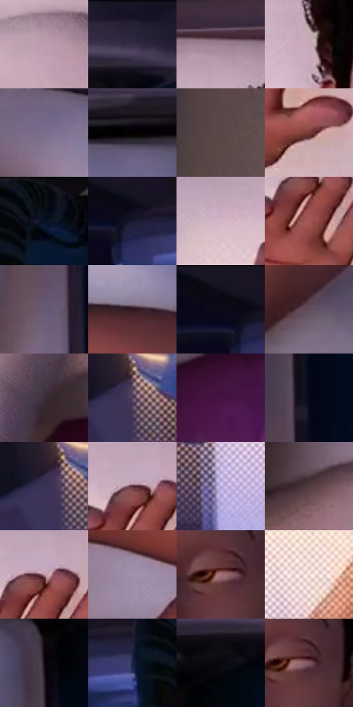

# 电影参考 697

- 状态：常规／活跃；来源世界：miles-home。
- 视角：overhead；景别：medium；场景：interior。
- 时段：interior-time-unknown（外观依据，中置信度；具体时间／晨昏未知）；光照：interior-mixed。
- 材质候选：skin, hair, fabric, metal, paper（帧级，不是像素分割）。
- 明暗组：dark；L* P5/P50/P95：1.99887 / 31.4317 / 76.177。
- 资格门禁：无附加门禁。
- 原截图 SHA-256：`cdda4e527b3ec637021057bd3d1ee3efb005e821ca66725b9399834fa449e6b0`；尺寸：2880 × 1208。
- sRGB 像素 SHA-256：`8ca809993c0827900dc38d151304324cbabda2492c2e69285d3ef60df03b1c4d`。

## 观察与迁移

床头暖灯与白枕，衣料和皮肤亮度分别保持。

左侧暖灯亮场带明显网点过渡，白枕、白T和被褥保持柔和褶面与接触阴影，皮肤棕暖、头发深黑、下方毯子紫；光场网点与布纤维不是同一层，不补造灯具。

本公开版保存32个128×128原像素色卡上下文；图集格子并非原场景相邻位置。原rect、图集tile和像素SHA见 `data/palette-crops.json`。上下文不足时不得批准替色，不能以小样推断完整构图。

## 实测色卡

颜色比例分母为保留采样像素，不是材料面积；全部 32 色参与全库匹配。表内四舍五入仅用于阅读，原精度在 JSON。

| ID | HEX | Lab | 原图 xy | 像素数 | 比例 | 明度角色 |
| --- | --- | --- | --- | ---: | ---: | --- |
| 697-S01 | #BC9EB1 | [68.255987, 14.31237, -5.693689] | [1064, 736] | 8896 | 4.601078% | light |
| 697-S02 | #2E263F | [17.112282, 10.151109, -14.563569] | [2532, 56] | 8811 | 4.557115% | deep-shadow |
| 697-S03 | #9A7F93 | [56.243541, 13.933045, -6.843224] | [1272, 92] | 8456 | 4.373507% | midtone |
| 697-S04 | #C8A9B6 | [72.251054, 13.445596, -2.446963] | [1236, 456] | 8311 | 4.298511% | light |
| 697-S05 | #7B6E8B | [48.544638, 11.050619, -14.016287] | [1796, 160] | 8230 | 4.256618% | midtone |
| 697-S06 | #050202 | [0.723273, 0.784463, 0.276482] | [2244, 140] | 7773 | 4.020254% | deep-shadow |
| 697-S07 | #594748 | [32.030011, 7.83899, 2.302916] | [2764, 328] | 7633 | 3.947845% | shadow |
| 697-S08 | #753A38 | [32.021113, 25.569786, 13.107889] | [980, 424] | 7310 | 3.780787% | shadow |
| 697-S09 | #061022 | [4.739897, 2.058819, -13.078267] | [440, 64] | 7163 | 3.704757% | deep-shadow |
| 697-S10 | #17172E | [8.925871, 7.437086, -15.452546] | [240, 84] | 7040 | 3.641141% | deep-shadow |
| 697-S11 | #D3B7C7 | [77.185269, 12.721758, -4.366241] | [744, 180] | 6970 | 3.604936% | light |
| 697-S12 | #A45853 | [46.309501, 30.603295, 16.893763] | [908, 248] | 6912 | 3.574938% | midtone |
| 697-S13 | #675871 | [39.673499, 11.299892, -11.951461] | [2380, 752] | 6756 | 3.494254% | shadow |
| 697-S14 | #341824 | [12.676933, 15.826638, -1.988564] | [2076, 452] | 6351 | 3.284785% | deep-shadow |
| 697-S15 | #15121F | [6.241364, 4.754957, -8.380002] | [196, 28] | 6251 | 3.233064% | deep-shadow |
| 697-S16 | #614C59 | [34.866426, 11.290534, -4.261508] | [2132, 708] | 5941 | 3.072730% | shadow |
| 697-S17 | #3E2F3B | [21.479842, 9.304307, -4.974467] | [1796, 988] | 5443 | 2.815160% | shadow |
| 697-S18 | #513E59 | [29.199364, 13.943902, -12.979835] | [272, 648] | 5381 | 2.783094% | shadow |
| 697-S19 | #451342 | [16.127643, 30.521512, -17.950011] | [2024, 1044] | 5345 | 2.764474% | deep-shadow |
| 697-S20 | #040819 | [2.435581, 2.294742, -9.46087] | [2432, 512] | 5315 | 2.748958% | deep-shadow |
| 697-S21 | #3B3356 | [23.569472, 12.529173, -19.92443] | [248, 648] | 5305 | 2.743786% | shadow |
| 697-S22 | #522733 | [21.887577, 21.543688, 1.426511] | [896, 180] | 5250 | 2.715339% | shadow |
| 697-S23 | #B6A9DC | [71.884834, 14.866549, -24.03044] | [460, 728] | 5201 | 2.689996% | light |
| 697-S24 | #513B3F | [27.397911, 10.403374, 1.326615] | [1716, 704] | 5180 | 2.679135% | shadow |
| 697-S25 | #BA939E | [64.784716, 16.39295, -0.17638] | [920, 180] | 5084 | 2.629483% | light |
| 697-S26 | #A08DA9 | [61.122637, 12.420056, -12.102411] | [1880, 580] | 4622 | 2.390533% | light |
| 697-S27 | #A07178 | [52.554505, 19.622887, 3.57744] | [1544, 568] | 4580 | 2.368810% | midtone |
| 697-S28 | #EFD7D5 | [87.851515, 7.9578, 4.012527] | [648, 564] | 4407 | 2.279333% | highlight |
| 697-S29 | #120B12 | [3.718183, 3.565839, -2.548429] | [2404, 216] | 4080 | 2.110207% | deep-shadow |
| 697-S30 | #1A2341 | [14.418445, 6.481056, -20.317402] | [344, 112] | 3703 | 1.915219% | deep-shadow |
| 697-S31 | #09080D | [2.355772, 0.992707, -1.898042] | [2472, 140] | 3190 | 1.649892% | deep-shadow |
| 697-S32 | #7E5661 | [41.144515, 18.308152, 0.368536] | [1564, 568] | 2456 | 1.270262% | midtone |

## 色阶与空间分布

- 采样 ROI：`[0.01, 0.02, 0.98, 0.94]`；步长：4；样本数：193346。
- 排除区：`[]`。
- 深暗、暗、中、亮、高光五段计数：`[67420, 49426, 34399, 37575, 4526]`。
- RGB 各 256 箱、L* 100 箱、13×5 色相明度表和 3×3 空间统计全部保存在 [总数据](../film-library.json)。
- [可视化档案](../../references/library.html)按需绘制直方图，不存 2,094 张重复图表图片。

## 纹理特征占比

**这是分块图像特征的面积占比，不是波点／排线／丝网／错版的精确语义覆盖率。** 窗格、发丝、织物也会产生方向或周期特征。
原图 ROI 像素 3104134；已测块覆盖 3104134（100.0000%）；未测 0。

| 特征 | 块覆盖像素 | 占已测面积 | 阈值敏感范围 |
| --- | ---: | ---: | --- |
| low-contrast | 129798 | 4.1815% | 2.9978% ~ 5.9422% |
| directional-structure | 907008 | 29.2194% | 20.4156% ~ 45.0743% |
| periodic-structure | 1856896 | 59.8201% | 49.5486% ~ 62.9911% |
| mixed-detail | 210432 | 6.7791% | 2.3793% ~ 10.6511% |

阈值敏感范围不是统计置信区间。逐块坐标、尺度、对比、方向一致性、频谱集中度、频率与角度见 [全量特征记录](../texture-features.jsonl)，以帧号定位。
四种印刷层的真实像素覆盖仍标为 `null`，不能填 0，也不能拿上表代替。不得据这些代理测量删除唯一证据。

[测量方法与保留策略](../../references/library-retention.md) · [分类索引](../archive/README.md)
