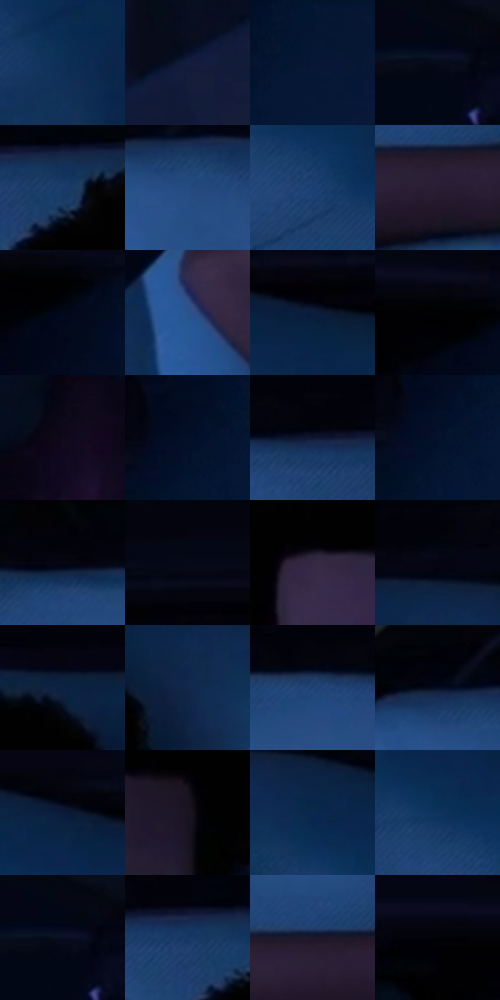

# 电影参考 698

- 状态：常规／活跃；来源世界：miles-home。
- 视角：overhead；景别：medium；场景：interior。
- 时段：interior-time-unknown（外观依据，中置信度；具体时间／晨昏未知）；光照：cool-interior。
- 材质候选：skin, hair, fabric, plastic, metal（帧级，不是像素分割）。
- 明暗组：very-dark；L* P5/P50/P95：0.88293 / 9.98514 / 32.4034。
- 资格门禁：无附加门禁。
- 原截图 SHA-256：`83da7c7ea6aeb1a94f908357bf661f66da545e276598961d678858bdcfe70154`；尺寸：2880 × 1212。
- sRGB 像素 SHA-256：`e0b2824954e7d7e0bd19f16f166fa974f445e0b94dfa9cc24d79aa224378274f`。

## 观察与迁移

熄灯冷蓝床铺，耳机和姿态变化另列，材质身份仍连续。

灯暗后暖亮场消失，白枕与白T显示蓝色环境响应，皮肤转低亮紫棕，头发仍深暗；耳机、手势和眼睛状态也改变，所以是照明对照而非严格曝光实验，白布没有换成蓝布。

本公开版保存32个128×128原像素色卡上下文；图集格子并非原场景相邻位置。原rect、图集tile和像素SHA见 `data/palette-crops.json`。上下文不足时不得批准替色，不能以小样推断完整构图。

## 实测色卡

颜色比例分母为保留采样像素，不是材料面积；全部 32 色参与全库匹配。表内四舍五入仅用于阅读，原精度在 JSON。

| ID | HEX | Lab | 原图 xy | 像素数 | 比例 | 明度角色 |
| --- | --- | --- | --- | ---: | ---: | --- |
| 698-S01 | #0E2F57 | [19.283603, 4.462046, -27.571021] | [2152, 352] | 8783 | 4.526293% | deep-shadow |
| 698-S02 | #121D3C | [11.507278, 6.964397, -21.474365] | [224, 648] | 8539 | 4.400548% | deep-shadow |
| 698-S03 | #051735 | [8.146519, 5.892761, -21.886807] | [2768, 60] | 7951 | 4.097524% | deep-shadow |
| 698-S04 | #060B1A | [3.185107, 1.884645, -9.151608] | [188, 96] | 7948 | 4.095978% | deep-shadow |
| 698-S05 | #183A68 | [24.383402, 5.292983, -30.534223] | [1292, 108] | 7433 | 3.830575% | shadow |
| 698-S06 | #244B81 | [31.787242, 5.623577, -34.490308] | [624, 116] | 7071 | 3.644019% | shadow |
| 698-S07 | #1A3E6F | [26.192142, 5.691667, -32.128875] | [1936, 280] | 6990 | 3.602276% | shadow |
| 698-S08 | #271E33 | [13.22339, 9.696116, -12.220207] | [1060, 444] | 6985 | 3.599699% | deep-shadow |
| 698-S09 | #020819 | [2.318964, 1.771743, -9.645147] | [2544, 140] | 6908 | 3.560017% | deep-shadow |
| 698-S10 | #2A538D | [35.204112, 5.947865, -36.407269] | [628, 512] | 6894 | 3.552802% | shadow |
| 698-S11 | #0B1D3D | [11.181646, 5.963823, -22.726866] | [2016, 140] | 6867 | 3.538888% | deep-shadow |
| 698-S12 | #010101 | [0.274173, -1.7e-05, 3.3e-05] | [2504, 108] | 6767 | 3.487353% | deep-shadow |
| 698-S13 | #0F0919 | [3.316096, 4.9637, -8.093075] | [2312, 920] | 6532 | 3.366247% | deep-shadow |
| 698-S14 | #030D22 | [3.81768, 2.800935, -14.508106] | [2672, 44] | 6473 | 3.335841% | deep-shadow |
| 698-S15 | #0C162F | [7.742325, 5.419365, -18.12521] | [1196, 72] | 6444 | 3.320896% | deep-shadow |
| 698-S16 | #05122A | [5.70844, 3.931345, -17.658159] | [2668, 88] | 6420 | 3.308528% | deep-shadow |
| 698-S17 | #070613 | [2.00915, 2.41028, -5.756099] | [800, 64] | 6344 | 3.269362% | deep-shadow |
| 698-S18 | #040612 | [1.804024, 1.413567, -5.454946] | [2088, 40] | 6312 | 3.252870% | deep-shadow |
| 698-S19 | #332742 | [18.135105, 12.166672, -15.000472] | [1320, 348] | 6188 | 3.188967% | deep-shadow |
| 698-S20 | #01040F | [1.154028, 0.84755, -4.718276] | [1744, 44] | 5586 | 2.878729% | deep-shadow |
| 698-S21 | #0B2242 | [13.280872, 4.368527, -22.87852] | [1584, 96] | 5510 | 2.839562% | deep-shadow |
| 698-S22 | #11294C | [16.634017, 4.543067, -24.395174] | [1720, 168] | 5481 | 2.824617% | deep-shadow |
| 698-S23 | #1F4375 | [28.351697, 5.470695, -32.4761] | [1024, 84] | 5452 | 2.809672% | shadow |
| 698-S24 | #02030A | [0.90272, 0.711755, -2.741004] | [588, 28] | 5339 | 2.751438% | deep-shadow |
| 698-S25 | #0A1B37 | [9.985142, 4.627835, -20.365924] | [1912, 116] | 4976 | 2.564367% | deep-shadow |
| 698-S26 | #191322 | [7.117078, 7.009021, -9.29731] | [1584, 380] | 4929 | 2.540146% | deep-shadow |
| 698-S27 | #0A274D | [15.75316, 5.403676, -26.500858] | [1840, 148] | 4771 | 2.458721% | deep-shadow |
| 698-S28 | #0E345F | [21.487562, 4.344725, -29.330768] | [1888, 216] | 4574 | 2.357197% | shadow |
| 698-S29 | #090E22 | [4.404436, 3.885968, -13.577897] | [192, 92] | 4555 | 2.347406% | deep-shadow |
| 698-S30 | #153763 | [22.972118, 4.863835, -29.55669] | [1240, 96] | 4550 | 2.344829% | shadow |
| 698-S31 | #1D182C | [9.769214, 8.125138, -12.611023] | [1032, 408] | 3592 | 1.851127% | deep-shadow |
| 698-S32 | #010105 | [0.353321, 0.556158, -1.513661] | [2416, 96] | 880 | 0.453505% | deep-shadow |

## 色阶与空间分布

- 采样 ROI：`[0.01, 0.02, 0.98, 0.94]`；步长：4；样本数：194044。
- 排除区：`[]`。
- 深暗、暗、中、亮、高光五段计数：`[147319, 46536, 189, 0, 0]`。
- RGB 各 256 箱、L* 100 箱、13×5 色相明度表和 3×3 空间统计全部保存在 [总数据](../film-library.json)。
- [可视化档案](../../references/library.html)按需绘制直方图，不存 2,094 张重复图表图片。

## 纹理特征占比

**这是分块图像特征的面积占比，不是波点／排线／丝网／错版的精确语义覆盖率。** 窗格、发丝、织物也会产生方向或周期特征。
原图 ROI 像素 3115310；已测块覆盖 3115310（100.0000%）；未测 0。

| 特征 | 块覆盖像素 | 占已测面积 | 阈值敏感范围 |
| --- | ---: | ---: | --- |
| low-contrast | 782254 | 25.1100% | 18.2032% ~ 28.7914% |
| directional-structure | 624768 | 20.0548% | 8.6366% ~ 33.7287% |
| periodic-structure | 1450880 | 46.5726% | 42.4351% ~ 52.8836% |
| mixed-detail | 257408 | 8.2627% | 5.6331% ~ 9.6884% |

阈值敏感范围不是统计置信区间。逐块坐标、尺度、对比、方向一致性、频谱集中度、频率与角度见 [全量特征记录](../texture-features.jsonl)，以帧号定位。
四种印刷层的真实像素覆盖仍标为 `null`，不能填 0，也不能拿上表代替。不得据这些代理测量删除唯一证据。

[测量方法与保留策略](../../references/library-retention.md) · [分类索引](../archive/README.md)
